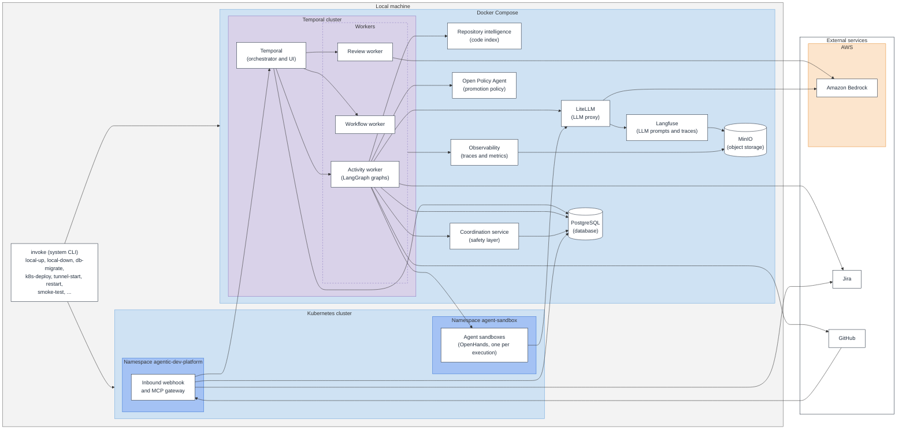
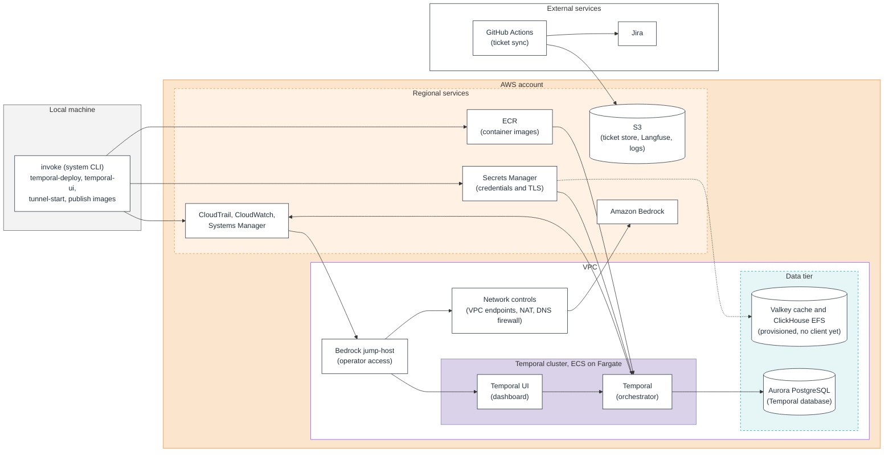
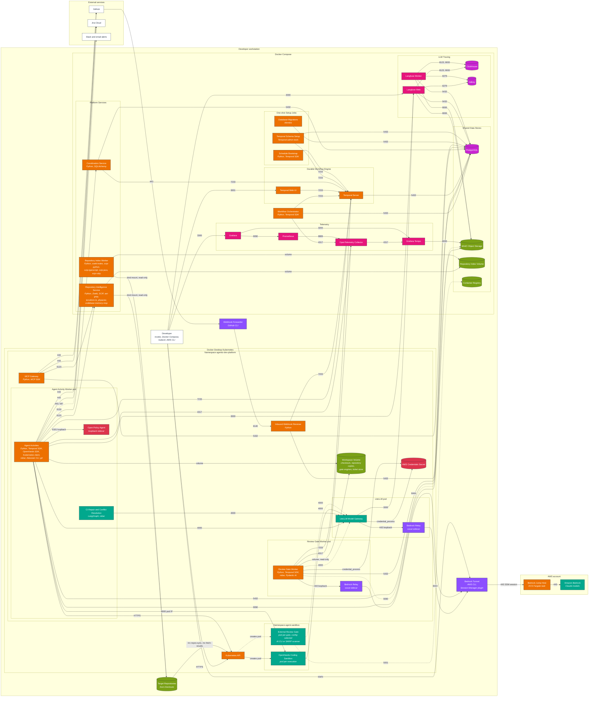
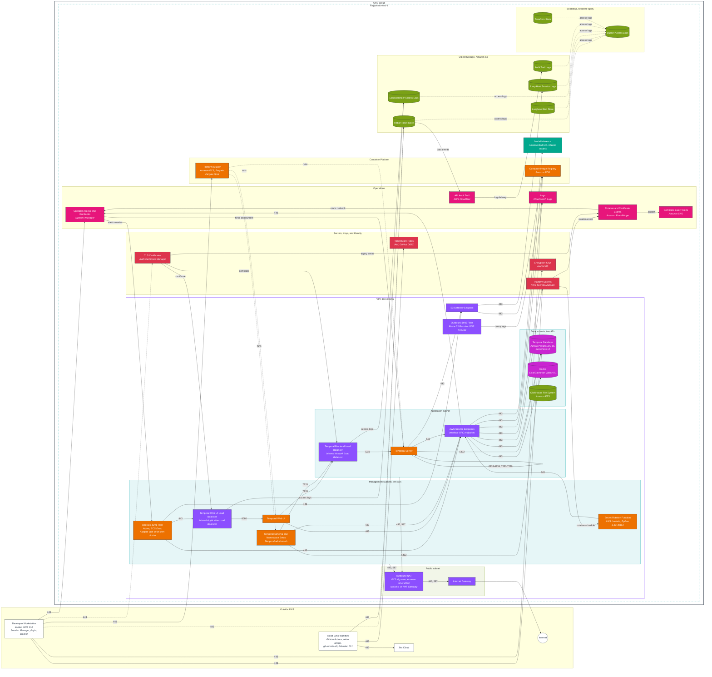

# Architecture

These diagrams show the components that exist in this repository and the connections the code configures between them. Each node maps to a Compose service, a Kubernetes manifest, a Terraform resource, or a client in the Python code. Components that only appear in the [roadmap](../ROADMAP.md) are not drawn.

## High-level architecture

These two diagrams show the platform by functional group. Each block names a component and its purpose, and each edge shows a primary dependency. Ports, technology stacks, and secondary connections are in the detailed diagrams below.

### Local, high level

- Temporal dispatches workflow and activity tasks to the workers, which hold long-poll connections to it. The inbound webhook signals Temporal when GitHub reports a closed pull request, and the MCP gateway reads from PostgreSQL, GitHub, and Jira.
- Every worker exports traces and metrics to Observability. LiteLLM sends its generation traces to Langfuse.

### AWS, high level

- Only the Temporal cluster, the Bedrock jump-host, and the shared infrastructure run in AWS. The workers, LiteLLM, Langfuse, repository intelligence, and observability run locally.
- The dashed edge from Secrets Manager is the rotation of the Valkey RBAC user. No workload in AWS connects to the Valkey cache or the ClickHouse file system yet.
- Systems Manager starts the jump-host session, and the Temporal tasks send their logs to CloudWatch.

## Local environment

The local stack runs in Docker Compose ([compose.yaml](../compose.yaml), [compose.override.yaml](../compose.override.yaml)) and on the Docker Desktop Kubernetes cluster ([deploy/kubernetes/local](../deploy/kubernetes/local)). The cluster runs the workloads that run on EKS in AWS, and no pod mounts a host directory. Each block names the function it performs. Blocks built in this repository list the technologies that implement them. Off-the-shelf products are named without a technology list. Edge labels are the destination port. A cluster workload reaches a Compose service on the port Compose publishes on the host. Dashed edges are optional paths that the default `.env.example` values leave disabled.

Component roles:

| Block | Role |
|---|---|
| Durable Workflow Engine | Temporal persists workflow state in PostgreSQL and dispatches tasks to the workers on the `agent-platform` and `agent-platform-review` task queues. |
| Workflow Orchestrator | Runs the intake, plan review, implementation, branch sync, pull request, draft pull request, and reap workflows. It executes no side effects. |
| Agent Activities | Runs every side effect the workflows request: planning model calls, repository context, work claims, code generation in the OpenHands sandbox, git push, pull request creation, Jira updates, policy checks, and alerts. |
| CI Repair and Conflict Resolution | LangGraph state graphs that run in-process in the activity worker. CI repair calls the model gateway. Conflict resolution resolves trivial merge conflicts without a model. |
| Open Policy Agent | Evaluates the pull request promotion policy. It runs as a sidecar of the activity worker, bound to the pod's loopback, so no Service exposes it. |
| Review Gate Worker | Runs the plan, code, security, and acceptance review gates with rebar against the execution's checkout on the workspace volume. Native mode calls Bedrock directly through the relay sidecar. Proxied mode calls the model gateway. |
| Coordination Service | Holds work claims, sequencing, and side-effect idempotency in PostgreSQL, and checks claim owners against Temporal. Every mutating call needs the shared bearer token. |
| Repository Intelligence Service | Builds code context packages for planning from Zoekt search, SCIP symbol indexes, ast-grep, language servers, and codebase-memory-mcp. |
| Repository Index Worker | Polls the target repositories for new commits and rebuilds the Zoekt and SCIP indexes on the shared volume. |
| LiteLLM Model Gateway | Maps logical model names to Bedrock Claude models and sends generation traces to Langfuse with credential-shaped strings redacted. Compose services and host tasks reach it on host port 4000 through a `LoadBalancer` Service. |
| Bedrock Relay and Bedrock Tunnel | Each relay answers on the `bedrock-runtime` hostname on its pod's loopback and forwards to the host tunnel, which forwards over an SSM session to the jump-host in AWS. |
| AWS Credentials Secret | Holds the credentials `inv aws-login` writes. LiteLLM and the review worker reread it through `credential_process` before the credentials they hold expire. |
| Workspace Volume | Holds the execution checkouts, the copies of the local-backend repositories and local gate engines that `inv repos-sync` sends, and the rebar ticket store seeded from MinIO. `inv fetch-results` brings the agent branches back to the host checkouts. |
| Inbound Webhook Receiver | Receives GitHub pull request events from the GitHub CLI forwarder and signals the matching Temporal workflow when a pull request closes. |
| MCP Gateway | Serves read-only Jira, GitHub, evidence, and repository context tools over the Model Context Protocol to clients that present its bearer token. |
| OpenHands Coding Sandbox | One agent-server pod per execution that performs the implementation stage. The activity worker reaches it on its pod IP with a per-sandbox session key. |
| External Review Gate | One pod per configured external gate, running an AI CLI reviewer or a SARIF scanner. |
| LLM Tracing | Langfuse records model generations from LiteLLM and from the workers. |
| Telemetry | The collector receives worker traces, metrics, and logs. Tempo stores traces, Prometheus scrapes metrics, and Grafana displays both. |

Notes on the local diagram:

- `BEDROCK_CONNECTIVITY_PROVIDER` selects the Bedrock path. The diagram shows the default `jumphost` provider. The `ssh-bastion` provider replaces the SSM session with an SSH tunnel, and the `direct` provider removes the tunnel and the relays.
- MinIO holds the Langfuse and Tempo buckets. The worker paths to MinIO are the rebar ticket store, used when `TICKET_BACKEND=rebar`, and the evidence Object Lock bucket, used when `EVIDENCE_OBJECT_STORE_ENABLED=true`. The cluster reaches MinIO on its published port 9090.
- The External Review Gate path is inactive until `config/local/gate_engine.yaml` enables an engine. The Container Registry runs only under the `registry` Compose profile.
- The `agent-sandbox` network policies limit sandbox egress to DNS and LiteLLM. The Docker Desktop cluster enforces them through its kindnet CNI, which `inv smoke-test` confirms.
- The MCP Gateway has no client in this repository.

## AWS environment

The AWS footprint is the [private-bedrock](../infra/terraform/examples/private-bedrock) composition root plus the separately applied [bootstrap](../infra/terraform/bootstrap) root. Every module in the composition root is gated by a `create_*` variable, and the diagram shows the composition with every gate enabled. Each block names the function it performs. The italic line names the AWS service for managed resources and lists the technologies for components built in this repository. Off-the-shelf products such as Temporal are named without a technology list. Edge labels are the destination port. Edges labelled with an action are AWS control-plane calls or event deliveries that have no fixed port. Dashed edges are optional paths.

Component roles:

| Block | Role |
|---|---|
| Developer Workstation | Publishes the jump-host and Temporal images, stores the Temporal TLS material, runs the Temporal deploy, and opens the jump-host session for the Bedrock tunnel and the Temporal Web UI. |
| Ticket Sync Workflow | A manually dispatched GitHub Actions workflow that assumes the ticket store writer role through GitHub OIDC and reconciles the rebar ticket store with Jira project ADP. |
| Outbound DNS Filter | Resolves only allowlisted domains for the VPC, namely AWS, GitHub, and Atlassian by default, and logs every query. |
| Outbound NAT | Forwards ports 443 and 587 from the application and management subnets to the internet. The data subnets have no default route. |
| Temporal Frontend Load Balancer | Fronts the Temporal frontend on 7233. It terminates TLS with an ACM certificate when one is set and otherwise passes TCP through to the server. |
| Temporal Server | Runs every Temporal service in each task. The image adds a Go health probe and a start script that renders the TLS and PostgreSQL configuration. |
| Temporal Web UI and its Load Balancer | Serves the Temporal Web UI over HTTPS to the operator CIDRs and the jump-host security group. |
| Temporal Schema and Namespace Setup | One-shot ECS tasks that apply the Temporal schema to Aurora and register the namespace. |
| Bedrock Jump-Host | An ephemeral task that holds an ECS Exec session open for a fixed TTL. The developer forwards local ports through it to the Bedrock endpoint and to the Temporal Web UI load balancer. |
| AWS Service Endpoints | Private endpoints for Bedrock Runtime, SSM Messages, ECR, CloudWatch Logs, KMS, Secrets Manager, the RDS Data API, and ElastiCache. |
| Temporal Database | Holds the `temporal` and `temporal_visibility` databases and the per-role platform database credentials. |
| Secret Rotation Function | Rotates the per-role database credentials through the RDS Data API and the Valkey RBAC user through the ElastiCache API. |
| Operator Access and Runbooks | Session Manager for the jump-host, Parameter Store for the jump-host settings, and the Automation runbook that force-deploys a service after its secret rotates. |
| Rotation and Certificate Events | Starts the restart runbook after a rotation and publishes ACM certificate expiry warnings to SNS. |
| Rebar Ticket Store | The S3 remote of the rebar tickets branch, read and written through `git-remote-s3` under separate reader and writer roles. |
| API Audit Trail | Records management events and the object-level events on the ticket store bucket. |

Notes on the AWS diagram:

- No platform worker, LiteLLM, Langfuse, or observability service runs in AWS. The Cache, the ClickHouse File System, and the Langfuse Blob Store have no client yet, and the per-role database credentials other than Temporal's have no reader.
- No workload in AWS sends traffic through the Outbound NAT yet. The Temporal and rotation security groups admit only the endpoints, S3, and the database, and the jump-host reaches the internet only through optional caller-supplied CIDRs.
- The Temporal server service is created with `desired_count = 0` and `ignore_changes` on the count and task definition. `inv temporal-deploy` runs the schema task, moves the service to the registered task definition at the configured count, and then runs the namespace task.
- The [evidence-store](../infra/terraform/evidence-store) module provisions an S3 Object Lock bucket but is not wired into either root module, so it is not drawn.
