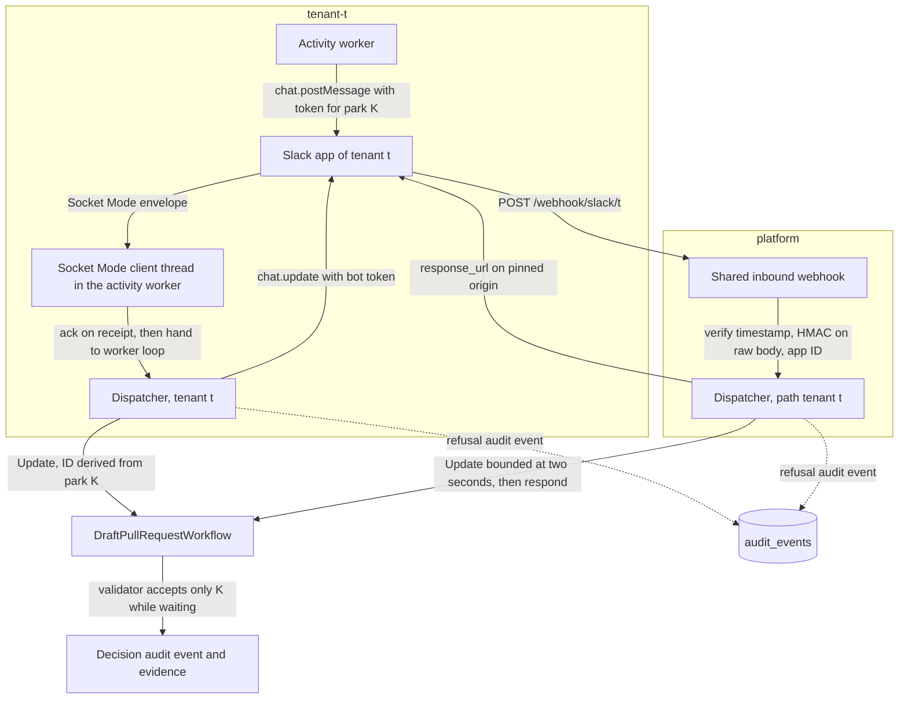
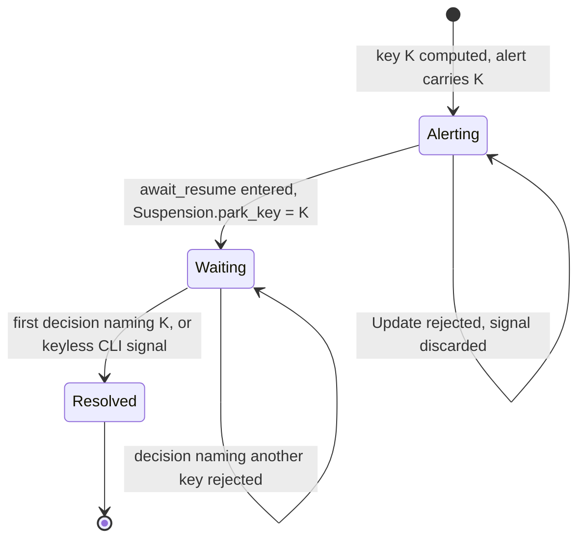

# Slack Escalation Channel - Plan

## Goal Capsule

- **Objective.** When a run parks for a human, the operator responsible for that run's tenant sees it in Slack and resolves it from the message, on commercial Slack, Enterprise Grid, or GovSlack, without a host checkout or a cluster shell. Each decision records the Slack user who made it.
- **Means.** One internal Slack app per tenant, reached over Socket Mode from the tenant's activity worker or over an HTTPS request URL on the shared inbound webhook (KTD1). Each click becomes one Temporal workflow Update that the workflow accepts only for the park it waits on (KTD3, KTD13).
- **Product authority.** Jira ADP-160 under the v0.3.0 Epic ADP-48. The Key Decisions below record the scope changes the user approved during planning, and their governed requirements state the rules.
- **Execution profile.** One pull request into `v0.3.0` from branch `ADP-160`. The implementer works in its own worktree with its own virtualenv, leaves every change uncommitted, and applies migrations only through the `db-migrate` container.
- **Stop conditions.**
  - A gate park and a repair park are each resolved from Slack in Socket Mode during both local release runs (R18, R19), with the Slack actor in the audit event and the decision evidence.
  - Signed-request integration tests prove the webhook transport, including the refusals in R5.
  - Pointing a tenant's API host at `slack-gov.com` routes every Web API and Socket Mode call there.
  - Under the `government` profile, an unapproved Slack host or `full` content fails `inv config-check`, tenant bundle validation, and the activity worker start, and the inbound webhook refuses that tenant's Slack route while serving other tenants.
  - Jira comment and email alerts still deliver when Slack is unconfigured or unreachable.
  - `inv ci`, `inv terraform-test`, and `inv sast` pass, and migration `0017` upgrades and downgrades through the `db-migrate` container.
- **Who finishes.** The implementer builds and validates. The user commits, pushes, opens the pull request, and merges. The live webhook-mode check and the GovSlack host check run in the v0.3.0 AWS session.

---

## Product Contract

### Summary

Add an escalation channel interface over the Jira comment, Slack, and email deliveries, and a Slack adapter that posts Block Kit messages with the actions that resolve a parked run. Each tenant runs its own Slack app on commercial Slack or GovSlack, chooses Socket Mode or an HTTPS request URL, and resolves clicks through a workflow Update scoped to the tenant and to the park the message was posted for. The work ends with two local release runs of v0.3.0, an upgrade from v0.2.1 and a fresh install, each exercising the Slack flow.

### Problem Frame

`services/orchestration/notifications.py` fans an alert out to a Jira comment, a Slack incoming webhook, and SMTP email. `alert_human_intervention` in `services/orchestration/temporal_activities/notify.py` calls it when `DraftPullRequestWorkflow` parks at `AWAITING_HUMAN` or stops. The message carries a bounded failure detail and a `Next step:` line rendered from the structured `Remedy` that ADP-24 added, and the workflow records the rendered remedy and the delivered channels in `audit_events.remedy` and `audit_events.alert_channels`.

The Slack delivery is one-way. The operator resolves a parked run with `inv gate`, `inv repair`, or `inv restart`, which run through `kubectl exec` in the tenant's activity worker, with the operating-system account as the actor. An operator who reads the alert on a phone, or who has no cluster access, cannot act on it.

The decision signals record whatever arrives. `submit_gate_decision` and `submit_repair_decision` set the pending decision and the resume trigger without checking which park is waiting, and the workflow ignores the gate name. A decision that arrives while the alert activity runs is cleared when the wait begins, and `inv gate` reports success for it.

Since v0.3.0 the platform is multi-tenant. Tenants share one Temporal namespace and are separated by task queue, by the `tenant-<t>` namespaces, and by `executions.tenant`. Each tenant's activity worker holds that tenant's `SLACK_WEBHOOK_URL`. The inbound webhook is one shared deployment that holds each tenant's webhook secrets as `<SECRET>_<TENANT>`. The DNS Firewall allowlist contains `hooks.slack.com` and no other Slack name, so the Web API, Socket Mode, and GovSlack are unreachable from a deployed VPC.

`audit_events.event_id` is `VARCHAR(64)`. A policy gate park for an `intake-xxxxxxxx` execution whose gate list is `security-review` builds a 67-character event ID, so the audit activity fails three times and the run fails.

The platform serves private, state, and federal deployments. GovSlack runs on the separate domain `slack-gov.com` under a FedRAMP High authorization, and requires every Web API call, OAuth call, `response_url`, and request URL to use that domain.

### Key Decisions

- **One Slack app per tenant.** Slack verifies each app with one signing secret, and the platform isolates tenant credentials, so each tenant creates its own internal app (session-settled, user-approved, chosen over one shared platform app, because a shared app would hold every tenant's credentials in one place and needs Slack's distributed-app terms). Governs R4, R5, R6, R13.
- **No hybrid transport.** Enabling Socket Mode stops Slack from delivering clicks to the app's request URL, so a tenant runs exactly one transport (session-settled, user-approved, chosen over `webhook`, `socket`, and `hybrid` as in the original ticket, because Slack cannot deliver one app's clicks both ways). Governs R7.
- **Abandon resolves as `inv repair --abandon`.** Budget parks offer abandon only, because a retry parks again at once (session-settled, user-approved, chosen over mapping abandon to `inv restart`, because restart re-admits the ticket, which the operator did not ask for). Governs R3.
- **The bot token takes precedence over the incoming webhook.** An upgraded install that carries `SLACK_WEBHOOK_URL` and adds a bot token posts once, through the bot (session-settled, user-approved, chosen over posting through both, because that would post two messages for one park, one of them without actions). Governs R2.
- **A Slack failure never fails a park.** Slack is delivered last with a short bound, and a failure is a missed channel (session-settled, user-approved, chosen over the shared retrying delivery, because a slow Slack could exhaust the 30-second alert activity and fail the workflow). Governs R16.
- **The release check is two local runs.** A v0.2.1 upgrade and a fresh v0.3.0 install, with the upgrade first and the fresh install last, after a backup of the current stack (session-settled, user-directed, chosen over a single fresh-install check, because developers who update and developers who rebuild take different paths). Governs R18, R19, R20.
- **Webhook mode is proven end to end in the AWS session.** Locally it is proven by signed-request integration tests, and Socket Mode carries the local end-to-end run (session-settled, user-approved, chosen over a public tunnel to the developer's machine, because a tunnel exposes the local webhook to the internet and adds a tool the repository does not have). Governs R18, R19.
- **The audit event ID column widens in this ticket.** Slack decisions write to `audit_events`, and long gate lists already overflow it (session-settled, user-approved, chosen over a separate ticket, because the Slack release runs would hit the same failure). Governs R21.

### Requirements

Product Contract preservation: changed R2, R4, R5, R6, R7, R8, R9, R10, R12, R13 for the per-tenant model, the removal of `hybrid`, the Update delivery, and the review findings recorded during deepening, under the user-approved Key Decisions above. R16 to R21 are new. R1, R3, R11, R14, and R15 keep their meaning with current file references.

**Channel and delivery**

- R1. An escalation channel interface delivers an alert and reports whether it delivered. Jira comment, Slack, and email are channels. A tenant's `escalation.yaml` selects its enabled channels, and a tenant without the file keeps the current behaviour, with each channel enabled when its settings are present.
- R2. The Slack channel posts through the Web API with the tenant's bot token, to the tenant's configured channel. Its API base URL defaults to `https://slack.com/api/` and `https://slack-gov.com/api/` serves GovSlack with no code change. With no bot token, `SLACK_WEBHOOK_URL` delivers one-way messages with no actions. With both, only the bot posts.
- R16. Slack is delivered after Jira and email, within a bound that keeps the whole alert inside the alert activity's timeout. A Slack error or timeout leaves `slack` out of the delivered channels and does not raise.

**Actions**

- R3. A human-gate park posts approve and reject actions. A repair park after exhausted repairs posts retry and abandon actions. A run-budget or tenant-budget park posts abandon only. Every other alert, and every park of a run that started before this change, posts no actions. Each message keeps the rendered `Next step:` text.
- R4. Each action carries a token signed with HMAC-SHA256 under the tenant's action key. The token binds the tenant, the execution, the workflow, the park key, the decision kind, the gate list, the permitted actions, and an expiry 72 hours after the park unless `escalation.yaml` sets another lifetime. A missing, altered, expired, keyless, or other-tenant token changes nothing.
- R8. An action resolves only when the click comes from the tenant's configured Slack organization and channel, and the clicking user's organization and user ID appear in the tenant's allowlist for that decision kind. The organization is the Grid `enterprise.id` when present and the workspace `user.team_id` otherwise. A click from a user outside the configured organization, including an external Slack Connect user, is refused. The actor is recorded as `slack:<organization>/<user>` in the workflow decision, in `audit_events.actor_type` and `actor_id`, and in a decision evidence record.
- R9. Each park is resolved at most once. A second click, a click on a stale message, or a click after the run was resolved by `inv gate`, `inv repair`, `inv restart`, or another Slack user changes nothing and reports the effective outcome.
- R17. A decision applies only while the run waits on the park the token names. A decision that arrives during the alert, or for an earlier park of the same execution, is refused and the operator is told so. It is never recorded as applied.
- R10. After an accepted action, the message shows the outcome and the actor, with its buttons removed. A refused action receives an ephemeral reply from a fixed set of reasons that names no other tenant, and the refusal is recorded as an audit event holding the tenant, the reason code, the Slack organization and user, and a digest of the park key. The action token, the `response_url`, and the raw payload are never logged or persisted.

**Transports**

- R5. The shared inbound webhook accepts each tenant's Slack interactivity at `/webhook/slack/<tenant>`. It rejects a missing or non-numeric timestamp, or one more than five minutes from the server clock, with 401, verifies the `v0` signature over the raw body with that tenant's signing secret in constant time, then decodes the body and confirms `api_app_id` matches the tenant's app. It responds within three seconds.
- R6. In each `socket` tenant, the activity worker process runs a Socket Mode client that opens the WebSocket URL `apps.connections.open` returns for the tenant's app-level token, against the tenant's API host, and hands each action to the same dispatcher as R5.
- R7. A tenant's `escalation.yaml` sets its Slack transport to `webhook` or `socket`. The activity worker refuses to start a `socket` tenant without its app token, and the inbound webhook refuses a `webhook` tenant's Slack route without its signing secret.

**Tier and hosts**

- R11. Message content has two levels. `full` carries the bounded failure detail. `minimal` carries the issue key, the stage, the reason code, the `Next step:` text, and a link to the ticket. A tenant whose `gates.yaml` profile is `government` defaults to `minimal`.
- R12. For every tenant, a `response_url` is called only when it is HTTPS under the `/actions/` path of the hooks host that matches the tenant's API base, and redirects are not followed. For a `government` tenant, the Slack API host must also appear in `approved_hosts` in its `escalation.yaml`, and the content level must be `minimal`. `inv config-check` and tenant bundle validation report a violation, so publishing or refreshing such a bundle is refused, the activity worker refuses to start for that tenant, and the inbound webhook refuses that tenant's Slack route while serving other tenants.

**Secrets, network, and documentation**

- R13. Each tenant has its own `slack_bot_token`, `slack_app_token`, `slack_signing_secret`, and a generated `escalation_action_key`, delivered locally and on EKS only to the processes that use them. Two tenants may not share a value or a Slack app ID. The DNS Firewall allowlist takes the exact Slack hosts a deployment uses through `dns_firewall_additional_domains`.
- R14. `config/platform/slack-app-manifest.yaml.example` declares the bot scopes, the interactivity request URL, `socket_mode_enabled`, and the GovSlack compliance block.
- R15. The FedRAMP hardening design and the control inheritance matrix record AC-3, IA-2, AU-2, AU-12, SC-7, and SC-8 for the channel, including the VPC-wide effect of the Slack egress entries under SC-7.

**Audit integrity**

- R21. An audit event ID built for any park stage, gate list, or Slack decision fits `audit_events.event_id`.

**Release verification**

- R18. A fresh v0.3.0 local install, from `.env.example` and the `config/local` examples, reaches a healthy stack and resolves a gate park and a repair park from Slack in Socket Mode.
- R19. An existing v0.2.1 local install, drained of parked and running work, upgrades to v0.3.0 by the documented steps, keeps its pre-upgrade data, and then resolves a gate park and a repair park from Slack in Socket Mode.
- R20. The release runs start from a backup of the developer's current local stack, run the upgrade first and the fresh install last, and leave the machine on a working v0.3.0 stack.

### Acceptance Examples

- AE1. Covers R9, R17. **Given** a repair park whose retry re-parked the run, **when** the operator clicks retry on the first message, **then** the workflow refuses it and the reply says the message belongs to an earlier park.
- AE2. Covers R4, R5. **Given** a click posted to `/webhook/slack/alpha` that verifies with tenant `alpha`'s signing secret but carries a token for tenant `beta`, **then** nothing reaches any workflow and the click is refused.
- AE3. Covers R8. **Given** an org-wide Enterprise Grid install, where the payload's `team` is null, **when** an allowlisted user clicks approve, **then** the actor recorded is `slack:<enterprise.id>/<user.id>`.
- AE4. Covers R16. **Given** a tenant whose Slack API does not answer, **when** a run parks, **then** the Jira comment and email are delivered, `alert_channels` omits `slack`, and the run is parked.
- AE5. Covers R12. **Given** a `government` tenant whose `escalation.yaml` names `slack.com` outside `approved_hosts`, **then** `inv config-check` reports it and that tenant's activity worker does not start.
- AE6. Covers R8. **Given** an external Slack Connect user in the tenant's channel, **when** that user clicks approve, **then** the click is refused and audited.
- AE7. Covers R4, R9. **Given** a token signed under tenant `alpha`'s key that names a workflow whose `executions.tenant` is `beta`, **then** nothing reaches the workflow.

### Scope Boundaries

- Microsoft Teams and other chat platforms are not built. The channel interface admits them later.
- Slash commands, conversational commands, and status queries from Slack are out of scope.
- Slack Marketplace and GovSlack Marketplace distribution is out of scope. Each tenant creates its own app from the manifest template.
- `inv gate` and `inv repair` keep the keyless signals. Moving them to the Update would change their output and exit codes, which is outside this ticket.
- Considered and not built:
  - Updating the Slack message when a run is resolved outside Slack. A later click is refused with the effective outcome (R9), which tells the operator at the moment it matters. Evidence that operators act on stale messages would change this.
  - A dual-key window for rotating the action key or signing secret. Rotation voids outstanding buttons, which is the wanted result after a compromise, and the refusal points at the `Next step:` command. Frequent scheduled rotation would change this.
  - Re-issuing an expired message. An expired token is refused with the `Next step:` command, which still works.
  - An `inv` task that restores the release-run backup. The backup steps follow the README procedures, and restoring is a manual, rare action.
  - A public tunnel for local webhook-mode checks (see Key Decisions).
  - A separate Socket Mode Deployment (see KTD1).
  - The side-effect ledger for Slack decisions. The Update ID gives the same deduplication for the life of the run, and a rejected Update reserves nothing. A workflow that continues as new would change this.
  - Socket Mode connection state in the worker heartbeat or `inv smoke-test`. The heartbeat drives pod liveness, a dropped connection is logged, and the clicking operator sees Slack's failure notice while the `Next step:` command still works. A socket tenant losing its connection unnoticed would change this.
  - A per-tenant counter of signature failures. The webhook has no metrics pipeline to read it, and a leaked signing secret produces valid signatures. A metrics pipeline on the webhook would change this.

### Dependencies

- A Slack workspace where the developer can create and install apps is needed for R18 and R19. It is not needed to build or merge.
- ADP-24 provides the structured `Remedy` and `DEPLOYMENT_POSTURE`. ADP-183 and ADP-24 provide the tenant-scoped decision stores. Both are merged.
- `temporalio` 1.36 in `uv.lock` supports workflow Updates with validators.
- The `v0.2.1` tag on the `v0.2.1` branch head, `772496f5`, exists before U9 runs.
- The AWS session's webhook-mode check uses a Slack app separate from the local Socket Mode app, because enabling Socket Mode on an app stops delivery to its request URL.

### Sources

- Jira ADP-160 and its acceptance criteria.
- Slack developer documentation for request signing, `block_actions` payloads, `response_url`, `chat.postMessage`, `chat.update`, `chat.postEphemeral`, Socket Mode, `apps.connections.open`, and Enterprise Grid identifiers.
- GovSlack developer documentation at `docs.slack.dev/govslack` for the `slack-gov.com` domain and the manifest compliance fields.
- Temporal Python SDK documentation for workflow Updates, Update validators, Update IDs, and `workflow.patched`.
- `docs/operator-remedies.md` for the structured remedy and the posture rendering this channel consumes.
- `docs/tenant-config.md` for the v0.2.x upgrade drain and the tenant semantics of pre-upgrade rows.

---

## Planning Contract

### Key Technical Decisions

- KTD1. **Transport placement follows the tenant boundary.** A `socket` tenant's Socket Mode client runs as a task inside its activity worker process in `tenant-<t>`, which already holds the tenant's bot token and action key, already reaches Temporal and Aurora through the tenant `SecurityGroupPolicy`, and already sits on the database password rotation restart list, the eks-deployer `tenant-workers` expansion, and the off-hours schedule (session-settled, user-approved, chosen over a separate Deployment, because that Deployment would need its own security group selector, Pod Identity role, SecretProviderClass, rotation entry, and deployer expansion). A `webhook` tenant's clicks reach the shared inbound webhook at `/webhook/slack/<tenant>`, which holds only that tenant's signing secret and action key and updates the message through the click's `response_url`, so no bot token enters the platform namespace (session-settled, user-approved, chosen over one dispatcher holding every tenant's bot token, because it would break the isolation that `TENANT_OWNED_SETTINGS` and the tenant module's `DenyOtherReaders` policy enforce). In both processes the dispatcher's tenant comes from the transport, the path segment or the worker's own tenant, and the token's tenant must equal it before any store or client is used. Governs R5, R6, R7.
- KTD2. **`slack_sdk` provides the clients.** `WebClient(base_url=...)` covers posting, `SocketModeClient` covers R6 when given a `WebClient` with the tenant's base URL, and `SignatureVerifier` covers R5. The Socket Mode client must be constructed with that `web_client`, or `apps.connections.open` goes to `slack.com`. The builtin Socket Mode client is used so no WebSocket library is added. The `slack_sdk` loggers are pinned at INFO or higher regardless of `LOG_LEVEL`, because at DEBUG they log request bodies that carry action tokens and envelopes that carry `response_url`. `httpx` was considered for posting, and was not chosen because the Socket Mode protocol would still need its own client.
- KTD3. **The workflow owns park acceptance.** Under one `workflow.patched` guard, each park computes a park key before its alert, from the execution ID, the stage, and the gate list for a gate park, or from the execution ID, `repair`, and the attempt number for a repair park. The key travels in the alert request and is recorded in a new `park_key` field of `Suspension` that is set only inside `await_resume`. A decision that names another key or arrives outside `await_resume` is discarded, and the first matching decision ends the wait. Under the patch, both the keyless signal handlers and the Update handlers record a decision only when none is recorded for the waiting park, so a signal and an Update processed in one activation cannot overwrite each other (session-settled, user-approved, chosen over a database check in the dispatcher, because the workflow ignores the gate name today and only the workflow knows which park is waiting). Conflict call-out from deepening: the original rationale said the execution state reads `AWAITING_HUMAN` while the alert runs, which holds only for gate parks, since the repair path persists that state after its alert. The decision is unchanged. Under the patch a discarded decision sets no resume trigger, and the wait ends only when a decision for the waiting key is recorded, so a stray `submit_pr_approval` or a discarded decision cannot end a park as a reject or abandon. The patch result is kept in an instance flag for the run, because `workflow.patched` is memoized per run and a run that passed a park before the deploy stays unpatched for every later park. Governs R3, R9, R17.
- KTD4. **Idempotency keys on the park, not the click.** The Update ID is `slack-decision:<tenant>:<park-key digest>`, so Temporal returns the first Update's outcome to a double click, a retried click, and a click from either transport, and a concurrent duplicate attaches to the Update in flight. A rejected Update reserves nothing, so a later click for the same park still applies. The token nonce is an HMAC of the park key, so an alert activity retry produces the same token. Governs R9.
- KTD5. **The structured remedy and park key reach the Slack channel.** `HumanInterventionAlert` carries the `Remedy` beside its rendered text, and `AlertHumanInterventionRequest` gains the park key. Buttons come from `Remedy.actions` after `for_tenant`. `approve_gate`, `reject_gate`, `retry_repair`, and a new `abandon_repair` step map to decisions, and every other step stays text. A request with no park key renders no buttons. Governs R3.
- KTD6. **Slack runs last and bounded in the alert activity.** The adapter posts through `asyncio.to_thread` after Jira and email, with no sleeping retry handler and a timeout of five seconds or the time left before the activity's start-to-close deadline less one second, whichever is smaller. With no time left, Slack is skipped, and any error or timeout drops `slack` from the delivered channels. The Socket Mode client, which is not on the park path, uses `RateLimitErrorRetryHandler`. Governs R16.
- KTD7. **The webhook transport decides before it responds.** The Slack route has its own handler outside `handle_inbound`, so the `integrations.yaml` mode lookup, the JSON parse, and the inbound ledger stay unchanged for `pr_closed` and `jira_intake`, and the tenant's `slack.transport` is the only switch for Slack. The handler checks the timestamp, verifies the HMAC over the raw bytes, decodes the form-encoded `payload`, checks `api_app_id` and the token, and applies the Update within a two-second bound, then responds. Only the message update runs after the response, through `asyncio.to_thread` with the KTD6 timeout, under a per-tenant concurrency bound, with exceptions logged and audited. A timed-out Update receives an ephemeral reply that the decision is not yet confirmed and that clicking again shows the outcome, because a client cannot withdraw an Update the server admitted. Slack never redelivers a click, so a pod stopped before the response shows the operator Slack's failure notice, and the retried click reuses the Update ID. Governs R5.
- KTD8. **Message updates use the transport's own credential.** The webhook transport updates through the click's `response_url` after the R12 origin check. The Socket Mode client updates through `chat.update` with the bot token. Refusals use the ephemeral `response_url` reply in both. Governs R10, R12.
- KTD9. **Slack settings live in a per-tenant bundle file.** `escalation.yaml` joins `TENANT_FILES` and the webhook's `ROUTING_FILES`, so each tenant's allowlist, channel, organization ID, app ID, transport, content level, token lifetime, and approved hosts load where the tenant's other routing config loads. The tier comes from the tenant's `gates.yaml` profile. `escalation.yaml` declares the same profile as `slack.profile`, because the webhook does not load `gates.yaml`, and bundle validation and `inv config-check` refuse a bundle whose `slack.profile` differs from its `gates.yaml` profile. The R12 check runs inside bundle validation, so a non-compliant bundle is refused on publish and on every worker and webhook refresh, and the last compliant bundle stays active (session-settled, user-approved, chosen over a single platform `escalation.yaml`, because the allowlist and tier are per tenant). Governs R1, R8, R11, R12.
- KTD10. **Per-tenant secrets reuse the existing per-tenant paths.** The bot and app tokens join the tenant `secrets` default list and `TENANT_OWNED_SETTINGS`, readable by the activity worker role only. The signing secret joins the webhook keys in `SECRET_SETTINGS`, `TENANT_WEBHOOK_KEYS`, and `webhook_secret_keys`. The action key is a dedicated per-tenant secret on the `infra/terraform/tenant/repo_intelligence.tf` model, readable by the activity worker role and the webhook reader role and no other, because the tenant secret policy denies every reader but the worker and the webhook secrets admit only the webhook reader. The existing refusals of a shared tenant secret extend to each, and the webhook refuses at tenant load two tenants that declare the same Slack app ID or hold equal signing secrets, because the EKS render compares ARNs and not values. Governs R13.
- KTD11. **Decision evidence and actor fields ride the same patch as KTD3.** The workflow `AuditEvent` gains defaulted `actor_type` and `actor_id`, which `record_audit_event` writes to the existing columns and `_audit_event_body` adds to the Object Lock copy. Keyless decisions record `actor_type` `operator`. One activity writes the decision audit event and its evidence record, so a retry writes both or neither. The evidence body holds the park key, the stage, the decision, and both actor fields, and nothing generated inside the activity such as a timestamp or UUID, so retries hash to the same content and two decisions at different attempts stay distinct. Governs R8.
- KTD12. **The release check is a runbook plus assertions.** `docs/release-verification.md` holds both runs as numbered steps with an expected result per step. The Slack Web API cannot press a button as a user, so the clicks are manual runbook steps, an environment-gated live test asserts their effects, and a `mailpit` service under a Compose `verify` profile makes email delivery observable (session-settled, user-approved, chosen over an `inv` release task, because the runs are destructive, human-paced, and rare). Governs R18, R19, R20.
- KTD13. **Slack decisions are a workflow Update.** The workflow adds `apply_gate_decision` and `apply_repair_decision` Updates whose validators apply the KTD3 rule and reject a mismatched or not-yet-waiting park, and whose handlers record the decision and return the outcome with its actor. The Update ID is the KTD4 key, so Temporal deduplicates a retried click within the run. A click after the run moved on reads the decision audit event for the effective outcome (session-settled, user-approved, chosen over the existing signals, because a signal returns no verdict and the dispatcher could record a discarded decision as applied). Governs R9, R10, R17.
- KTD14. **`audit_events.event_id` widens to 255 characters.** Migration `0017` alters the column in place. The column has no foreign keys, and `ON CONFLICT (event_id)` behaviour is unchanged (session-settled, user-approved, chosen over hashing event IDs under the workflow patch, because changing the ID format would need its own patch and loses readable IDs). Governs R21.

### High-Level Technical Design

A click travels one of two paths, each with its own dispatcher instance, and both apply the same workflow Update.

The park key decides which decisions the workflow accepts.

### Assumptions

- A GovSlack organization can install an internal app built from the manifest without a Marketplace listing. Slack's FAQ supports this and also says only Marketplace apps are installable on GovSlack, so a customer's org admin confirms it before a federal deployment.
- The Socket Mode WebSocket hosts are taken from the URLs `apps.connections.open` returns, which Slack refreshes. U9 records every distinct commercial host across all reconnects of both runs and adds them to the private-bedrock README, and the AWS session adds the GovSlack hosts there. A host missing from the DNS Firewall shows as a logged connection failure and as Slack's failure notice on click.

### Sequencing

U1 and U10 first, then U3 and U6, then U2, U4, and U5, then U7, then U8, and U9 last. U10 defines the park key and the Update, U3 defines the token and the dispatcher, and U6 defines the R12 check that both transports call.

### Risks

| Risk | Mitigation |
|---|---|
| Runs parked before the deploy replay on new workflow code | KTD3, KTD11, and KTD13 sit behind one `workflow.patched` guard held per run, and U10 tests a run that parked before the patch and continues on the patched worker |
| A run pinned to the old build sits at a human park during the deploy, and `inv resume-parked` moves only `suspended_flows` rows | The U9 drain asserts no `AWAITING_HUMAN` execution and no running workflow before the version moves, and `docs/release-verification.md` states that such a park is resolved with `inv gate` or `inv repair` before deploying |
| A leaked signing secret or app-level token lets a reader of the channel act as any allowlisted user, or receive clicks on a third-party Socket Mode connection | U8 documents a compromise runbook that regenerates the credential, writes Secrets Manager, rolls the webhook or the activity worker, and rotates the action key to void outstanding buttons. |
| The shared webhook's event loop and threads serve every tenant, so a slow Slack call could stall GitHub and Jira deliveries | KTD7 bounds the Update, runs every Slack HTTP call through `asyncio.to_thread` with a timeout, and caps concurrent dispatches per tenant. U4 tests that a hanging `response_url` does not delay a Jira delivery |
| The Slack DNS Firewall entries apply VPC-wide, so sandbox pods can resolve the Web API | The entries list exact hosts, `hooks.slack.com` already carries the same exposure, and R15 records it under SC-7 |
| A slow Jira call leaves little of the 30-second alert activity for Slack, and an alert activity retry repeats the Jira comment | KTD6 bounds Slack by the time left, so Slack never pushes the activity past its deadline. The Jira timeout and duplicate comment on retry predate this work and are unchanged |
| The shared webhook policy in `tenant_webhooks.tf` nears its 6144-character cap with one more key per tenant | U7 extends the existing size precondition test and reports the new estimate in the module README |
| Off-hours scales the activity workers, the inbound webhook, and the Temporal foundation to zero, so neither transport resolves clicks overnight | The `Next step:` text works once the stack is up, and the refusal is Slack's own failure notice |
| The release runs destroy the current local stack, and the Temporal, Valkey, ClickHouse, and migration steps are one-way | R20 orders a backup first, and the runbook names each one-way step before it runs |
| The upgrade re-admits every v0.2.1 ticket not in Done, because tenant intake schedules start unpaused | The runbook pauses intake before the first v0.3.0 start and resumes it after the tickets are reconciled |

---

## Implementation Units

### U1. Escalation channel interface and tenant configuration

- **Goal:** Put the three deliveries behind a channel interface and load each tenant's `escalation.yaml`.
- **Requirements:** R1, R7, R8, R11, KTD9.
- **Dependencies:** none.
- **Files:**
  - `services/orchestration/escalation.py` (new)
  - `services/orchestration/notifications.py`
  - `services/integration/tenant_config.py`
  - `services/integration/credentials.py`
  - `scripts/config_check.py`
  - `scripts/webhook_render.py`
  - `config/local/tenants/beta.example/escalation.yaml.example` and `config/local/escalation.yaml.example` (new)
  - `tests/unit/test_escalation_config.py` (new)
  - `tests/unit/test_notifications.py`
- **Approach:**
  1. Define the channel protocol and a registry that `deliver_alert` iterates, preserving the current order of Jira and email with Slack last (KTD6).
  2. Parse `escalation.yaml` with `config_version`, channels, `slack.transport`, `slack.api_base_url`, `slack.channel`, `slack.organization_id`, `slack.app_id`, `slack.profile`, `slack.content`, `slack.token_ttl_hours`, `slack.approved_hosts`, and `slack.allowlist` by decision kind.
  3. Register the file in `TENANT_FILES`, `ROUTING_FILES`, `_CURRENT_CONFIG_VERSIONS`, and `_CONFIGS`, and add its loader to `_loaders` in `tenant_config.py`, so a bundle with it validates and `inv config-check` reports it.
- **Patterns to follow:** `services/orchestration/gates/config.py` for a versioned per-tenant file, and `TenantRouting` in the webhook for refreshed per-tenant routing files.
- **Test scenarios:**
  - A tenant with no `escalation.yaml` delivers to every channel whose settings are present, as today.
  - A file that disables email delivers to Jira and Slack only.
  - An unknown transport, a missing channel ID or organization ID with Slack enabled, and an allowlist entry without a user ID each fail validation with the field named.
  - An omitted token lifetime resolves to 72 hours.
  - A `slack.profile` that differs from the tenant's `gates.yaml` profile is refused by bundle validation and `inv config-check`.
  - A tenant bundle containing `escalation.yaml` validates, and one with a misspelled file name is refused.
- **Verification:** existing notification tests pass unchanged and the new file round-trips through bundle validation and `inv config-check`.

### U10. Park key, Update decisions, actor recording, and the event ID column

- **Goal:** Make the workflow accept a decision only for the park it is waiting on, report the outcome to the caller, and record the decider.
- **Requirements:** R8, R9, R17, R21, KTD3, KTD11, KTD13, KTD14.
- **Dependencies:** none.
- **Files:**
  - `services/orchestration/temporal_workflows/draft_pull_request.py`
  - `services/orchestration/temporal_workflows/suspendable.py`
  - `services/orchestration/suspension.py`
  - `services/orchestration/temporal_activities/persistence.py`
  - `services/orchestration/temporal_activities/notify.py`
  - `database/models/schema.py`
  - `database/migrations/versions/0017_audit_event_id_length.py` (new)
  - `tests/unit/test_draft_pull_request_workflow.py`
  - `tests/unit/test_alert_payload_contract.py`
- **Approach:**
  1. Under one new `workflow.patched` ID evaluated once per run and held in an instance flag, compute the park key per KTD3 before `_alert_human_intervention` for both park kinds, pass it in `AlertHumanInterventionRequest`, and set `Suspension.park_key` inside `await_resume`. Leave `Suspension.detail` unchanged, because `record_suspension` persists it for code-defect and dependency parks.
  2. Change the patched wait condition so it ends only when a decision for the waiting key is recorded, record a decision only when none is recorded for the waiting park, and keep keyless `submit_gate_decision` and `submit_repair_decision` signals accepted while waiting, so `inv gate` and `inv repair` behave as today.
  3. Add the KTD13 Updates with validators, returning the accepted outcome or the effective outcome and its actor.
  4. In the unpatched branch, pass no park key, so U2 renders no buttons and U3 refuses any token without a key.
  5. Add defaulted `actor_type` and `actor_id` to `AuditEvent`, write them in `record_audit_event` and `_audit_event_body`, and write the decision audit event and evidence in one activity per KTD11.
  6. Add migration `0017` widening `audit_events.event_id` to 255, and match `database/models/schema.py`.
- **Execution note:** Start with a test of a gate park and a repair park recorded before the patch that then continue on the patched worker. Run the migration upgrade and downgrade only through the `db-migrate` container against a scratch database.
- **Patterns to follow:** the `code-defect-alert` and `delete-run-model-key` patches and their replay tests, and migration `0016_audit_event_remedy` for an `audit_events` column change.
- **Test scenarios:**
  - A run parked before the patch continues on the patched worker, accepts a keyless signal, renders no actions, and completes without nondeterminism.
  - An Update sent during the alert activity is rejected, and a later matching Update resolves the park.
  - A review-stage park and a policy-stage park with the same gate list get distinct park keys, and an Update for the first is rejected at the second.
  - A repair Update naming attempt 1 is rejected after the run re-parks at attempt 2.
  - Two matching Updates resolve once, the second returns the first decision's outcome and actor, and an Update reusing the first Update ID returns the same result.
  - A discarded decision and a `submit_pr_approval` during a gate park do not end the wait.
  - A keyless decision from `inv gate` still resolves a waiting park with `actor_type` `operator`.
  - A keyless `submit_gate_decision` and a matching Update processed in one activation resolve once, and the Update's returned outcome matches the decision audit event.
  - The decision audit event carries `actor_type` `slack` and the actor ID, its Object Lock body carries both, and one evidence record is written per decision, distinct across two attempts by the same actor.
  - A policy park with three long gate names for an `intake-` execution records its audit event.
  - `AuditEvent` and `AlertHumanInterventionRequest` with the new fields round-trip through the Temporal converter.
- **Verification:** the workflow tests and the payload contract test pass, and migration `0017` upgrades and downgrades cleanly through the `db-migrate` container.

### U3. Action tokens, the abandon step, and the dispatcher

- **Goal:** Turn a verified click into exactly one tenant-scoped, park-scoped Update.
- **Requirements:** R3, R4, R8, R9, R10, KTD1, KTD4, KTD5, KTD13.
- **Dependencies:** U10.
- **Files:**
  - `services/integration/slack/tokens.py` (new)
  - `services/integration/slack/dispatcher.py` (new)
  - `services/operator_remedy.py`
  - `services/orchestration/remedies.py`
  - `tests/unit/test_slack_tokens.py` (new)
  - `tests/unit/test_slack_dispatcher.py` (new)
  - `tests/unit/test_operator_remedy_contract.py`
- **Approach:**
  1. Sign and verify tokens per R4 under the tenant's action key, with the nonce derived from the park key (KTD4), within the 2,000-character button value. A token without a park key is refused.
  2. Add the `abandon_repair` step kind, render it as `inv repair --issue <k> --abandon --tenant <t>` and `scripts.repair <k> --abandon`, and offer it per R3 inside `repair_remedy` and its budget branches only, leaving the shared budget helpers and `implementation_remedy` unchanged, because an implementation-stage budget alert ends the run.
  3. Build the dispatcher with an injected store factory over `shared_platform_engine` for the transport's tenant and a client that wraps the process's Temporal client. Check the token tenant against the transport tenant, the workflow's `executions.tenant`, the organization, the channel, and the allowlist, then apply the Update per KTD4 and KTD13 within the two-second bound.
  4. Record a refusal audit event per R10 with an event ID bounded to the column, from a fixed set of reason codes.
- **Patterns to follow:** `services/repository_intelligence/tenant_tokens.py` for per-tenant HMAC tokens, and `PrClosedHandler` in `services/orchestration/webhook/pr_events.py` for a store and signaller reused across requests.
- **Test scenarios:**
  - Covers AE2. A token for tenant `beta` presented on tenant `alpha`'s transport is refused.
  - Covers AE7. A token signed under `alpha`'s key naming a `beta` workflow is refused before any Update.
  - An altered token, an expired token, a keyless token, and a token with an unknown decision kind are each refused with a distinct reason code.
  - Covers AE3. A Grid click with a null `team` resolves with `slack:<enterprise.id>/<user.id>`.
  - Covers AE6. A click whose organization or channel differs from the configuration is refused.
  - A user on the allowlist for gates but not repairs is refused on a repair message.
  - Covers AE1. A rejected Update reserves nothing, the reply says the message belongs to an earlier park, and a later click for the waiting park applies.
  - Two concurrent clicks for one park attach to one Update and both report the same outcome.
  - A click after `inv gate` resolved the park reports the effective outcome and its actor.
  - A refusal audit row holds no token, no `response_url`, and no other tenant's name.
  - Every remedy that offers `abandon_repair` passes the remedy contract test for both postures, and an implementation-stage budget remedy offers none.
- **Verification:** dispatcher and token tests pass, and the remedy contract test passes with the new step.

### U2. Slack Web API adapter and Block Kit messages

- **Goal:** Post an actionable message for a park, bounded so Slack cannot fail it.
- **Requirements:** R2, R3, R11, R16, KTD2, KTD5, KTD6.
- **Dependencies:** U1, U3.
- **Files:**
  - `services/integration/slack/client.py` (new)
  - `services/integration/slack/messages.py` (new)
  - `services/orchestration/notifications.py`
  - `services/orchestration/temporal_activities/notify.py`
  - `pyproject.toml`
  - `uv.lock`
  - `tests/unit/test_slack_messages.py` (new)
  - `tests/unit/test_notifications.py`
- **Approach:**
  1. Add `slack_sdk` to the core dependencies and the `worker` extra, build a `WebClient` per tenant from its API base URL, and pin the `slack_sdk` loggers per KTD2.
  2. Carry the structured `Remedy` and the park key on `HumanInterventionAlert`, and render buttons from `Remedy.actions` after `for_tenant`, with the token from U3 on each button.
  3. Render `full` and `minimal` content per R11, with top-level `text` beside the blocks.
  4. Post per KTD6, prefer the bot token over `SLACK_WEBHOOK_URL` per R2.
- **Patterns to follow:** the current `_slack` delivery and `_intervention_message` bounding in `notifications.py`.
- **Test scenarios:**
  - A gate park renders approve and reject, a repair-exhausted park renders retry and abandon, and a budget park renders abandon only.
  - An intake-unroutable alert, a bundle-refusal alert, and an alert with no park key render no buttons.
  - `minimal` content omits the failure detail and keeps the `Next step:` text.
  - A base URL of `https://slack-gov.com/api/` sends the request to `slack-gov.com`.
  - Covers AE4. A Slack client that hangs past the bound leaves `slack` out of the channels while Jira and email are delivered.
  - With both a bot token and `SLACK_WEBHOOK_URL`, only the bot posts.
  - With under one second left before the activity deadline, Slack is skipped and recorded as a missed channel.
  - With `LOG_LEVEL=DEBUG`, a post logs no action token.
- **Verification:** the alert tests pass and the alert activity completes within its timeout when Slack hangs.

### U4. HTTPS request URL transport

- **Goal:** Accept a `webhook` tenant's clicks at `/webhook/slack/<tenant>`.
- **Requirements:** R5, R10, R12, R13, KTD7, KTD8, KTD10.
- **Dependencies:** U3, U6.
- **Files:**
  - `services/orchestration/webhook/server.py`
  - `services/orchestration/webhook/tenants.py`
  - `services/orchestration/webhook/slack_events.py` (new)
  - `deploy/kubernetes/inbound-webhook.yaml`
  - `tests/unit/test_webhook_tenants.py`
  - `tests/end_to_end/test_slack_webhook.py` (new)
- **Approach:**
  1. Add the Slack handler outside `handle_inbound`, verifying before decoding per KTD7.
  2. Route `/webhook/slack/<tenant>` per tenant, following the Jira routes, with the tenant's signing secret from `_INBOUND_SECRETS`, and refuse at tenant load two tenants sharing a Slack app ID or signing secret.
  3. Respond per KTD7, update or reply per KTD8 with the R12 origin check.
  4. Add the path to the Ingress.
- **Patterns to follow:** `jira_routes` and `tenant_secrets` in the webhook server, and the duplicate-secret refusal in `tenants.py`.
- **Test scenarios:**
  - A signed click for a waiting gate park returns 200 within three seconds and the park resolves.
  - An invalid signature, a stale timestamp, and a non-numeric timestamp each return 401 without decoding the body.
  - A request whose `api_app_id` differs from the tenant's app is refused.
  - A signed click for a `webhook` tenant is processed when `integrations.yaml` has no Slack entry, and a JSON delivery on `/webhook/pr` still passes through `handle_inbound` unchanged.
  - A duplicate delivered while the first is in flight returns the first outcome.
  - An Update that exceeds its bound receives the not-yet-confirmed reply.
  - A `response_url` on another host, over HTTP, or answering with a redirect is not followed.
  - A `response_url` that hangs does not delay a concurrent Jira delivery.
  - Two tenants declaring the same Slack app ID are refused at load.
- **Verification:** the signed-request integration test passes against the webhook server with a fake Temporal client.

### U5. Socket Mode transport

- **Goal:** Run a Socket Mode client inside the activity worker of each `socket` tenant.
- **Requirements:** R6, R10, R12, KTD1, KTD2, KTD8.
- **Dependencies:** U3, U6.
- **Files:**
  - `services/integration/slack/socket_client.py` (new)
  - `services/orchestration/worker.py`
  - `tests/unit/test_slack_socket_client.py` (new)
- **Approach:**
  1. Build the `SocketModeClient` with the tenant's `WebClient`, acknowledge each envelope from the client's thread on receipt, because the worker's event loop can be blocked by synchronous activity work for longer than Slack's three-second window.
  2. Hand each acknowledged envelope to the U3 dispatcher on the worker's event loop with `asyncio.run_coroutine_threadsafe`, and report the outcome with `chat.update` or the ephemeral `response_url` reply.
  3. Start the client in the activity worker when the tenant's transport is `socket`, and stop it with the worker.
- **Patterns to follow:** the worker's existing background tasks.
- **Test scenarios:**
  - An envelope for a waiting park is acknowledged and reaches the dispatcher once.
  - With the worker's event loop blocked for more than three seconds, an envelope is still acknowledged within three seconds.
  - A GovSlack base URL sends `apps.connections.open` to `slack-gov.com`.
  - A `socket` tenant without an app token fails worker start, and a `webhook` tenant's worker starts no client.
  - A dropped connection is logged and reconnects.
- **Verification:** client tests pass and the worker starts the client only where configured.

### U6. Tier and host enforcement

- **Goal:** Refuse a non-compliant Slack configuration for a `government` tenant.
- **Requirements:** R11, R12, KTD9.
- **Dependencies:** U1.
- **Files:**
  - `services/integration/slack/policy.py` (new)
  - `services/integration/tenant_config.py`
  - `scripts/config_check.py`
  - `services/orchestration/worker.py`
  - `services/orchestration/webhook/server.py`
  - `tests/unit/test_slack_policy.py` (new)
- **Approach:** check the host, the content level, and the `response_url` origin per R12 in one module that bundle validation, `inv config-check`, the activity worker start, and the webhook's tenant load call. The webhook applies it from `slack.profile` and refuses only the failing tenant's Slack route.
- **Test scenarios:**
  - Covers AE5. A `government` tenant with an unapproved host fails `inv config-check` and the worker start.
  - A `government` tenant with `full` content fails.
  - A `government` tenant with an approved `slack-gov.com` host and `minimal` content passes, and accepts only `hooks.slack-gov.com/actions/` response URLs.
  - A `private` tenant with any host passes and accepts only `hooks.slack.com/actions/` response URLs.
  - A refresh to a `government` bundle naming an unapproved host is refused and the previous bundle stays active, in the worker and in the webhook, and the webhook keeps serving other tenants.
- **Verification:** policy tests pass and each process calls the check at start.

### U7. Secrets, network, and deployment wiring

- **Goal:** Deliver each tenant's Slack credentials only where they are used, locally and on EKS.
- **Requirements:** R13, KTD10.
- **Dependencies:** U4, U5.
- **Files:**
  - `scripts/k8s_render.py`
  - `scripts/eks_render.py`
  - `scripts/webhook_render.py`
  - `scripts/webhook_eks_render.py`
  - `deploy/kubernetes/aws/secret-provider-classes.yaml`
  - `infra/terraform/tenant/escalation.tf` (new), `infra/terraform/tenant/main.tf`, `infra/terraform/tenant/webhook.tf`, `infra/terraform/tenant/tests/webhook.tftest.hcl`
  - `infra/terraform/examples/private-bedrock/variables.tf`, `tenant_webhooks.tf`
  - `config/local/tenants/beta.env.example`, `.env.example`
  - `tests/unit/test_k8s_cluster.py`, `tests/unit/test_eks_render.py`, `tests/unit/test_webhook_render.py`, `tests/unit/test_webhook_eks_render.py`
- **Approach:**
  1. Apply KTD10 to each list and render, and extend the shared-value refusals.
  2. Create the action key secret per tenant in `escalation.tf` with the worker role and the webhook reader role as its only readers, and generate it locally.
  3. Document the commercial and GovSlack Web API and hooks hosts for `dns_firewall_additional_domains` in the private-bedrock README.
- **Patterns to follow:** `infra/terraform/tenant/repo_intelligence.tf` for a tenant secret with several named readers.
- **Test scenarios:**
  - A tenant's bot and app tokens reach its activity worker and no other pod.
  - The signing secret reaches the inbound webhook under the tenant's suffix and no worker.
  - The action key reaches the tenant's activity worker and the inbound webhook, and the webhook reader cannot read the tenant's `github_token`.
  - Two tenants with the same signing secret are refused.
  - The aggregated webhook policy stays under its size cap for the tested tenant count.
- **Verification:** render and Terraform tests pass.

### U8. Slack app manifest and documentation

- **Goal:** Let an operator create and run the app, recover from a credential compromise, and record the controls.
- **Requirements:** R14, R15.
- **Dependencies:** U2, U4, U5, U6.
- **Files:**
  - `config/platform/slack-app-manifest.yaml.example` (new)
  - `README.md`, `docs/operator-remedies.md`, `docs/tenant-config.md`, `docs/local-to-aws-mapping.md`
  - `docs/fedramp-medium-hardening-design.md`, `docs/fedramp-control-inheritance.md`
  - `CHANGELOG.md`, `ROADMAP.md`
- **Approach:** describe app creation on `api.slack.com/apps` and `api.slack-gov.com/apps`, the two transports, the allowlist, the organization and channel pins, the content levels, the compromise runbook from the Risks table, and the controls. Mark the ADP-24 remedies as done in the roadmap.
- **Test expectation:** none, because the unit adds documentation and an example file. U1's validation covers the example's shape.
- **Verification:** the manifest example names every scope the adapter calls, and the docs describe only the shipped transports.

### U9. Local release verification

- **Goal:** Prove v0.3.0 works for a developer who upgrades from v0.2.1 and for one who installs fresh, with Slack in each.
- **Requirements:** R18, R19, R20, KTD12.
- **Dependencies:** U1 to U8, U10.
- **Files:**
  - `docs/release-verification.md` (new)
  - `compose.yaml`
  - `infra/terraform/examples/private-bedrock/README.md`
  - `tests/integration/test_slack_live.py` (new)
- **Approach:**
  1. Back up the current stack per R20, covering `.env`, `config/local`, `.build-id.json`, a `pg_dump` of every database, and the README Valkey, ClickHouse, and Langfuse backups.
  2. **Upgrade run.**
     1. Run `inv local-destroy` from v0.3.0.
     2. Install v0.2.1 from a detached sibling worktree at tag `v0.2.1` with its own environment, and create a finished run and a resolved gate park.
     3. Drain per `docs/tenant-config.md`, and assert no `AWAITING_HUMAN` execution and no running workflow remain.
     4. Copy the v0.2.1 worktree's `.env`, `config/local`, and `.build-id.json` into the ADP-160 worktree, and run every later step there. The fixed Compose project name keeps the stack's volumes across directories.
     5. Migrate `.env` and `config/local`, run `inv runtime-images` and `inv gate-engine-images`, run `inv temporal-upgrade`, and pause intake.
     6. Run `inv local-up`.
     7. Assert the migration head is `0017_audit_event_id_length`, `inv config-check` and `inv smoke-test` pass, and the v0.2.1 rows remain with a NULL tenant.
     8. Reconcile the re-admitted v0.2.1 tickets, resume intake, and assert intake admits only tickets not already finished.
     9. Run the Slack flows.
  3. **Fresh run.**
     1. Run `inv local-destroy` and clear the tenant workspace directories.
     2. Install from `.env.example` and the examples.
     3. Run the same assertions and the Slack flows.
  4. The Slack flows each run resolves:
     - a gate approve
     - a gate reject
     - a repair retry that re-parks, followed by a stale click and an abandon
     - a click from a user outside the allowlist
     - a double click
     - a Slack outage with Jira and email still delivered, observed in `mailpit`
  5. Record every distinct WebSocket host `apps.connections.open` returned across all reconnects of both runs, and add them to the private-bedrock README beside the U7 hosts.
- **Execution note:** This is release smoke verification. Each step's expected result is checked before the next step runs.
- **Test scenarios:**
  - `test_slack_live.py`, gated on `RUN_LIVE_SLACK=1`, parks a gate run, posts the message, waits for an allowlisted user to click approve in a Slack client, and asserts the audit actor and the resumed run.
  - The same test waits for a non-allowlisted user's click and asserts the refusal audit row.
- **Verification:** both runs complete every step with its expected result, and the machine ends on the fresh v0.3.0 stack.

---

## Verification Contract

| Gate | Command | Proves |
|---|---|---|
| Unit and hermetic end to end | `inv ci` | U1 to U7 and U10, including the pre-patch continuation and payload contract tests |
| Migration | `0017` upgrade and downgrade through the `db-migrate` container on a scratch database | R21 and a reversible schema change |
| Terraform | `inv terraform-test` | U7 tenant secret, action key readers, and webhook policy wiring |
| Security | `inv sast` | the new dependency and code pass the register with no new entry |
| Webhook transport | `tests/end_to_end/test_slack_webhook.py` in `inv ci` | R5 ordering and refusals, R12 origin pinning |
| Live Slack | `RUN_LIVE_SLACK=1` on `tests/integration/test_slack_live.py`, with clicks made by hand in a Slack client | R8, R10 against a test workspace |
| Release runs | `docs/release-verification.md`, both runs | R18, R19, R20 |
| AWS session | webhook-mode click through the ALB, GovSlack host capture | R5 end to end, the federal DNS entries |

---

## Definition of Done

- Every unit's verification holds, and the gates above pass on the final tree.
- A run parked before the patch continues and resolves on the patched worker in the workflow tests.
- Both release runs completed and their results are recorded in the pull request description.
- The Jira ticket text no longer offers `hybrid`.
- No experimental code, scratch file, or unused helper from abandoned approaches remains in the diff.
