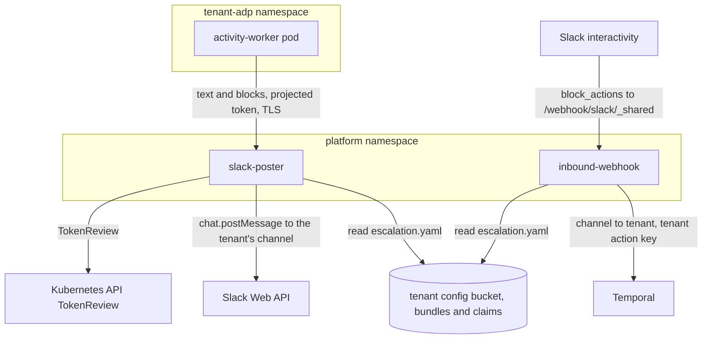
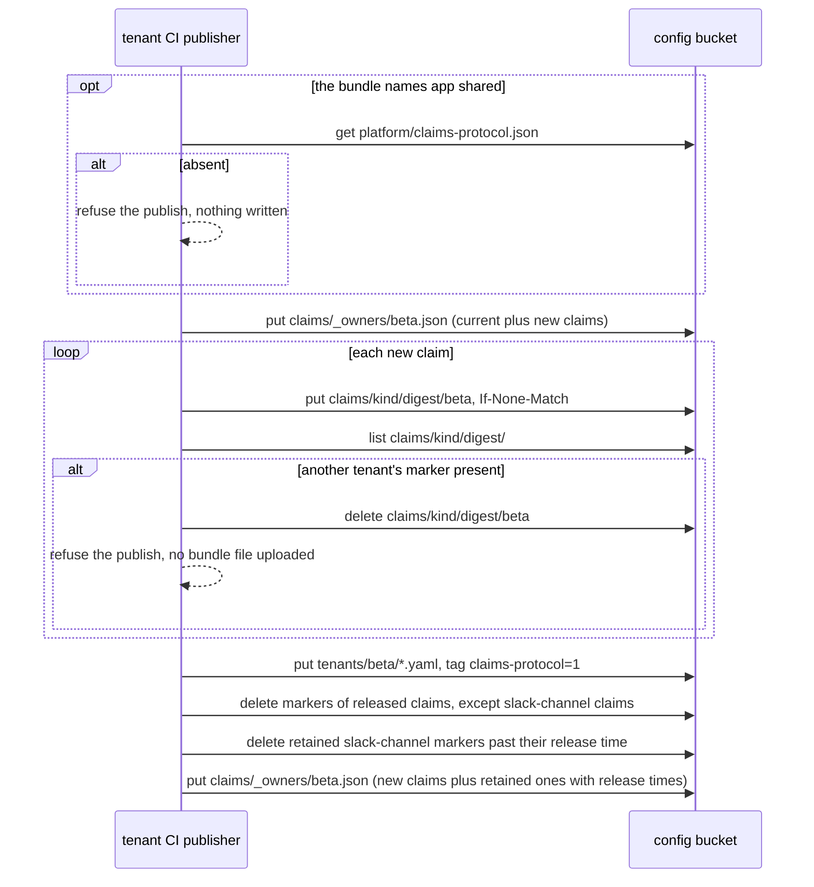
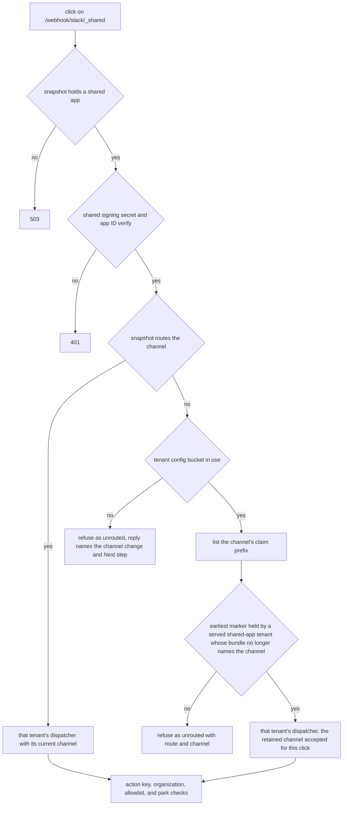
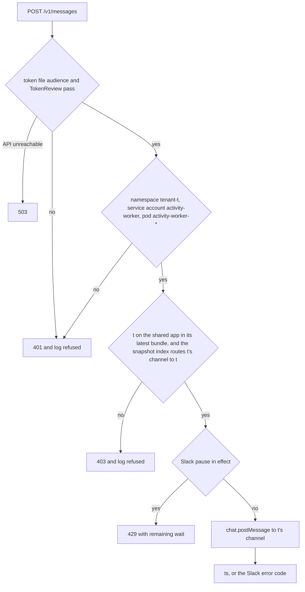

# Shared Slack App for Tenants - Plan

## Goal Capsule

- **Objective.** Several tenants in one Slack workspace or Enterprise Grid org resolve their parked runs from their own channels through one Slack app that the platform operates. No tenant can post into another tenant's channel, decide another tenant's parks, or take a configuration value another tenant holds, and a clash between two tenants' configurations is reported before either bundle goes into service.
- **Means.** A platform posting service holds the shared bot token (KTD8) and serves a certificate the workers verify (KTD15), clicks arrive at one shared route on the inbound webhook (KTD10), and each exclusive configuration value is an owner-keyed claim in the tenant config bucket (KTD2), gated by the claims-protocol object (KTD14).
- **Product authority.** Jira ADP-160 under the v0.3.0 Epic. The Key Decisions below record the choices the user made during planning, and their governed requirements state the rules.
- **Execution profile.** One pull request into `v0.3.0` from branch `ADP-160`, extending the draft ADP-160 pull request. The implementer leaves every change uncommitted. The work adds no database migration.
- **Stop conditions.**
  - Two local tenants on the shared app each resolve a gate park from their own channel, and a click or post for one tenant never reaches the other tenant's channel.
  - A tenant bundle that names a channel, app ID, or Jira project another tenant holds fails `inv tenant-config-validate`, the local render, and the publish, before any bundle file changes.
  - A pod other than a tenant activity worker, including the tenant's MCP gateway and its sandbox pods, cannot post through the posting service.
  - Per-tenant Slack apps pass every existing test unchanged.
  - In a deployment on the tenant config bucket, a shared-app tenant that moves from `C1` to `C2` still resolves its open `C1` parks from `C1`, and no other tenant can claim `C1` or receive the tenant's alerts there during the retention window.
  - In a deployment on the tenant config bucket, no `app: shared` tenant posts or decides a click before `platform/claims-protocol.json` exists.
  - The worker refuses a posting service certificate that the trusted CA did not issue or that does not name the posting service host, and no `verify=False` acceptance remains in `security/sast-accepted.yaml`.
  - A malformed `slack-shared-app.yaml` or a failed claim listing leaves the PR, Jira, and per-tenant Slack routes serving.
  - Every finding of the code review, the simplification pass, and the flow analysis of this work is fixed, and none is reported as residual risk.
  - No tenant file is read from a platform location and no tenant setting from `platform.env`, and the local stack runs `adp` and `beta` from their own folders.
  - `inv ci`, `inv terraform-test`, and `inv sast` pass.
- **Who finishes.** The implementer builds and validates. The user commits, pushes, and merges. The user runs three checks that need resources only the user holds: the AWS checks that `inv tenant-verify-aws` gains in U21, in the v0.3.0 AWS session, the two-tenant shared app Slack run in `docs/release-verification.md`, with the user's test workspace, and `gitnexus impact` on the new symbols once the new files are tracked, unless the implementer can index them earlier (U21).

---

## Product Contract

### Summary

The platform gains an opt-in shared Slack app. A tenant selects it in `escalation.yaml` and names its own channel. Its alerts post through a new internal posting service that holds the app's only bot token and posts only to that tenant's channel, and its clicks arrive at a shared route on the inbound webhook that hands each click to the tenant whose channel it came from. Every configuration value that only one tenant may hold becomes a claim in the tenant config bucket, so a clash fails the tenant's pull request CI and its publish instead of surfacing at runtime.

### Problem Frame

Each tenant needs its own Slack app today, and creating and installing an app needs a workspace right that most tenant members do not hold. A deployment with several teams in one workspace needs an admin to create, install, and maintain one app per team, and each app's credentials are one more set to rotate. Teams that share a workspace want one app the platform operates.

Sharing an app removes the isolation the per-tenant design gets for free. Slack offers no bot token limited to one channel, so whoever holds the token can post to every channel the bot belongs to. One signing secret signs every tenant's clicks. And tenants publish their bundles independently from their own CI, under publisher roles that cannot read each other's bundles, so two tenants can name the same channel without either knowing, and nothing compares them until the webhook loads both. The same blind spot already exists for a per-tenant app's ID and for Jira project keys.

### Key Decisions

- **The shared app is opt-in, and per-tenant apps stay supported.** A tenant uses one or the other, never both. (session-settled: user-approved, chosen over replacing per-tenant apps, because existing tenants keep working with no migration.) Governs R2, R4.
- **Clicks arrive over the request URL on the inbound webhook.** (session-settled: user-approved, chosen over a single Socket Mode consumer, because Slack sends each Socket Mode payload to one connection, and the webhook already applies decisions and replies through `response_url`.) Governs R2, R5.
- **A central posting service holds the shared bot token.** (session-settled: user-approved, chosen over each tenant worker holding the shared token, because a compromised worker could otherwise post to every tenant's channel.) Governs R7, R8.
- **Each tenant keeps its own action key.** (session-settled: user-approved, chosen over one platform key, because a button then verifies only for the tenant that signed it.) Governs R5.
- **One shared app per deployment, installed into one workspace or Enterprise Grid org.** (session-settled: user-approved, chosen over a distributed app with an OAuth install per workspace, because an internal app needs no token store or install flow.) Governs R1.
- **The tenant names its channel in `escalation.yaml`.** (session-settled: user-directed, chosen over a channel the platform operator assigns, because the tenant keeps control of its escalation channel, and pre-runtime clash validation closes the collision gap.) Governs R2, R11.
- **Every cross-tenant configuration clash is caught before runtime.** (session-settled: user-directed, chosen over catching clashes only at runtime, because a tenant should learn of a clash in its own CI, not from a refused click.) Governs R11, R12, R13, R14, R15, R16.
- **Every review finding of this work is fixed in this work.** (session-settled: user-directed, chosen over reporting findings as residual risk, because an item left in a bad state is a defect the user would have to rediscover.) Governs R10, R19, R20, R21, R22.
- **A channel a shared-app tenant leaves stays claimed for a retention window, and its buttons keep working.** (session-settled: user-directed, chosen over an immediate release with a clearer refusal, because the immediate release lets another tenant claim the channel before the posting service refreshes.) Governs R19.
- **Shared-app tenants run only after the claims protocol is in force.** (session-settled: user-directed, chosen over gating the publish alone, because an upload outside the protocol could otherwise take an unmarked tenant's channel at runtime.) Governs R20.
- **The worker verifies the posting service certificate against the platform CA.** (session-settled: user-directed, chosen over a dedicated posting service CA, because the platform CA already reaches every EKS pod and a second CA adds a key to generate and keep.) Governs R10.

### Requirements

**Shared app selection**

- R1. A deployment may define one shared Slack app. Its app ID, organization ID, and API base URL are platform configuration, and its bot token and signing secret are platform secrets that no tenant pod receives.
- R2. A tenant selects the shared app with `slack.app: shared` in `escalation.yaml` and names its own channel, allowlist, content level, button lifetime, profile, and approved hosts. Validation refuses such a file when it sets `app_id`, `organization_id`, or `api_base_url`, names a transport other than `webhook`, or names a channel ID that does not match `^C[A-Z0-9]+$`, which refuses `G`, `D`, `U`, and `W` IDs.
- R3. A government-profile tenant on the shared app is held to the existing host and content policy, with the shared app's API host as its host.
- R4. Tenants on their own apps behave as before, and validation refuses a per-tenant app that declares the shared app's ID.

**Clicks**

- R5. A click on a shared-app message arrives at `/webhook/slack/_shared`, verifies under the shared signing secret and app ID, and is decided by the tenant whose `escalation.yaml` names the click's channel, under that tenant's action key and every existing dispatcher check.
- R6. A click from a channel that no shared-app tenant names, or that more than one names when the claims do not decide it (R17), is refused with an ephemeral reply and a `SLACK_ACTION_REFUSED` event that names the route and the channel.

**Posting**

- R7. A shared-app tenant's alerts post through the posting service, the only component holding the shared bot token, to the channel the tenant's latest bundle names and to no other channel.
- R8. The posting service accepts a post only from a tenant activity worker pod and takes the tenant from the pod's identity, never from the request.
- R9. A failed post, a Slack rate limit included, leaves `slack` out of the alert's channels without failing the park, and the worker's warning names the Slack error code.
- R10. The hop from the worker to the posting service is encrypted under a certificate the worker verifies, and only tenant activity worker pods can reach the service on the network.

**Cross-tenant clash validation**

- R11. Each value that only one tenant may hold is a claim. The claims are the channel of a shared-app tenant, the app ID of a per-tenant app, and, for a tenant on the Jira ticket backend, each Jira project with its site and intake label, so two tenants may share a project only under different intake labels. A per-tenant app's channel is a claim that other per-tenant app tenants may hold too and that a shared-app tenant may not.
- R12. Publishing a bundle that names a value another tenant holds is refused before any bundle file uploads, and the refusal names the kind and the value.
- R13. `inv tenant-config-validate` reports a clash in the tenant's pull request CI when it is given the bucket and the probe credentials, and states that it skipped the check when it is not.
- R14. A tenant's publisher can create and release only its own claims, the earliest claim on a value wins, and once a deployment enforces the claim protocol, an upload from a publisher that does not run the protocol is refused.
- R15. Locally, the render and `inv tenant-config-validate` refuse a clash across every tenant directory, the home tenant's `config/<env>/` files included, before anything deploys.
- R16. An admin can backfill claims from the published bundles, list clashes and claims no bundle names, and release a claim. The backfill exits non-zero and leaves a value unclaimed when two published bundles already name it.
- R17. At runtime, when two tenants name one channel, the webhook and the posting service serve the tenant that holds the earliest claim and refuse the other, and refuse both only when the claims do not decide it.

**Hardening**

- R19. A shared-app tenant that stops naming a channel keeps its claim on that channel until its previous button lifetime plus two refresh intervals has passed, and until then no other tenant can claim the channel and a click on the tenant's buttons in it is decided by that tenant.
- R20. A deployment on the tenant config bucket accepts `app: shared` only once `platform/claims-protocol.json` exists. Until then the publish, pull request validation, the webhook, and the posting service refuse every shared-app tenant and name the missing object.
- R21. A fault in the shared app file or in a claim listing degrades only the shared route and the tenants whose decision failed, and never the PR, Jira, or per-tenant Slack routes.
- R22. Before runtime, the platform refuses `app: shared` with no served tenant, and refuses two served tenants that hold one action key.

**Config layout**

- R23. A config root holds only platform config, `platform.env` and the platform files. Each tenant holds its config in `tenants/<tenant>/` and its settings and credentials in `tenants/<tenant>.env`. No tenant is a home tenant, and no tenant reads another tenant's files or a platform copy of a tenant-only file.
- R24. A tenant-only file in a platform location is refused, locally by the render, `inv config-check`, and `inv tenant-config-validate`, and in AWS by the Terraform plan over `container_config_dir`. A platform file in a tenant bundle stays refused.
- R25. `gates.yaml` and `integrations.yaml` are platform defaults that a tenant's copy replaces, including a tenant `gates.yaml` that disables a core gate.
- R26. In `registries.yaml`, `mode` is platform only. A tenant may add or replace `mirrors` and `packages` entries only on hosts the platform file names. It names its own `credential.username`, which no other tenant may hold, and keeps its token in its own settings. A tenant in `external` mode without a credential is refused before runtime.
- R27. The `isolation` section of the rebar ticket store config is platform config, and a tenant `tickets.yaml` that sets it is refused.
- R28. Nothing selects a config environment. A checkout reads `config/local/`, and a deployed task reads `PLATFORM_ENV_CONFIG_DIR`.
- R29. Locally, the tenants are the folders of `config/local/tenants/` with their settings files, so onboarding or offboarding a tenant changes no platform file. In AWS, the Terraform `tenants` map stays the onboarding step, because it creates the tenant's IAM, KMS, and isolation resources. A host `inv` command that acts on one tenant takes `--tenant`, which may be omitted only when one tenant exists.
- R30. In AWS, a tenant worker whose `tenants/<tenant>/` prefix holds no published bundle refuses to start and names the prefix.
- R31. Every review-stage activity of a run executes in the run tenant's own review worker, under the tenant's identity and the bundle the run recorded, so the tenant's `gates.yaml` and `gate_engine.yaml` govern its review-stage gates.
- R32. Each tenant signs its review verdicts with its own key, and a verdict signed with another tenant's key does not verify for the run.
- R33. Each decision kind of a tenant's Slack approvers is either anyone in the tenant's channel, or a list of named users and Slack user groups. A user passes when the user is named or is a member of a named group. Every mode still requires the click to come from the tenant's organization and channel.
- R34. A group's members come from Slack and are refreshed every five minutes. When the last successful read of a group is older than ten minutes, a click that only that group would admit is refused.
- R35. A run that fails outside a handled outcome records FAILED, an audit event, and an operator alert. The orphan reaper alerts and audits every run it reclaims. A child workflow never replaces the parent's ID in the execution record.
- R36. Intake starts no run while the local model path is unhealthy. Each candidate is deferred, so the ticket store's watermark stays behind it and the next pass reads it again. The deferred tickets start on the first pass after the model path recovers.
- R37. A model call that fails because the credentials expired, the Bedrock path is unreachable, or LiteLLM is unreachable fails at once as ModelUnavailable, naming the failing hop. A run whose model call fails this way parks with its work kept and resumes when the model path recovers.
- R38. Each tenant's escalation channels receive one alert when the model path becomes unhealthy and one when it recovers. Each alert names the remedy for the failing hop, `inv aws-login`, `inv tunnel-start --detach`, or `inv k8s-reload`.
- R39. A workstation can install a scheduled job that renews a static-key AWS session before it expires and restarts the Bedrock tunnel when it stops.
- R40. An actionable alert states what happened, its effect, how to fix it for the deployment's posture, and how to validate the fix, and carries Acknowledge, Run validation, and Fix done buttons. A run alert carries Acknowledge and Restart run. Every button is admitted by the tenant's existing `repair` allowlist kind.
- R41. Fix done checks the failing condition again. On success it resolves the alert in place, posts the recovery in the alert's thread, closes the episode, starts the deferred tickets, and resumes the parked runs. On failure it replies privately with the condition that still fails.
- R42. Locally, the host agent renews the AWS session and restarts the Bedrock tunnel without a click, reports what it did in the alert's thread, and the automatic check resolves the alert. When it cannot, the alert gives the manual fix, the validation, and the Fix done step.
- R43. A deployment validation runs inside the deployment, the same locally and in AWS. A tenant validates only its own configuration and sees no other tenant's data. A platform administrator validates the platform, all tenants, or one tenant.
- R44. The local Compose workflow worker runs workflow code from the image the last `inv k8s-reload` built. Running it from the working tree is opt-in.
- R45. A tenant-facing alert holds no shell command in any posture. Every tenant action is a button, and with Slack enabled the Jira comment and the email point to the Slack post. A tenant configuration fault names the file and key to change in the tenant's config repository.
- R46. A platform fault reaches the tenant as its effect and the statement that work resumes on its own, with no fix steps and no platform internals. Its fix steps go to the platform administrator destination, which is a Slack channel, an email list, or both, from platform config. Config validation refuses a platform config that sets neither.
- R47. A limit can be raised without a config change or a restart. A tenant that reaches a limit is alerted with Request increase, Park all jobs, and Acknowledge. A request within the platform band, by default 25 percent of the configured limit per step and 100 percent per period, reaches the administrators with Approve and Deny, and an approval takes effect at once. A request above the band states that the configured limit must change.
- R48. A run that reaches a per-run limit parks and resumes on a grant. Park all jobs stops intake and lets running runs finish. A tenant whose period budget is spent has its running runs park at their next stage boundary, resuming on a grant or the period reset.

**Documentation**

- R18. The Slack escalation doc, a shared app manifest example, the tenant config doc, both FedRAMP docs, the affected READMEs, and the CHANGELOG describe the shared app, the posting service, the claims, and moving a tenant between apps in both directions.

### Acceptance Examples

- AE1. **Covers R5, R6.** Given tenants `adp` and `beta` on the shared app with channels `C1` and `C2`, when an allowlisted `adp` approver clicks Approve on a message in `C1`, the `adp` gate park resolves with the Slack actor. When the same payload arrives with channel `C3`, which no tenant names, the click is refused and a `SLACK_ACTION_REFUSED` event names the `_shared` route and `C3`.
- AE2. **Covers R12, R13.** Given `adp` holds the channel claim for `C1`, when `beta` opens a pull request whose `escalation.yaml` names `C1`, `inv tenant-config-validate` fails naming the channel claim, and a publish of the same bundle from `main` fails before any file of `beta`'s bundle changes.
- AE3. **Covers R14.** Given `adp` holds a claim, when `beta`'s publisher role deletes `adp`'s claim marker, S3 denies the request.
- AE4. **Covers R8.** Given a pod in `tenant-adp` running as the `activity-worker` service account but named `mcp-gateway-...`, when it posts with a projected token for the posting service audience, the posting service refuses it. A pod in `tenant-adp-sandbox` is refused the same way.
- AE6. **Covers R14, R17.** Given `adp` holds the channel claim for `C1`, a `beta` publish naming `C1` through the publisher is refused and leaves no `beta` marker. When `beta` instead writes a marker for `C1` and a bundle naming `C1` outside the claim protocol, `adp`'s next publish succeeds and warns that `beta` also claims `C1`, and the webhook and the posting service route `C1` to `adp` and refuse `beta`.
- AE7. **Covers R19.** Given `adp` on the shared app with channel `C1` and an open gate park posted in `C1`, when `adp` publishes `C2`, its `C1` marker stays, a `beta` publish naming `C1` is refused, the posting service posts `adp` alerts only to `C2`, and Approve on the `C1` message resolves the `adp` park. After the window, the next `adp` publish deletes the `C1` marker.
- AE8. **Covers R20.** Given a bucket without `platform/claims-protocol.json`, a publish naming `app: shared` is refused before any file uploads, and the webhook and the posting service refuse a shared-app tenant whose bundle was uploaded outside the protocol. Once Terraform writes the object, the same publish succeeds.
- AE9. **Covers R21.** Given a malformed `slack-shared-app.yaml` at webhook start, the PR and Jira routes and every own-app tenant's Slack route serve, and `/webhook/slack/_shared` answers 503. Once the file is fixed, the next refresh serves the shared route without a restart.
- AE5. **Covers R16.** Given `adp` and `beta` published bundles before claims existed, both naming Jira project `OPS` on the same site with the same intake label, when the admin runs the backfill, it claims every other value, leaves `OPS` unclaimed, reports both tenants, and exits non-zero.
- AE10. **Covers R23, R24.** Given `config/local/escalation.yaml`, `inv k8s-reload` fails and names the file and `config/local/tenants/<tenant>/escalation.yaml` as its location.
- AE11. **Covers R26.** Given a platform `registries.yaml` in `external` mode with mirrors on `artifactory.example.gov`, a tenant mirror on `artifactory.example.gov/agency-remote` validates, and a tenant mirror on `other.example.com` is refused with the host named. Two tenants with one `credential.username` fail the local render, and in AWS the second publish fails.
- AE12. **Covers R29.** Given the folders `adp/` and `beta/` with `adp.env` and `beta.env`, the render deploys both workers with no `TENANTS` setting. Removing `beta/` and `beta.env` removes the beta worker at the next `inv k8s-reload`.
- AE13. **Covers R33.** Given `allowlist.gate: channel`, any user of the tenant's organization who clicks Approve in the tenant's channel decides the gate, and a Slack Connect user from another organization is refused.
- AE14. **Covers R33, R34.** Given `allowlist.repair` naming the group `S0123456789`, a member of that group decides a repair park, a non-member is refused, and after the group's last read is more than ten minutes old a member is refused as stale until the next read succeeds.
- AE15. **Covers R35.** Given a plan child that exhausts its model retries, the run's execution is FAILED, a RUN_FAILED audit event exists, and the tenant's channels receive an alert whose remedy names `inv restart`.
- AE16. **Covers R36, R38.** Given an expired `aws-credentials` session and a new ready ticket, the intake pass starts nothing, defers the ticket, and alerts once naming `inv aws-login`. After the session is renewed, the next pass starts the ticket and the channels receive one recovery alert.
- AE17. **Covers R37.** Given a run in planning when the Bedrock tunnel stops, the run parks as model_unavailable with its plan state kept, and after `inv tunnel-start --detach` it resumes without a new intake.
- AE18. **Covers R40, R41.** Given a model path alert, a `repair` approver presses Acknowledge and the post shows who and when. Run validation posts a report in the thread naming the failing check. After the fix, Fix done resolves the post, posts the recovery in the thread, and the deferred ticket starts within the same minute. A user outside the `repair` kind is refused privately.
- AE19. **Covers R42.** Given the tunnel stopped on a workstation with the host agent installed, the agent restarts it, reports in the alert's thread, and the alert resolves with no click.
- AE20. **Covers R43.** Given tenants adp and beta, Run validation in adp's channel reports adp's checks and platform dependencies as pass or fail with no platform internals and nothing of beta. `inv deployment-validate --all-tenants` reports the platform and both tenants.

### Scope Boundaries

- Socket Mode for the shared app reaches only the inbound webhook, and the request URL stays the documented default in AWS (KTD21).
- Tenant pulls from another AWS account's ECR are considered and not built. A tenant's private images publish to its own prefix in the deployment's ECR. A tenant that must keep private images in its own account would change this, and the change needs per-tenant repository ARNs, a tenant admission list, and Inspector delegated administration.
- A key-level merge of a tenant `gates.yaml` or `integrations.yaml` over the platform file is considered and not built. A tenant file replaces the platform file whole, as the layering does today.
- A migration command for the config layout is considered and not built (KTD27).
- One app installed across several workspaces through OAuth distribution is not built (Key Decisions).
- A drain window that accepts the previous app's clicks after a tenant moves apps is considered and not built. Every message keeps its `Next step:` command, so an approver whose button fails still resolves the park, and the move runbook resolves open parks first. A report of approvers stalled by a move would change this.
- Accepting two signing secrets during a rotation is considered and not built. Regenerating the secret cuts every shared tenant's buttons until the webhook rolls, which the leak runbook states. A rotation cadence that makes this frequent would change this.
- Fair queuing across tenants and per-channel rate buckets are considered and not built. Alert volume is a few posts per run, and the shared 429 pause in KTD8 keeps the app from being disabled. Sustained 429 responses in the posting service log would change this.
- Refusing a Slack Connect channel through `conversations.info` is considered and not built. It needs the `channels:read` and `groups:read` scopes, and the dispatcher's organization and allowlist checks already refuse external clickers. The doc states that alert content in a shared channel is visible to the external organization.
- A check that a click's `message.bot_id` is the shared bot is considered and not built. The HMAC token already proves the button came from the tenant.
- A runtime refusal of two tenants admitting one Jira project is considered and not built. The claim refuses it before publish, and the webhook routes Jira deliveries by tenant path.
- Posting service audit rows in `audit_events` are considered and not built. The service holds no database credential, and its structured logs record each post and refusal (KTD8).
- A cache of positive TokenReview results is considered and not built. Alert volume is a few posts per run, and a cache would extend acceptance of a token whose pod was deleted. TokenReview latency in the posting service log would change this.
- A rate limit on failed TokenReview calls is considered and not built. The ingress policy admits only tenant activity worker pods. Repeated failed reviews in the posting service log would change this.
- A cap on `token_ttl_hours` for shared-app tenants is considered and not built. The publisher reads the button lifetime of its own previous bundle when it computes the retention window (KTD13). A tenant that sets lifetimes long enough to block channel reuse would change this.
- A dedicated CA for the posting service hop is considered and not built (Key Decisions). A platform CA key compromise that must not reach this hop would change this.
- Reloading the trusted CA in running workers is considered and not built. The CA reaches EKS workers at process start and the local CA is reused across renders, so a CA change rolls the workers. A CA rotated more often than a deploy would change this.
- An admin restore of an older S3 object version bypasses the claims. The tenant config doc states it, and admins republish through the publisher instead.

#### Deferred to Follow-Up Work

- Slack token rotation for the shared app. Enabling `token_rotation_enabled` cannot be reversed, and refresh tokens are single use, so it needs a single-writer refresher rehearsed on a development app first.

### Sources

- Slack interaction payloads, https://docs.slack.dev/reference/interaction-payloads/block_actions-payload. `team` is null for an org install, and `channel` can be absent in favor of `container.channel_id`.
- Slack request verification and `response_url` limits, https://docs.slack.dev/authentication/verifying-requests-from-slack and https://docs.slack.dev/interactivity/handling-user-interaction.
- `chat:write.public`, https://docs.slack.dev/reference/scopes/chat.write.public. The shared app does not request it, so channel membership stays the Slack-side boundary.
- Slack rate limits, https://docs.slack.dev/apis/web-api/rate-limits. Limits apply per method, per workspace, per app, so every shared tenant shares one budget.
- Slack channel ID changes, https://docs.slack.dev/apis/slack-connect. A shared `G` channel receives a new `C` ID.
- Kubernetes bound service account tokens, https://kubernetes.io/docs/reference/access-authn-authz/service-accounts-admin/.
- S3 condition keys, https://docs.aws.amazon.com/AmazonS3/latest/userguide/conditional-writes.html. `s3:if-none-match` enforces a conditional create, and `s3:ExistingObjectTag` does not apply to `DeleteObject`.

---

## Planning Contract

### Key Technical Decisions

- KTD1. **A tenant worker authenticates to the posting service with a projected service account token that the service verifies through TokenReview.** (session-settled: user-directed, chosen over per-tenant secret tokens in the repository intelligence pattern, because it adds no long-lived secret or rotation and behaves the same in kind and EKS.)
  - The worker pod mounts a token for audience `slack-posting-service` with a 600-second lifetime and re-reads the file on every request, because the kubelet replaces it before expiry.
  - The service sends TokenReview with `spec.audiences` set to that audience and requires the authenticated user to be `system:serviceaccount:tenant-<t>:activity-worker`, with `t` in `TENANTS` and the bound pod name in `authentication.kubernetes.io/pod-name` starting with `activity-worker-`. The pod name check is required because the tenant's MCP gateway runs as the same service account.
  - The service also requires `status.audiences` to contain the audience and the review to carry a bound pod UID, and parses the username against the tenant name pattern `^[a-z][a-z0-9]{1,15}$`, so a local tenant named `x-sandbox` cannot turn tenant `x`'s sandbox namespace into a worker namespace.
  - The pod name check is sufficient because no Role in `tenant-<t>` grants pod creation or token requests. The worker's only Role is in the sandbox namespace, and a sandbox pod's token fails the namespace check.
  - Each post gets its own review. The service answers 503 when the API server is unreachable.
  - The service's ClusterRole grants only `create` on `tokenreviews`, not the `system:auth-delegator` role, which also grants SubjectAccessReview.
  - The repository intelligence plan rejected TokenReview because its callers ran on ECS. Every caller here is a pod in kind or EKS.
- KTD2. **Claims are owner-keyed markers in the tenant config bucket, and the earliest marker on a value wins.** Each claim is the empty object `claims/<kind>/<digest>/<tenant>`, where the kind is one of `slack-channel`, `slack-own-channel`, `slack-app`, and `jira-project`, and the digest is SHA-256 over the kind and the canonical value.
  - Canonical values are an uppercase channel or app ID matching `^[A-Z0-9]+$`, and for Jira the site as `https://` plus the lowercase IDNA host with no path or port, followed by the uppercase project key and the project's effective intake label, empty when the project sets none.
  - Markers of `slack-own-channel`, written by per-tenant app tenants, do not conflict with each other. A `slack-channel` claim and a `slack-own-channel` claim on one channel ID conflict, so the check of either kind also lists the other kind's digest prefix for the same ID.
  - A publisher creates its own marker with `If-None-Match: *`, then lists `claims/<kind>/<digest>/`. The marker with the earliest `LastModified` holds the value. A publisher whose marker is not the earliest deletes its own marker and refuses the publish. The holder proceeds and warns with the other tenant's name. Markers with the same `LastModified` refuse both. A squatting marker therefore never blocks the tenant that claimed first.
  - Keys are parsed strictly. Apart from the tenant index `claims/_owners/<tenant>.json` (KTD3), a key under `claims/` with more or fewer than four segments, or with an unknown kind, is ignored by every reader and denied by the bucket policy.
  - The bucket policy authorizes create and delete only on `claims/<kind>/*/${aws:PrincipalTag/tenant-config-publisher}` for each kind, because S3 cannot condition a delete on an object's existing tags. It denies a create without `s3:if-none-match`, except on the tenant's own index. It denies `s3:ListBucket` and `s3:ListBucketVersions` under `claims/` unless the prefix names one digest ending in `/`, with a negated operator so a request without a prefix is denied. The list deny exempts `admin_principals` through the `ArnNotLike` condition the tenant statements use, so the admin report in R16 can list every marker.
  - A DynamoDB table was rejected because IAM cannot bind a delete to an item's owner attribute. A central validation service was rejected because tenant CI cannot reach internal services.
  - The conditional put follows `services/integration/image_exceptions.py`, which handles the same 412 and 409 codes.
- KTD3. **Each tenant keeps an index of its own claims, and the publish follows a fixed order.** The index is `claims/_owners/<tenant>.json`, which only that tenant's publisher reads and writes. Before step 1, a bundle naming `app: shared` reads `platform/claims-protocol.json`, and the publish is refused with nothing written when the object is absent (KTD14). A publish proceeds in this order:
  1. Write the index as the union of its current entries and the new bundle's claims.
  2. Create and check each new claim per KTD2.
  3. Upload the bundle.
  4. Delete the markers of claims the bundle no longer names, except a `slack-channel` claim, which KTD13 retains, and delete each retained marker whose retention has passed and whose channel the bundle does not name.
  5. Write the index as the new bundle's claims plus the retained channel claims with their release times. A retained channel the bundle names again becomes a current claim with no release time.
  A failure at any step leaves extra claims and never fewer, and the admin release and the backfill report recover them. The tenant config doc recommends one CI concurrency group per tenant.
- KTD4. **A protocol tag stops a publisher that does not run the claim protocol.** With the new `enforce_claims_protocol` variable of the tenant-config-store module set, the bucket policy denies a `PutObject` under `tenants/*` that lacks the object tag `claims-protocol=1`. The variable defaults to off and is turned on after the backfill. The publisher role gains `s3:PutObjectTagging`. The tag is set by the uploader, so it stops an outdated publisher, and the claim precedence in KTD2 and KTD9 handles a hostile one.
- KTD5. **A read-only probe role per tenant serves pull request CI.** It trusts the config repository's `pull_request` OIDC subject, carries no tenant tag, and may only list single-digest prefixes under `claims/` and read `platform/claims-protocol.json` (KTD14). `inv tenant-config-validate` probes when `--bucket` or `TENANT_CONFIG_BUCKET` and AWS credentials are present, and prints that it skipped the probe otherwise.
- KTD6. **The shared app's public settings live in `config/<env>/slack-shared-app.yaml`.** The file is registered as config `slack_shared_app` at version 1. The worker, the webhook, the posting service, and tenant CI validation through `--environment-dir` all read it. `SLACK_SHARED_BOT_TOKEN` and `SLACK_SHARED_SIGNING_SECRET` are added to `_withheld_from_pods` in `scripts/k8s_render.py` and refused in a tenant `.env` file, following `_refuse_tenant_tokens`. In kind, the bot token goes in a dedicated Secret that only `slack-poster` mounts, not the shared `agentic-platform` Secret.
- KTD7. **`escalation.yaml` stays at config version 1.** The new optional `app` key defaults to `own`. An older worker refuses a bundle with `app: shared` because `app_id` is missing, and it keeps the last valid bundle, so the platform deploys before any tenant publishes `app: shared`. A version bump was rejected because it forces every operator to edit every file.
- KTD8. **The posting service is a new platform deployment, `slack-poster`, served from the platform image as `services/slack_poster`.**
  - `POST /v1/messages` accepts JSON with `text` and `blocks` and refuses any other field, so a request cannot name a channel, a username, or an icon. A header carries the alert's remaining deadline, which bounds the Slack call.
  - The service calls only `chat.postMessage`, to the channel of the tenant's latest `escalation.yaml`, with unfurling off. It returns the message timestamp or the Slack error code. The webhook already updates messages through `response_url`, so the service needs no `chat.update`.
  - The service runs one replica, because the token bucket, the in-flight cap, and the 429 pause are held in process and hold only when one process sees every post. R9 already accepts a dropped post while the pod restarts.
  - Before calling Slack, it holds each tenant to a token bucket below one post per second and a small in-flight cap, and clamps the deadline header to a server maximum, so one compromised worker cannot keep the shared pause in effect.
  - On a 429, it pauses `chat.postMessage` for every tenant for `Retry-After` seconds and answers each post during the pause with the remaining wait. One app in one workspace has one budget, and continued calls risk Slack disabling the app for every tenant.
  - Readiness calls `auth.test` at startup and fails when Slack rejects the token or when the response's `enterprise_id`, else its `team_id`, differs from the configured organization ID.
  - The service serves TLS with a mounted certificate that the worker verifies (KTD15).
  - The service holds no database credential. Each post and each refusal is a structured log event naming the tenant, the channel, and the reason. No log event carries the request body, which holds action tokens, or the `Authorization` header.
  - Its IAM role grants `s3:ListBucketVersions` on the `tenants/` prefix, `s3:GetObject` and `s3:GetObjectVersion` on `tenants/*/escalation.yaml` and `tenants/*/gates.yaml`, the single-digest claim listing, `s3:GetObject` on `platform/claims-protocol.json` (KTD14), and `kms:Decrypt` through S3, though the bucket policy admits shared readers to every bundle file. The snapshot (KTD9) fetches only those two files.
- KTD9. **The tenant Slack settings snapshot moves to `services/integration/slack/tenant_settings.py`.** The webhook and the posting service both use it.
  - The snapshot gains a channel-to-tenant index over the shared-app tenants (KTD16). On the tenant config bucket, the refresh lists the claim prefix of every shared-app channel and serves a shared-app tenant on a channel only when its marker is the earliest of every contending marker, retained ones included. A tenant whose marker is not earliest, or that holds none, is refused and logged. In kind, where no bucket exists, a single claimant is served and two claimants are both refused, because the render refuses the clash first (R17). A per-tenant app tenant naming a shared tenant's channel contends through its `slack-own-channel` marker.
  - The app ID clash map leaves out the shared-app tenants and reserves the shared app ID against per-tenant apps.
  - The extraction also keeps the posting service from importing the webhook server module, which configures logging when imported.
- KTD10. **The shared route is `/webhook/slack/_shared`.** No tenant name can contain an underscore, and the path stays under the `/webhook/slack` Ingress prefix.
  - The route is built from `SLACK_SHARED_SIGNING_SECRET` and each shared-app tenant's `ESCALATION_ACTION_KEY_<TENANT>`, because a shared-app tenant has no signing secret of its own.
  - `click_from_payload` falls back to `container.channel_id`, so the router and the dispatcher read one field.
  - A new `Refusal` member covers a channel that routes to no tenant, and its refusal record carries the route and the channel in its correlation IDs. The ephemeral reply for that refusal checks `response_url` against the shared app's hooks host.
  - The per-tenant route answers 404 for a tenant on `app: shared`, and the shared route serves only `app: shared` tenants. Otherwise a retired app's signing secret could sign a payload naming the shared app ID to `/webhook/slack/<t>`.
- KTD11. **Every tenant worker gets the projected token volume and the egress rule to the posting service, whichever app it uses.** Moving between apps then needs a bundle publish and no deploy. The posting service's ingress NetworkPolicy admits only pods labeled `app.kubernetes.io/name: activity-worker` in namespaces with the worker role label, through an explicit peer that `_platform_policy` in `scripts/tenant_render.py` leaves unchanged. The namespace label alone would also admit the tenant's MCP gateway. The service stays out of the `load-balancer-targets` policy, whose VPC `ipBlock` matches pod addresses. `SLACK_POSTING_URL` is the service's fully qualified cluster name, because a tenant namespace resolves short names in its own namespace first.
- KTD12. **The worker chooses the app from the run's pinned bundle, and the posting service and the webhook use the latest bundle.** A run pinned to a bundle from before a move therefore posts through the app its bundle names. A post that the posting service refuses after a move leaves `slack` out of that alert (R9).
- KTD13. **A released shared-app channel claim is retained in the publisher's own index, with no new claim kind and no bucket policy change.** (session-settled: user-directed, chosen over releasing the marker at once and only improving the refusal, because the immediate release lets another tenant claim the channel before the posting service refreshes.) Governs R19.
  - The index entry of a retained claim carries a release time equal to the publish time plus the previous bundle's `token_ttl_hours`, under which the buttons in that channel were signed, plus twice `TENANT_CONFIG_REFRESH_SECONDS`. The publisher reads that lifetime from its own previous bundle, so no cap on the lifetime is needed.
  - A retained channel that a later bundle names again returns to a current claim and keeps its marker and its precedence.
  - The marker stays in place, so every other publisher's check sees it as the earliest holder and refuses (KTD2). The refusal names the holder and states that the claim may be retained after a channel change.
  - The tenant's next publish after the release time deletes the marker. `inv tenant-config-claims report` prints a retained claim inside its window as retained with its release time and no finding, reports one past its release time as a finding, and `release` removes one early.
- KTD14. **Terraform writes `platform/claims-protocol.json` once the protocol is in force, and every reader of shared-app settings on the bucket requires it.** (session-settled: user-directed, chosen over gating only the publish and pull request validation, because an upload outside the protocol could otherwise take an unmarked tenant's channel at runtime.) Governs R20.
  - The tenant-config-store variable `claims_backfilled`, `tenant_config_claims_backfilled` in private-bedrock, writes the object through `aws_s3_object`, and its validation requires `enforce_claims_protocol`. A fresh deployment sets both on its first apply, and an existing one sets them after `inv tenant-config-claims backfill` exits 0.
  - The key sits under `platform/`, outside the strict `claims/` parser of KTD2. Publisher IAM grants no write under `platform/`, following the image policy key, and the bucket policy's allowed-key list gains the key.
  - The publisher, probe, webhook, and posting service roles gain `s3:GetObject` on the key and no list grant. S3 answers `AccessDenied` for an absent key to a role without list rights, so every reader treats `NoSuchKey` and `AccessDenied` alike as absent, and its refusal names the object as absent or not readable by the role.
  - The snapshot reads the object on every refresh on the bucket and refuses every shared-app tenant while it is absent (R20). Any other read error keeps the last result, and before the first successful read refuses every shared-app tenant.
- KTD15. **The posting service serves a mounted leaf issued by the platform CA, and each worker trusts only that CA for this hop.** (session-settled: user-directed, chosen over a dedicated posting service CA, because the platform CA already reaches every EKS pod.) Governs R10.
  - The leaf names `slack-poster.agentic-dev-platform.svc.cluster.local` and `127.0.0.1`. `services/server_tls.py` gains a mode that loads a mounted certificate and key, which only the posting service uses, and the probe trusts the mounted CA.
  - In EKS, `inv slack-poster-certs issue` and `put` issue the leaf from the platform CA into a Secrets Manager secret of shape `{certificate, private_key}`, following `scripts/clickhouse_certs.py`, and the poster's SecretProviderClass mounts it. The CA certificate comes from `PLATFORM_CA_PEM`.
  - Locally, the render generates a CA and a leaf once into a per-user state directory outside the repository, following the in-repository refusal of `scripts/temporal_certs.py`, reuses them on every render, and regenerates them when the leaf is within 30 days of expiry or its names differ.
  - In both environments, the render emits a `slack-poster-ca` ConfigMap that the worker Deployment mounts, so `scripts/tenant_render.py` copies it into every tenant namespace. It carries every certificate in `PLATFORM_CA_PEM`, so a CA rotation can hold the old and new CA together. `SLACK_POSTING_CA_FILE` names the mounted file, and the client verifies against that file alone.
  - Locally, a pod annotation carrying the leaf's SHA-256 fingerprint rolls the posting service when the leaf changes. In EKS, the secret store's restart rolls it when the leaf secret changes.
  - The posting service logs a `slack_poster_leaf_expiring` error at start and once a day while its mounted leaf is within 30 days of expiry.
- KTD16. **The snapshot computes channel decisions from shared inputs only, keeps the last good result per input, and caches parses by content.** Governs R17, R21.
  - The channel index is a function of the served tenants, the latest bundle texts, the environment fallback texts, the shared app file, the claims-protocol object, and the markers. Signing-secret and action-key refusals apply after it, so the webhook and the posting service reach identical channel decisions.
  - A failed read of the shared app file keeps the last good app, and none at first start. A failed listing for one channel keeps that channel's last decision, and refuses its claimants at first start. Other channels and tenants still update.
  - The refresh fetches a file only when its S3 version ID changed, and re-parses a tenant only when the content hash of its escalation text, its gates text, the environment fallback texts, or the shared app changed. Channel precedence is recomputed on every refresh, because markers change without a bundle change.
  - One S3 client per process serves every tenant source and the claim listings, and tenants refresh on a bounded thread pool.
- KTD17. **A click from a channel the snapshot does not route goes to the tenant holding the earliest marker on it, and that tenant's dispatcher accepts the channel for that click.** Governs R19.
  - The shared route lists the channel's claim prefix only for a click the snapshot does not route, so the cost falls on clicks from retained channels and from strangers.
  - The route requires the holder to be a served shared-app tenant whose bundle no longer names the channel. The dispatcher then runs every existing check under that tenant's action key and allowlist, with the retained channel accepted in place of the current one.
  - Without a bucket, the click is refused with a reply that names the channel change and the `Next step:` command.
- KTD18. **The posting service refuses the tenants that share an action key through a SHA-256 fingerprint of each key, never the key itself.** (session-settled: user-directed, chosen over mounting every raw action key into the posting service and over leaving the refusal at the webhook alone, because a raw key would let the posting service sign a decision.) Governs R22.
  - Locally, the render computes each tenant's fingerprint and passes it to the posting service as `ESCALATION_ACTION_KEY_SHA256_<TENANT>`. In EKS, the secret store keeps the fingerprint beside each tenant's action key, and the posting service's SecretProviderClass mounts only the fingerprints.
  - The snapshot compares fingerprints where the webhook compares keys, so both refuse the same tenants.
- KTD19. **A channel claim stays first come, first served, and an admin resolves a contested channel.** (session-settled: user-directed, chosen over admin-only channel claims, because a tenant's own publisher keeps naming its channel without an admin step.) Governs R14, R16.
  - `inv tenant-config-claims report` names, for each contested value, the holder and every tenant whose bundle names the value without holding it. The escalation doc gains a runbook that verifies ownership of the channel and releases the holder's marker.
- KTD20. **An admin sweep releases every retained claim past its release time, whichever tenant holds it.** (session-settled: user-directed, chosen over a runtime that reads other tenants' indexes, because that reverses KTD13.) Governs R19.
  - `inv tenant-config-claims sweep` deletes each past-due retained marker and its index entry. The report's past-due finding names the sweep as the next step.
- KTD21. **The shared app may deliver clicks over Socket Mode to the inbound webhook, as an alternative to the request URL.** (session-settled: user-directed, chosen over a public tunnel or relay to a local webhook, because third-party webhook relays are prohibited and the deployments have no FedRAMP-authorized tunnel, and over an AWS relay, because it adds an internet-facing endpoint used only for testing.) Refines the request URL decision for R5.
  - `SLACK_SHARED_APP_TOKEN`, an app-level token with `connections:write`, selects Socket Mode. Only the inbound webhook receives it, locally through its own Secret and in EKS through the secret store's `slack_shared_app_token`, and the render refuses it in a tenant's env file.
  - The webhook opens the connection out to Slack, so no inbound URL, tunnel, or relay is needed, and each click passes through the same shared route checks as a request URL click after the connection authenticates it in place of the signing secret.
  - A Slack app delivers clicks over one transport, so the app a deployment creates turns Socket Mode on or sets the request URL. The request URL stays the documented default in AWS, where Socket Mode needs the WebSocket hosts in the DNS Firewall.
- KTD22. **Platform config sits at the config root and each tenant's config sits in its own folder, with no home tenant.** (session-settled: user-directed, chosen over keeping the home tenant's files in the environment layer, because that layer then supplies one tenant's values to every tenant, and a local tenant should match a published S3 prefix.) Governs R23, R24, R25, R27.
  - Tenant only: `repositories`, `checks`, `gate_engine`, `github`, `jira`, `profiles`, `escalation`, `tickets` without `isolation`, the tenant `image_exceptions.yaml`, and the authoring key.
  - Platform default that a tenant file replaces: `gates` and `integrations`.
  - Platform default that a tenant file extends: `registries`, as KTD24 states.
  - Platform only: `image_policy`, `review-trust-root`, `slack-shared-app`, `rebar-store-aws-config`, the review signing key, the platform `image_exceptions.yaml`, the ticket store isolation, and the tracked files under `config/platform/`.
  - `.env` becomes `config/local/platform.env`, which refuses tenant-owned settings. Every tenant has `config/local/tenants/<tenant>.env`.
- KTD23. **`ENVIRONMENT` is removed.** (session-settled: user-directed, chosen over keeping it, because no code branches on its value and it only names the `config/<environment>/` path segment.) Governs R28.
  - `env_config_dir` returns `PLATFORM_ENV_CONFIG_DIR` when that is set, and `config/local/` otherwise. `config/aws-connected/`, the compose setting, and the `environment` variable of `container-services` are removed.
- KTD24. **`registries.yaml` splits by key.** (session-settled: user-approved, chosen over a platform-only file, because each tenant needs its own registry identity, and over a tenant-only file, because `mode` is bound to the ECR caches, the worker IAM, and DNS Firewall.) Governs R26.
  - A tenant's `mirrors` and `packages` entries merge over the platform's entries by key, and validation refuses a tenant entry whose host the platform file does not name.
  - `credential.username` lives in the tenant's `registries.yaml` and is a claim of kind `registry-username`, so two tenants with one username clash at the local render and at the AWS publish. The token stays in `<tenant>.env` locally and in the tenant's `registry_token` secret in AWS.
  - `inv tenant-verify-aws` sends each tenant's credential to `https://<mirror host>/v2/` from the tenant's activity worker and expects 200, which detects an expired or revoked token.
- KTD25. **The tenant list is the tenant folders locally and the Terraform `tenants` map in AWS.** (session-settled: user-directed, chosen over a `TENANTS` platform setting, because onboarding a tenant changes no platform file unless it creates security resources.) Governs R29.
  - `platform.env` refuses `TENANT` and `TENANTS`. The render derives the list and gives each pod `TENANTS` and its `TENANT`, as the deploy does in AWS.
  - A host command for one tenant loads `platform.env` and then `tenants/<tenant>.env`.
- KTD26. **A tenant worker refuses an empty bucket prefix.** (session-settled: user-directed, chosen over reading the platform layer for an unpublished tenant, because the tenant-only files have no platform copy to read.) Governs R30.
- KTD27. **This checkout's config moves in this work with no migration command.** (session-settled: user-directed, chosen over an `inv` migration task, because this checkout is the only local multi-tenant deployment.) Governs R23.
- KTD28. **Each tenant runs its own review worker, which signs with the tenant's own review signing key.** (session-settled: user-directed, chosen over pinning each review activity of one shared review worker to its run's bundle, because a tenant's gate engines then run under the tenant's identity and never in a process that reads other tenants' data.) Governs R31, R32.
  - The worker polls `<REVIEW_TASK_QUEUE>-<tenant>`, configures its tenant's bundle, and pins each activity to the bundle its run recorded, as the activity worker does. Intake gives each run its tenant's review queue.
  - It runs in the namespace `tenant-<tenant>-review`, apart from the tenant's activity worker, so no activity worker or sandbox pod can read the tenant's review signing key.
  - Each key in `review-trust-root.yaml` names its tenant. A verdict verifies only under a key of the run's tenant, and a review worker refuses to start when its key is not an active key of its tenant. The trust root stays platform config, because a tenant must not control the anchor its own verdicts are checked against. Adding a tenant's key is the onboarding step this security boundary requires.
  - In AWS the ECS review worker is removed, and each tenant's review worker runs on EKS under its own Pod Identity role, which writes the evidence bucket and reads only its tenant's bundle prefix and review signing key secret.
- KTD29. **No process runs without a tenant.** (session-settled: user-directed, chosen over keeping the platform tenant of the webhook and repository intelligence, because a deployment always serves at least one tenant.) Governs R23, R29.
- KTD30. **Approver modes extend the allowlist in place.** (session-settled: user-directed, chosen over a new `approvers` key, because the existing lists of `user_id` keep parsing.) Each kind under `slack.allowlist` is the string `channel` or a list whose entries name a `user_id` or a `group_id`. The tenant template defaults both kinds to `channel`. The channel mode is allowed under every profile. Governs R33.
- KTD31. **Group members are resolved by the tenant's activity worker and read from Postgres by every dispatcher.** (session-settled: user-approved, chosen over giving the inbound webhook a bot token, because the webhook holds no Slack token for any tenant.) The worker reads each group the tenant names with `usergroups.users.list`, through its own bot token, or through the Slack posting service for a tenant on the shared app, which admits only groups the tenant's `escalation.yaml` names. It records the members with the read time per tenant and group. The bot needs the `usergroups:read` scope. Governs R33, R34.
- KTD32. **Model path health is a one-token LiteLLM probe made when a ticket is picked up, and the hop is named from LiteLLM's error.** (session-settled: user-approved for the local build, chosen over a probe per dependency, because AWS assets reach Bedrock over internal connections with Pod Identity credentials.) An expired-credential error names the AWS session, a failed connection to the Bedrock host names the tunnel, and a failed connection to LiteLLM names LiteLLM. The probe runs when a ticket is picked up, before its run starts, and its result is cached for about a minute, so a pass with many candidates probes once. Governs R36, R37, R38.
- KTD33. **Intake defers rather than holds while the model path is unhealthy.** (session-settled: user-approved.) A held rebar ticket advances the watermark past it, and a deferred one does not. The gate reuses the admission deferral the concurrency cap uses. Governs R36.
- KTD34. **Model path alerts go to every tenant's escalation channels, once per transition.** (session-settled: user-approved, chosen over a platform operator channel.) A side-effect ledger key per tenant and unhealthy episode keeps the per-minute pass from repeating an alert. Governs R38.
- KTD35. **Alert buttons reuse the `gate` and `repair` allowlist kinds.** (session-settled: user-approved, chosen over a kind per alert type.) `gate` admits clearing a named gate, and `repair` admits every other alert action. Governs R40.
- KTD36. **A button records an approval or asks the deployment to check, and never runs a command a click names.** (session-settled: user-approved.) Configuration faults, including Pod Identity or Bedrock path drift in AWS, are fixed outside Slack by re-applying the declared configuration, then confirmed with Run validation and Fix done. Restart LiteLLM is not offered. Governs R40, R41.
- KTD37. **Tenant validation runs in the tenant's activity worker, and platform validation runs as a Kubernetes Job in the platform namespace.** (session-settled: user-approved scope, mechanism proposed.) The tenant worker holds only its tenant's credentials, so its report cannot name another tenant. A tenant sees each platform dependency as pass or fail only. The platform Job holds the platform's access, runs the platform checks, and starts each requested tenant's validation on its queue. Governs R43.
- KTD38. **Alerts are routed by who can act on them.** (session-settled: user-approved, replacing the posture-rendered commands in tenant alerts, because tenant engineers in AWS hold no platform access.) Administrator issues need platform access: the model path, Temporal, the database, ADP code defect parks, sandbox and gate infrastructure, platform configuration, limit changes, and platform-scope validation failures. Every other issue is the tenant's, including restarting a run. A tenant run that fails on a platform error type also sends its cause to the administrators. Governs R45, R46.
- KTD39. **Limit increases are grants stored in Postgres and added to the configured limit when it is checked.** (session-settled: user-approved.) Administrators approve every in-band request with one click. A period grant expires at the period reset and a run grant ends with its run. Governs R47, R48.

### High-Level Technical Design

Components and trust boundaries:

Publish with claims:

Shared click routing:

Posting service request decision:

### Sequencing

Settings and parsing come first, because every later unit reads them (U1). The claim core precedes the S3 protocol and the Terraform that enforces it (U6, then U7 and U8). The snapshot extraction follows the claim core, whose read-only lookup it uses for runtime precedence, and precedes both its consumers (U6, then U2, then U3 and U4), so the Slack path and the claim protocol proceed in parallel. Deployment wiring follows the services it deploys (U9 after U4 and U5), and the docs close the work (U10).

The hardening units follow U10 and fix every finding of the review of U1 to U10. Shared constants and the claims tooling come first, because later units build on their helpers (U12, U11). The snapshot rework precedes everything that reads its decisions (U13, then U14, U15, U16, and U17). Verified TLS is independent of the snapshot (U18). Hygiene and test completion run after the behavior they touch has settled (U19, then U20), and deployed verification closes the work (U21).

The config layout units follow U28. The `ENVIRONMENT` removal comes first, because every later unit rewrites the same config paths (U29). The classification follows (U30), and the isolation and registries splits build on it (U31, U32). The settings split and the derived tenant list follow (U33). The per-tenant review worker follows the classification (U36), its tenant-bound keys follow it (U37), and its local and AWS deployment follow both (U38, U39). The templates and docs follow the code (U34), and the move of this checkout's config closes the work (U35). The approver modes follow the config work. The modes and the dispatcher check come first (U40), the group resolver follows them (U41), and the templates, manifests, and docs close them (U42).

### Risks

| Risk | Mitigation |
|---|---|
| A leaked shared bot token posts to every tenant channel | Only the posting service holds it (KTD6), and the leak runbook covers the shared app. The doc sets the manifest's `allowed_ip_address_ranges` to the NAT egress address in AWS, which stops use from outside the VPC only, since every pod in the VPC shares that address |
| A leaked shared signing secret forges an approval of any open park of every shared tenant, because button values and approver IDs are readable by channel members | Only the webhook holds the secret, the leak runbook regenerates it and rolls the webhook, and the FedRAMP docs record it as approval authority across tenants |
| One tenant's alert burst rate-limits every shared tenant | The shared 429 pause (KTD8) and the doc's note on the shared budget |
| A shared `G` channel changes ID and stops routing | R2 admits only `C` IDs, and an unknown channel fails closed with an audit event (R6) |
| A platform CA key holder presents a leaf for the posting service host | The key never enters the cluster (KTD15), the NetworkPolicy admits only tenant workers to the port (KTD11), and the token is audience-bound for 600 seconds (KTD1) |
| A tenant CI on an older publisher skips claims before enforcement | The backfill and the protocol tag (KTD4), turned on in that order, and no shared-app tenant runs until the claims-protocol object exists (KTD14) |
| A retained channel blocks a tenant that needs it | The retention ends at a computed time (KTD13), the report lists retained claims past due, and an admin can release one early |
| The poster's leaf expires | The local render regenerates it within 30 days of expiry, and `inv tenant-verify-aws` reports the EKS leaf's remaining validity (U21) |
| A hostile publisher uploads a bundle naming another tenant's channel with no marker | Runtime precedence serves the tenant holding the earliest marker (KTD9), so the uploader is refused and the holder keeps Slack |
| `LastModified` has one-second resolution, so two publishes of one value in the same moment can each list only their own marker and both proceed | Runtime precedence (KTD9) refuses the later tenant, and the backfill report lists the pair for an admin |
| Claim markers reveal tenant names to a principal that can list one digest | Listing is limited to single-digest prefixes, so a name is visible only to a principal that already knows the value. The tenant config doc states this |

---

## Implementation Units

| U-ID | Title | Key files | Depends on |
|---|---|---|---|
| U1 | Shared app settings and `app: shared` parsing | `services/orchestration/escalation.py`, `services/integration/slack/shared_app.py` | none |
| U2 | Shared tenant Slack settings snapshot | `services/integration/slack/tenant_settings.py`, `services/orchestration/webhook/server.py` | U1, U6 |
| U3 | Shared click route | `services/orchestration/webhook/slack_events.py`, `services/integration/slack/dispatcher.py` | U2 |
| U4 | Slack posting service | `services/slack_poster/` | U2 |
| U5 | Worker posting client | `services/orchestration/notifications.py`, `services/integration/slack/poster_client.py` | U1, U4 |
| U6 | Claim extraction and local clash checks | `services/integration/tenant_claims.py`, `scripts/k8s_render.py` | U1 |
| U7 | Claim protocol, probe, and admin commands | `scripts/tenant_config.py`, `tasks.py` | U6 |
| U8 | Bucket policy and IAM for claims | `infra/terraform/tenant-config-store/policies.tf`, `infra/terraform/tenant/publisher.tf` | U7 |
| U9 | Posting service deployment wiring | `deploy/kubernetes/slack-poster.yaml`, `scripts/tenant_render.py`, `infra/terraform/examples/private-bedrock/eks.tf` | U4, U5 |
| U10 | Manifest, docs, and CHANGELOG | `docs/slack-escalation.md`, `config/platform/slack-shared-app-manifest.yaml.example` | U1 to U9 |
| U11 | Claims tooling correctness and reuse | `scripts/tenant_config.py`, `services/integration/tenant_claims.py`, `scripts/aws_clients.py` | U10 |
| U12 | One decision and one constant for the posting service render | `scripts/webhook_eks_render.py`, `scripts/webhook_render.py`, `scripts/k8s_cluster.py` | U10 |
| U13 | Snapshot computed from shared inputs, fail-static, and cached | `services/integration/slack/tenant_settings.py`, `services/integration/tenant_config.py` | U11 |
| U14 | Startup resilience and the shared app read from the snapshot | `services/orchestration/webhook/server.py`, `services/orchestration/webhook/slack_events.py`, `services/slack_poster/server.py` | U13 |
| U15 | Refusal of configurations that cannot work | `services/orchestration/webhook/tenants.py`, `services/orchestration/escalation.py`, `scripts/webhook_eks_render.py` | U13 |
| U16 | Claims-protocol object gate | `infra/terraform/tenant-config-store/`, `infra/terraform/tenant/publisher.tf`, `scripts/tenant_config.py` | U11, U13 |
| U17 | Channel retention and retained-channel clicks | `services/integration/tenant_claims.py`, `scripts/tenant_config.py`, `services/integration/slack/dispatcher.py` | U11, U13, U14 |
| U18 | Verified TLS to the posting service | `services/server_tls.py`, `services/integration/slack/poster_client.py`, `scripts/slack_poster_certs.py` | U12 |
| U19 | Code and comment hygiene | `scripts/tenant_config.py`, `services/integration/slack/policy.py`, `tests/support.py` | U11 to U18 |
| U20 | Test completion and proof | `tests/unit/test_slack_poster_server.py`, `tests/unit/test_webhook_render.py` | U19 |
| U21 | Local environment and deployed verification | `scripts/tenant_verify_aws.py`, `config/local/tenants/beta/escalation.yaml` | U20 |
| U22 | Alert delivery isolated from shared app faults | `services/integration/slack/shared_app.py`, `services/integration/slack/poster_client.py` | U21 |
| U23 | Claims logic in one place | `services/integration/tenant_claims.py`, `services/integration/tenant_secrets.py` | U22 |
| U24 | Posting service parity and reach | `services/integration/slack/tenant_settings.py`, `scripts/webhook_eks_render.py`, `infra/terraform/tenant/escalation.tf` | U23 |
| U25 | Posting service runtime resilience | `services/slack_poster/server.py`, `services/integration/slack/poster_client.py` | U24 |
| U26 | Claims operations and verification | `scripts/tenant_config.py`, `scripts/tenant_verify_slack.py` | U25 |
| U27 | Review closure | `services/integration/slack/dispatcher.py`, `.env.example` | U26 |
| U28 | Socket Mode delivery for the shared app | `services/orchestration/webhook/slack_socket.py`, `services/orchestration/webhook/server.py` | U27 |
| U29 | `ENVIRONMENT` removal | `scripts/config.py`, `services/integration/credentials.py`, `infra/terraform/container-services/` | U28 |
| U30 | Platform and tenant config classification | `services/integration/tenant_config.py`, `scripts/k8s_render.py`, `scripts/config_check.py` | U29 |
| U31 | Ticket store isolation as platform config | `services/integration/tickets/store_config.py` | U30 |
| U32 | Registries split by key | `services/orchestration/gates/registry_mirrors.py`, `services/integration/tenant_claims.py` | U30 |
| U33 | Platform and tenant settings files and the derived tenant list | `scripts/config.py`, `tasks.py`, `scripts/k8s_render.py`, `scripts/webhook_render.py` | U30 |
| U34 | Templates, docs, and CHANGELOG for the config layout | `config/local/tenants/tenant.example/`, `README.md`, `docs/tenant-config.md` | U31, U32, U33, U38, U39 |
| U35 | This checkout's config move and local verification | `config/local/` (git-ignored) | U34 |
| U36 | Per-tenant review worker runtime | `services/orchestration/worker.py`, `services/orchestration/task_queues.py`, `services/orchestration/intake_runtime.py` | U30 |
| U37 | Tenant-bound review signing keys | `services/review/trust_root.py`, `services/review/gate.py`, `services/orchestration/review_signing.py` | U36 |
| U38 | Per-tenant review worker local render | `scripts/tenant_render.py`, `scripts/k8s_render.py`, `deploy/kubernetes/review-worker.yaml` | U36, U37, U33 |
| U39 | Per-tenant review worker in AWS | `infra/terraform/container-services/`, `infra/terraform/tenant/`, `infra/terraform/examples/private-bedrock/`, `deploy/kubernetes/aws/`, `scripts/eks_render.py` | U36, U37 |
| U40 | Approver modes and the dispatcher check | `services/orchestration/escalation.py`, `services/integration/slack/dispatcher.py`, `database/migrations/` | U39 |
| U41 | Group membership resolver | `services/integration/slack/approver_groups.py`, `services/slack_poster/server.py`, `services/orchestration/worker.py` | U40 |
| U42 | Approver templates, manifests, and docs | `config/local/tenants/tenant.example/escalation.yaml.example`, `config/platform/slack-*manifest.yaml.example`, `docs/slack-escalation.md` | U41 |

### U1. Shared app settings and `app: shared` parsing

- **Goal:** Load the shared app's settings and parse a tenant's choice of the shared app with every validation rule.
- **Requirements:** R1, R2, R3, R4, KTD6, KTD7.
- **Dependencies:** none.
- **Files:**
  - `services/integration/slack/shared_app.py` (new)
  - `services/orchestration/escalation.py`
  - `services/integration/credentials.py`
  - `scripts/config.py`
  - `services/integration/tenant_config.py`
  - `config/local/slack-shared-app.yaml.example` (new)
  - `config/local/escalation.yaml.example`
  - `tests/unit/test_escalation_config.py`
  - `tests/unit/test_slack_shared_app.py` (new)
- **Approach:**
  1. Add a loader for `slack-shared-app.yaml`, registered as `slack_shared_app` version 1, that returns no app when the file is absent.
  2. Add the `app` key to `_parse_slack`. For `shared`, fill `app_id`, `organization_id`, and `api_base_url` from the shared app, and apply the R2 refusals before the profile policy runs, so R3 checks the shared host.
  3. Refuse a per-tenant `app_id` equal to the shared app ID (R4).
  4. Add the settings `SLACK_SHARED_BOT_TOKEN`, `SLACK_SHARED_SIGNING_SECRET`, `SLACK_POSTING_URL`, and `SLACK_POSTING_TOKEN_FILE`.
  5. Make `validate_bundle` read the shared app file from the environment directory, so tenant CI applies the same rules.
- **Patterns to follow:** `_parse_slack` and `_require_profile_policy` in `services/orchestration/escalation.py`, and the version table in `services/integration/credentials.py`.
- **Test scenarios:**
  - `app: shared` with a channel and an allowlist parses into settings whose app ID, organization ID, and API host come from the shared app file.
  - `app: shared` with `app_id`, with `organization_id`, or with `api_base_url` is refused, and the message names the key.
  - `app: shared` with `transport: socket` is refused.
  - `app: shared` with channel `G0123`, `D0123`, `U0123`, or `W0123` is refused.
  - `app: shared` with no shared app file in the environment is refused, and the message names the file.
  - A government tenant on a GovSlack shared app whose host is missing from `approved_hosts` is refused, and one with `full` content is refused.
  - A file without `app` parses as a per-tenant app, as before.
  - A per-tenant app whose `app_id` equals the shared app ID is refused.
- **Verification:** `inv tenant-config-validate` with `--environment-dir` holding the shared app file accepts and refuses bundles per R2, R3, and R4.

### U2. Shared tenant Slack settings snapshot

- **Goal:** Give the webhook and the posting service one snapshot of each tenant's Slack settings, with a channel index and the clash rules.
- **Requirements:** R4, R17, KTD9.
- **Dependencies:** U1, U6.
- **Files:**
  - `services/integration/slack/tenant_settings.py` (new)
  - `services/orchestration/webhook/server.py`
  - `services/orchestration/webhook/tenants.py`
  - `tests/unit/test_webhook_tenants.py`
  - `tests/unit/test_slack_tenant_settings.py` (new)
- **Approach:**
  1. Move `TenantSlackSettings`, `_SlackSnapshot`, and the YAML helper out of `server.py`, keeping the background refresh and the last-valid behavior, and make the snapshot fetch only `escalation.yaml` and `gates.yaml` from each listed bundle identity.
  2. Compute the channel-to-tenant index for shared-app tenants inside the snapshot at refresh, resolving a doubly named channel through the read-only claim lookup from U6 per KTD9.
  3. Change `shared_slack_tenants` to leave out shared-app tenants and reserve the shared app ID.
- **Patterns to follow:** the snapshot and refresh thread in `services/orchestration/webhook/server.py`, and `shared_slack_tenants` in `services/orchestration/webhook/tenants.py`.
- **Test scenarios:**
  - Two shared-app tenants with channels `C1` and `C2` index to their tenants.
  - Covers AE6. Two shared-app tenants name `C1`, the claim lookup shows `adp`'s marker earliest, and the index routes `C1` to `adp` and logs an error naming `beta`.
  - Two shared-app tenants name `C1` with no marker, and both are left out of the index with an error naming both.
  - Two shared-app tenants are not refused for sharing the shared app ID.
  - A per-tenant app tenant declaring the shared app ID is refused.
  - A refresh whose `escalation.yaml` fails validation keeps the last valid index for that tenant.
  - A refresh reads no bundle file other than `escalation.yaml` and `gates.yaml`.
- **Verification:** the existing webhook tenant tests pass unchanged, and the new snapshot tests pass.

### U3. Shared click route

- **Goal:** Accept shared-app clicks at one route and decide each one under the tenant that owns its channel.
- **Requirements:** R5, R6, KTD10.
- **Dependencies:** U2.
- **Files:**
  - `services/orchestration/webhook/slack_events.py`
  - `services/orchestration/webhook/server.py`
  - `services/integration/slack/dispatcher.py`
  - `tests/unit/test_webhook_tenants.py`
  - `tests/unit/test_slack_dispatcher.py`
  - `tests/end_to_end/test_slack_webhook.py`
- **Approach:**
  1. Add a shared interactivity handler that verifies the timestamp, the signature under `SLACK_SHARED_SIGNING_SECRET`, and the shared app ID, then reads the channel through `click_from_payload` and looks up the tenant in the snapshot.
  2. Build a dispatcher for every served tenant that holds an `ESCALATION_ACTION_KEY_<TENANT>`, from the action key alone, and select one per click through the refreshed snapshot's channel index, so a tenant that moves to the shared app after startup needs no restart (KTD11). Register the route when the shared app and its secret are present.
  3. Add the `container.channel_id` fallback, the new refusal member, and the route and channel correlation IDs.
- **Patterns to follow:** `SlackInteractivity.handle` and `slack_routes`, and the signed request helpers in `tests/end_to_end/test_slack_webhook.py`.
- **Test scenarios:**
  - Covers AE1. A signed click on `C1` resolves `adp`'s park, and the Update carries the Slack actor.
  - Covers AE1. A signed click on an unindexed channel returns an ephemeral refusal and records `SLACK_ACTION_REFUSED` with the route and the channel.
  - A click on a channel two tenants name with no deciding marker is refused the same way, and a click on a channel whose earliest marker belongs to `adp` dispatches to `adp`.
  - A click with a bad signature, a stale timestamp, or another app ID returns 401 before the body is read.
  - A click whose payload carries only `container.channel_id` routes and dispatches.
  - A click on `C1` carrying a token signed with `beta`'s key is refused as unverified.
  - An org-install payload with `team` null routes on its `enterprise.id` and channel.
  - A per-tenant route keeps working beside the shared route.
  - A tenant that moves to `app: shared` after the webhook starts has its next click resolved without a restart.
  - The per-tenant route of a tenant on `app: shared` answers 404 to a payload signed with that tenant's old signing secret and carrying the shared app ID.
  - A per-tenant app tenant whose `escalation.yaml` names a shared tenant's channel, with a later marker, leaves the shared index unchanged, and the shared tenant's click still dispatches. With an earlier marker, the shared tenant is left out of the index.
- **Verification:** the end-to-end webhook tests cover the shared route with signed requests.

### U4. Slack posting service

- **Goal:** Post a shared-app tenant's alert to that tenant's channel, and refuse every other caller.
- **Requirements:** R7, R8, R9, R10, KTD1, KTD8.
- **Dependencies:** U2.
- **Files:**
  - `services/slack_poster/__init__.py` (new)
  - `services/slack_poster/server.py` (new)
  - `services/slack_poster/auth.py` (new)
  - `tests/unit/test_slack_poster_auth.py` (new)
  - `tests/unit/test_slack_poster_server.py` (new)
- **Approach:**
  1. Serve the endpoint and the probes with the HTTP front-door helpers and `server_tls`.
  2. Add a TokenReview verifier per KTD1 that calls the API server with the pod's own service account credentials and CA, with no new dependency.
  3. Resolve the channel from the snapshot (U2), refuse any channel outside the R2 pattern, call `chat.postMessage` through `tenant_web_client`, and hold the 429 pause in process.
  4. Run the `auth.test` readiness check and log each outcome per KTD8.
- **Execution note:** Write the TokenReview identity tests before the request handler.
- **Patterns to follow:**
  - `services/repository_intelligence/server.py` for the request handling and the TLS setup.
  - `services/http_front_door.py` for the bounded body.
  - `tenant_web_client` and `quiet_slack_sdk_logging` in `services/integration/slack/client.py`.
- **Test scenarios:**
  - A request from `tenant-adp`, service account `activity-worker`, pod `activity-worker-abc`, with the right audience posts to `adp`'s channel and returns the timestamp.
  - Covers AE4. The same identity with pod `mcp-gateway-xyz` is refused.
  - Covers AE4. A pod in `tenant-adp-sandbox` is refused.
  - A token reviewed for another audience is refused, and so is a review whose `status.audiences` lacks the audience or that carries no pod UID.
  - A username whose namespace is `tenant-x-sandbox` is refused even when `x-sandbox` appears in `TENANTS`.
  - A body that names `channel`, `username`, `icon_url`, or `as_user` is refused, and nothing is posted.
  - A snapshot channel of `U0123` is refused with 403, and nothing is posted.
  - A tenant whose latest bundle uses its own app is refused with 403.
  - A tenant whose channel another tenant also names is refused with 403 unless the snapshot index routes the channel to it, and the holder of the earliest marker still posts.
  - Slack answers 429 with `Retry-After: 30`, and the next post from another tenant within 30 seconds returns the remaining wait without calling Slack.
  - Slack answers `not_in_channel`, and the response carries that code.
  - A tenant posting faster than its bucket allows is answered with the remaining wait, and Slack is not called.
  - A deadline header above the server maximum is clamped to it.
  - No log event of a post or a refusal contains the request body or the `Authorization` header.
  - The API server is unreachable, and the response is 503.
  - `auth.test` returns another `team_id`, and readiness fails.
- **Verification:** the unit tests pass with a fake Slack client and a fake TokenReview endpoint.

### U5. Worker posting client

- **Goal:** Send a shared-app tenant's alert through the posting service within the alert's deadline.
- **Requirements:** R7, R9, KTD11, KTD12.
- **Dependencies:** U1, U4.
- **Files:**
  - `services/integration/slack/poster_client.py` (new)
  - `services/orchestration/notifications.py`
  - `services/integration/slack/socket_client.py`
  - `services/orchestration/worker.py`
  - `tests/unit/test_notifications.py`
  - `tests/unit/test_slack_poster_client.py` (new)
- **Approach:**
  1. Branch `SlackChannel.deliver` on the pinned bundle's app choice before it considers `slack_bot_token`.
  2. Build and sign the blocks as `_post_with_bot` does, then send them with the token read from `SLACK_POSTING_TOKEN_FILE` and the remaining deadline.
  3. Do not start the Socket Mode client for a shared-app tenant.
- **Patterns to follow:** the deadline handling in `_post_with_bot` in `services/orchestration/notifications.py`.
- **Test scenarios:**
  - A shared-app tenant's alert posts through the client, and the delivered channels include `slack`.
  - The posting service answers `not_in_channel`, the delivered channels leave out `slack`, the warning names the code, and the park continues.
  - The posting service is unreachable, and the alert still delivers Jira and email.
  - The token file is missing, the warning names the file, and no request is sent.
  - The client sends no channel field, whatever the settings hold.
  - A per-tenant app tenant still posts with its own bot token.
  - The worker does not start Socket Mode for a shared-app tenant.
- **Verification:** the notification tests pass for both app choices.

### U6. Claim extraction and local clash checks

- **Goal:** Derive the claims of a bundle and refuse a clash across local tenant directories.
- **Requirements:** R11, R15, KTD2.
- **Dependencies:** U1.
- **Files:**
  - `services/integration/tenant_claims.py` (new)
  - `scripts/k8s_render.py`
  - `scripts/tenant_config.py`
  - `tests/unit/test_tenant_claims.py` (new)
  - `tests/unit/test_k8s_cluster.py`
- **Approach:**
  1. Extract claims from each tenant's effective config, the bundle layered over `config/<env>/` as `validate_bundle` reads it, with the kind, the canonical value, and the digest of KTD2. Extract `jira-project` claims only for a tenant whose resolved ticket backend is Jira. Apply the same rule in the render, `validate`, the publish, and the backfill.
  2. Add an in-memory registry that reports each value two tenants hold.
  3. Call it in `localize_tenants` after `_refuse_shared_slack_credentials`, over every tenant bundle and the home tenant's files.
  4. Make the local `validate` compare against the other tenant directories of the same environment.
  5. Add a read-only lookup that lists one digest prefix and returns its markers in `LastModified` order, which U2 and U7 use.
- **Patterns to follow:** `_refuse_shared_slack_credentials` and `tenant_bundle` in `scripts/k8s_render.py`.
- **Test scenarios:**
  - A shared-app bundle yields one `slack-channel` claim, a per-tenant app bundle yields one `slack-app` claim and one `slack-own-channel` claim, and a Jira-backend tenant whose `jira.yaml` has two projects on one site yields two `jira-project` claims.
  - One project on one site under two different intake labels yields two distinct claims, and a tenant on the rebar backend yields no `jira-project` claim.
  - One project key on two Jira sites yields two distinct claims.
  - Two local tenants naming one shared channel fail the render, and the message names both tenants and the channel.
  - The home tenant's `config/local/escalation.yaml` and a tenant directory naming one channel fail the render.
  - Two per-tenant apps posting to one channel do not clash, and a shared-app tenant naming a per-tenant app's channel fails the render.
  - A tenant bundle without `escalation.yaml` that inherits an `app: shared` file from `config/<env>/` yields that file's channel claim.
  - The two-tenant render of the home tenant beside `beta.example` passes.
  - The lookup returns the markers of one digest prefix earliest first, and ignores a key that fails the strict parse.
- **Verification:** `inv k8s-reload` refuses a local clash before anything is applied.

### U7. Claim protocol, probe, and admin commands

- **Goal:** Claim values at publish, probe them in pull request CI, and give admins backfill, report, and release.
- **Requirements:** R12, R13, R14, R16, KTD2, KTD3, KTD4, KTD5.
- **Dependencies:** U6.
- **Files:**
  - `services/integration/tenant_claims.py`
  - `scripts/tenant_config.py`
  - `tasks.py`
  - `tests/unit/test_tenant_claims_store.py` (new)
  - `tests/unit/test_tenant_config_publish.py` (new)
- **Approach:**
  1. Add an S3 claim store with create, check, release, and index operations per KTD2 and KTD3.
  2. Run the claim steps of KTD3 in `publish` around the existing upload, and tag every uploaded file per KTD4.
  3. Add the probe to `validate` per KTD5.
  4. Add `inv tenant-config-claims` with backfill, report, and release subcommands for admin credentials.
- **Patterns to follow:** the conditional put and conflict codes in `services/integration/image_exceptions.py`, and `S3Source` in `services/integration/tenant_config.py`.
- **Test scenarios:**
  - Covers AE2. A publish whose channel another tenant's marker holds deletes its own marker, uploads nothing, and names the channel claim.
  - Covers AE2. The probe in `validate` reports the same clash without writing.
  - A publish with no clash creates the markers, uploads with the protocol tag, releases the claims the previous index held that the bundle no longer names, and writes the new index.
  - Two publishers claim one value with markers of the same `LastModified`, and both refuse.
  - Covers AE6. A `beta` publish naming a value `adp` claimed earlier refuses and leaves no `beta` marker.
  - Covers AE6. With a `beta` marker written outside the protocol on a value `adp` claimed earlier, `adp`'s publish succeeds and warns naming `beta`.
  - A channel ID in lowercase and a Jira site URL with a trailing slash, a port, or an uppercase host produce the digest of their canonical form.
  - An upload that fails after the claims leaves the claims and the union index in place, and a rerun completes.
  - `validate` without a bucket prints that the probe was skipped and returns the offline result.
  - Covers AE5. The backfill leaves a value two bundles name unclaimed, names both tenants, and exits non-zero.
  - The report lists a marker that no published bundle names, and the backfill reports it as a squat when another tenant's bundle names the value.
  - The release removes one tenant's marker for one value and updates that tenant's index.
- **Verification:** the store and publish tests pass against a fake S3 client that enforces `If-None-Match`.

### U8. Bucket policy and IAM for claims

- **Goal:** Let each publisher manage only its own claims, give pull request CI a probe identity, and enforce the protocol tag on request.
- **Requirements:** R13, R14, KTD2, KTD4, KTD5.
- **Dependencies:** U7.
- **Files:**
  - `infra/terraform/tenant-config-store/policies.tf`
  - `infra/terraform/tenant-config-store/variables.tf`
  - `infra/terraform/tenant-config-store/outputs.tf`
  - `infra/terraform/tenant-config-store/tests/tenant_config_store.tftest.hcl`
  - `infra/terraform/tenant/publisher.tf`
  - `infra/terraform/tenant/variables.tf`
  - `infra/terraform/tenant/tests/`
  - `infra/terraform/examples/private-bedrock/tenants.tf`
- **Approach:**
  1. Admit objects under `claims/` in the bucket policy.
  2. Add fixed statements per KTD2 for claim creates, deletes, and lists, extend the existing tenant write and read denies to the tenant's own index, and, behind `enforce_claims_protocol`, deny a bundle put without the tag.
  3. In the tenant module, grant the publisher the claim operations and `s3:PutObjectTagging`.
  4. Add the probe role, trusted for a configurable pull request subject.
- **Patterns to follow:** the principal-tag statements in `infra/terraform/tenant-config-store/policies.tf` and the OIDC trust in `infra/terraform/tenant/publisher.tf`.
- **Test scenarios:**
  - The policy for 200 tenants still holds a fixed statement count and no tenant name.
  - Covers AE3. The deny on claim deletes resolves its `NotResource` to the principal's own tenant suffix.
  - The create deny requires `s3:if-none-match` on markers and leaves the tenant's own index out.
  - A key with five segments under `claims/`, or with an unknown kind other than the `_owners` index, is denied, and a publisher's own `claims/_owners/<tenant>.json` is admitted.
  - An admin principal can list every key under `claims/`.
  - The list deny covers `s3:ListBucket` and `s3:ListBucketVersions`, denies a request with no prefix, and admits only a prefix that names one digest and ends in `/`.
  - The read deny admits a publisher to its own index only.
  - With `enforce_claims_protocol` off, no bundle tag statement exists. With it on, the statement denies a put under `tenants/*` without `claims-protocol=1`.
  - The probe role trusts only the pull request subject, carries no tenant tag, and grants only listing under `claims/` and reading `platform/claims-protocol.json`.
- **Verification:** `inv terraform-test` passes for both modules. The AWS session checks a cross-tenant delete and an untagged put against the bucket.

### U9. Posting service deployment wiring

- **Goal:** Run the posting service in kind and EKS with its secret, its identity, and its network boundary, and give every tenant worker the token and the path to reach it.
- **Requirements:** R1, R8, R10, KTD6, KTD11.
- **Dependencies:** U4, U5.
- **Files:**
  - `deploy/kubernetes/slack-poster.yaml` (new)
  - `deploy/kubernetes/local/kustomization.yaml`
  - `deploy/kubernetes/aws/kustomization.yaml`
  - `deploy/kubernetes/aws/secret-provider-classes.yaml`
  - `deploy/kubernetes/aws/network-policies.yaml`
  - `scripts/k8s_render.py`
  - `scripts/k8s_cluster.py`
  - `scripts/tenant_render.py`
  - `scripts/eks_render.py`
  - `scripts/webhook_render.py`
  - `scripts/webhook_eks_render.py`
  - `infra/terraform/secret-store/main.tf`
  - `infra/terraform/examples/private-bedrock/eks.tf`
  - `infra/terraform/examples/private-bedrock/tenant_webhooks.tf`
  - `infra/terraform/examples/private-bedrock/variables.tf`
  - `tests/unit/test_k8s_cluster.py`
  - `tests/unit/test_eks_render.py`
  - `tests/unit/test_webhook_render.py`
- **Approach:**
  1. Copy the inbound webhook manifest without its Ingress, run one replica with the `Recreate` strategy (KTD8), and bind the service account to a ClusterRole that grants only `create` on `tokenreviews` (KTD1).
  2. Deliver `SLACK_SHARED_BOT_TOKEN` to the posting service only and `SLACK_SHARED_SIGNING_SECRET` to the webhook only, locally through dedicated Secrets per KTD6 and in AWS as secret-store external secrets.
  3. Add the projected volume, `SLACK_POSTING_TOKEN_FILE`, `SLACK_POSTING_URL`, and the egress peer to every tenant worker in `tenant_render`.
  4. Add the ingress policy of KTD11.
  5. Add `slack-shared-app.yaml` to the environment routing files in `scripts/webhook_render.py`, and project the tenant config ConfigMap that carries it and each tenant's `escalation.yaml` and `gates.yaml` into `slack-poster` as well as the webhook.
  6. In Terraform, add the Pod Identity workload, list it as a shared reader of the config bucket, and limit its IAM role per KTD8. Grant the webhook's role the single-digest claim listing for KTD9.
- **Patterns to follow:**
  - `deploy/kubernetes/inbound-webhook.yaml` and its AWS patch.
  - `_withheld_from_pods` and `_refuse_tenant_tokens` in `scripts/k8s_render.py`.
  - The `eks_workloads` entries in `infra/terraform/examples/private-bedrock/eks.tf`.
- **Test scenarios:**
  - The local render gives no tenant pod `SLACK_SHARED_BOT_TOKEN` or `SLACK_SHARED_SIGNING_SECRET`.
  - A tenant `.env` file that sets either secret is refused.
  - Every tenant worker carries the projected token volume with audience `slack-posting-service` and a 600-second lifetime.
  - The posting service ingress policy admits activity worker pods in worker namespaces, no sandbox namespace, and no `mcp-gateway` pod, and the service is not selected by `load-balancer-targets`.
  - No Role the render emits in `tenant-<t>` grants `create` on `pods` or `serviceaccounts/token`.
  - `SLACK_POSTING_URL` in every worker is the service's fully qualified cluster name.
  - In kind, the webhook and `slack-poster` pods both hold `slack-shared-app.yaml` and each shared-app tenant's `escalation.yaml`.
  - `slack-poster` renders with one replica and the `Recreate` strategy.
  - The EKS render mounts the bot token only into the posting service and the signing secret only into the webhook.
  - The private-bedrock plan lists the posting service as a shared reader, its role reads only `escalation.yaml` and `gates.yaml` under `tenants/` per KTD8, and no secret is created when the shared app is off.
- **Verification:** `inv k8s-reload` brings up `slack-poster` in kind, and its readiness passes with a valid token.

### U10. Manifest, docs, and CHANGELOG

- **Goal:** Document the shared app for operators, tenants, and assessors.
- **Requirements:** R18.
- **Dependencies:** U1 to U9.
- **Files:**
  - `config/platform/slack-shared-app-manifest.yaml.example` (new)
  - `docs/slack-escalation.md`
  - `docs/tenant-config.md`
  - `docs/release-verification.md`
  - `docs/fedramp-medium-hardening-design.md`
  - `docs/fedramp-control-inheritance.md`
  - `infra/terraform/tenant-config-store/README.md`
  - `infra/terraform/tenant/README.md`
  - `infra/terraform/secret-store/README.md`
  - `infra/terraform/examples/private-bedrock/README.md`
  - `deploy/kubernetes/README.md`
  - `CHANGELOG.md`
- **Approach:**
  - The manifest example has Socket Mode off, the `_shared` request URL, `chat:write` only, `allowed_ip_address_ranges` commented for AWS, and the GovSlack `compliance` block commented.
  - The Slack doc adds shared app creation, the move runbook in both directions, the shared rate budget, Slack Connect exposure, and the shared credentials in the leak runbook. The move runbook resolves open parks, publishes so the tenant claims the channel, invites the bot to the new channel, removes the bot from the old channel, and deletes the retired app's `SLACK_SIGNING_SECRET_<TENANT>`.
  - The tenant config doc adds claims, the probe, the backfill before enforcement, the concurrency group, removal and rename steps, and the admin restore caveat.
  - The FedRAMP docs map the posting service to AC-3, AC-4, AC-6, IA-3, IA-9, SC-8, and AU-2, record the shared signing secret as approval authority across tenants, and record the worker-to-posting-service hop under SC-8 with the verification KTD15 builds.
  - Release verification adds a two-tenant shared app flow.
- **Test expectation:** none, documentation only.
- **Verification:** each doc describes the behavior U1 to U9 build, and the hygiene tests pass.

### U11. Claims tooling correctness and reuse

- **Goal:** Make the admin claim commands compute each tenant's claims the way runtime does, and remove the repeated work and duplicated helpers in the claims tooling.
- **Requirements:** R11, R16.
- **Dependencies:** U10.
- **Files:**
  - `scripts/tenant_config.py`
  - `services/integration/tenant_claims.py`
  - `scripts/aws_clients.py`
  - `services/integration/image_exceptions.py`
  - `scripts/tenant_verify_aws.py`
  - `scripts/k8s_render.py`
  - `tests/unit/test_tenant_config_publish.py`
  - `tests/unit/test_tenant_claims.py`
  - `tests/unit/test_tenant_claims_store.py`
- **Approach:**
  1. `_published_claims` passes base settings to `_ticket_backend`, as `_other_tenant_claims` does, so the TENANT tenant's own `.env` never reaches another tenant's backend.
  2. `bundle_claims` takes a mapping of file texts. Directory callers pass `bundle_files`, `_published_claims` passes the fetched texts, and the temporary staging directory goes away.
  3. `_published_claims` lists tenants with a `/` delimiter on `tenants/` and fetches only `escalation.yaml` and `jira.yaml` of each.
  4. `main` builds one S3 client and computes the bundle's claims once, and passes both to `validate` and `publish`.
  5. `_marker_findings` builds a per-tenant set of claim digests once and looks markers up in it.
  6. `ClaimStore.indexes` fetches indexes on a bounded thread pool, and `extend_index` and `write_index` share one private put.
  7. The missing-code and conflict-code sets and the error-code reader move to `scripts/aws_clients.py`. `tenant_claims.py`, `image_exceptions.py`, `tenant_verify_aws.py`, and the probe's hand-read code use them.
  8. `scripts/tenant_config.py` and `scripts/k8s_render.py` call `served_tenants` instead of repeating its expression.
- **Patterns to follow:** `_other_tenant_claims` in `scripts/tenant_config.py`, `Bundle.files` in `services/integration/tenant_config.py`, the pool in `scripts/sast_scan.py`.
- **Test scenarios:**
  - With TENANT `adp` whose `.env` sets `TICKET_BACKEND=jira` and tenant `beta` on the base `rebar` backend, `claims-report` lists no `jira-project` claim for `beta`.
  - `bundle_claims` over a mapping holding `escalation.yaml` and `jira.yaml` returns the same claims as over a directory with those files.
  - `_published_claims` against a fake bucket with a third bundle file fetches only the two claim files.
  - `validate` then `publish` in one `main` run builds one client.
  - `_marker_findings` reports the same squats as before for a bucket with three tenants and five markers.
  - The probe's denied listing still reports `the claims probe failed with AccessDenied`.
- **Verification:** the claims test suites pass, and no botocore error-code reader or S3 missing-code or conflict-code set remains in `services/integration/tenant_claims.py`, `services/integration/image_exceptions.py`, `scripts/tenant_verify_aws.py`, or `scripts/tenant_config.py` outside the helpers in `scripts/aws_clients.py`.

### U12. One decision and one constant for the posting service render

- **Goal:** Make the local render, the EKS render, and the rollout list agree on whether the posting service runs, from one constant and one predicate.
- **Requirements:** R7, R10.
- **Dependencies:** U10.
- **Files:**
  - `scripts/webhook_eks_render.py`
  - `scripts/webhook_render.py`
  - `scripts/k8s_cluster.py`
  - `services/integration/slack/shared_app.py`
  - `tests/unit/test_webhook_render.py`
  - `tests/unit/test_k8s_cluster.py`
- **Approach:**
  1. `SHARED_APP_FILE` lives only in `scripts/webhook_eks_render.py`, which stays standard-library only, and `services/integration/slack/shared_app.py` imports it.
  2. One predicate over a resolved environment directory decides whether the posting service runs. The local render and `deployments` both call it with the directory resolved from the repository root, as `worker_registry` does, so `PLATFORM_ENV_CONFIG_DIR` on the host no longer splits them.
  3. The poster's token digest moves to its own annotation key, `agentic-dev-platform/slack-poster-token-hash`.
- **Patterns to follow:** `worker_registry` in `scripts/k8s_cluster.py`, `CONFIG_HASH` in `scripts/eks_render.py`.
- **Test scenarios:**
  - With `PLATFORM_ENV_CONFIG_DIR` pointing at a directory holding `slack-shared-app.yaml` and the repository environment directory holding none, the local render emits no posting service and `deployments` lists none.
  - With the file in the repository environment directory, both include the posting service.
  - The rendered poster template carries the digest under `agentic-dev-platform/slack-poster-token-hash` and no webhook hash key.
- **Verification:** the render and cluster test suites pass.

### U13. Snapshot computed from shared inputs, fail-static, and cached

- **Goal:** Make the webhook and the posting service reach identical channel decisions, keep each input's last good result on failure, and stop refetching and reparsing unchanged files.
- **Requirements:** R17, R21, KTD16.
- **Dependencies:** U11.
- **Files:**
  - `services/integration/slack/tenant_settings.py`
  - `services/integration/tenant_config.py`
  - `services/integration/tenant_claims.py`
  - `services/orchestration/webhook/tenants.py`
  - `services/slack_poster/server.py`
  - `services/orchestration/escalation.py`
  - `tests/unit/test_slack_tenant_settings.py`
  - `tests/unit/test_webhook_tenants.py`
- **Approach:**
  1. `_channels` builds claimants before any secret refusal and returns the index and the refused set instead of changing its argument.
  2. On the bucket, every shared-app channel's prefix is listed each refresh, and a claimant is served only when its marker is the earliest contender (KTD9). One pure function in `tenant_claims.py` decides the holder from a marker list, and both `ClaimStore.check` and the snapshot call it.
  3. `BundleSource` gains a fetch of named files. The S3 source fetches only those names, the directory source reads them, and the version-ID branch in `_slack_files` goes away with its comment.
  4. Each refresh reads the shared app file and the environment fallback files once. `load_escalation_config` takes the shared app as an argument, so the platform tenant, each alert, and each Socket Mode click stop rereading it.
  5. A per-tenant cache holds the last fetched version IDs and the content hash of the parse inputs, and keeps the last compliant settings for an input that failed before, without logging the error again each interval.
  6. One S3 client per process is shared by every tenant source, `TenantRegistries`, and the claim listings, and tenants refresh on a pool of at most eight threads with the existing per-tenant fail-static.
  7. File reads use `FileNotFoundError` handling instead of an `is_file` check, in `tenant_settings.py`, `shared_app.py`, and `tenant_claims.py`.
- **Patterns to follow:** `TenantConfig.refresh` and its `latest.id` comparison, `TenantRouting._refresh_projects` for per-unit fail-static, `TenantRouting.bundle_text` for the read.
- **Test scenarios:**
  - Own-app tenants `b` and `c` share a signing secret, `b` holds the earlier `slack-own-channel` marker on `C1`, and shared-app tenant `a` names `C1`. The webhook snapshot and a poster snapshot built without signing secrets both refuse `a` on `C1`.
  - A shared-app tenant naming `C1` with no marker on the bucket is refused and logged.
  - A second refresh with unchanged version IDs issues no GET, and a changed version ID issues one GET for that file.
  - A changed environment fallback `gates.yaml` reparses every tenant that inherits it.
  - A listing failure for `C1` at first start refuses `C1`'s claimants and serves the tenant on `C2`.
  - A listing failure for `C1` after a good refresh keeps the last `C1` decision.
  - A malformed shared app file after a good refresh keeps the last shared app and still updates own-app tenants.
  - A refresh over five tenants builds one S3 client.
- **Verification:** the snapshot and routing suites pass, and the decision for `C1` is identical in a webhook-shaped and a poster-shaped snapshot over the same inputs.

### U14. Startup resilience and the shared app read from the snapshot

- **Goal:** Keep the webhook's other routes and the posting service process serving when shared-app inputs fail at start, and serve the shared route from the current shared app without a restart.
- **Requirements:** R21.
- **Dependencies:** U13.
- **Files:**
  - `services/orchestration/webhook/server.py`
  - `services/orchestration/webhook/slack_events.py`
  - `services/slack_poster/server.py`
  - `tests/end_to_end/test_slack_webhook.py`
  - `tests/unit/test_slack_poster_server.py`
- **Approach:**
  1. `build_routes` registers the shared route whenever `SLACK_SHARED_SIGNING_SECRET` is set, and the route reads the shared app from the snapshot on each request. It answers 503 while the snapshot holds no shared app, because Slack retries a 5xx and not a 404.
  2. A failed first refresh is logged and leaves the snapshot's background refresh to retry, instead of stopping the process.
  3. The posting service's `main` follows the same rule, and stays not ready until a refresh succeeds and `auth.test` passes.
  4. The posting service's `main` computes `served_tenants` once, and the Slack client factory keeps one `WebClient` per timeout value, with `quiet_slack_sdk_logging` called once.
- **Patterns to follow:** `await_slack` in `services/slack_poster/server.py`, the per-unit fail-static of `TenantRouting._refresh_projects`.
- **Test scenarios:**
  - Covers AE9. A malformed `slack-shared-app.yaml` at start leaves `/webhook/pr`, a Jira delivery, and an own-app tenant's Slack route answering normally, and `/webhook/slack/_shared` answers 503.
  - Fixing the file and running a refresh serves a shared click with no restart.
  - Changing the shared app ID and refreshing makes the shared route verify clicks against the new ID.
  - An S3 failure on the first refresh starts the webhook, and the next successful refresh serves the shared route.
  - The posting service started against a failing first refresh answers `/health` 200 and `/ready` 503, and becomes ready after a successful refresh.
  - Two posts with one deadline reuse one `WebClient`.
- **Verification:** the webhook end-to-end and posting service suites pass.

### U15. Refusal of configurations that cannot work

- **Goal:** Refuse before runtime the shared-app configurations that would fail on every post or click, and stop refusing a shared-app tenant for a secret it never uses.
- **Requirements:** R22, R17.
- **Dependencies:** U13.
- **Files:**
  - `services/orchestration/webhook/tenants.py`
  - `services/orchestration/escalation.py`
  - `services/integration/slack/tenant_settings.py`
  - `services/slack_poster/server.py`
  - `scripts/webhook_eks_render.py`
  - `scripts/k8s_render.py`
  - `tests/unit/test_webhook_tenants.py`
  - `tests/unit/test_escalation_config.py`
  - `tests/unit/test_webhook_eks_render.py`
- **Approach:**
  1. `shared_slack_tenants` leaves shared-app tenants out of the signing-secret comparison, as it already does for app IDs, and refuses every served tenant whose `ESCALATION_ACTION_KEY_<TENANT>` equals another served tenant's.
  2. One check refuses `app: shared` when no tenant is served. `load_escalation_config`, the snapshot's platform-tenant load, the posting service's `main`, both renders, and `inv config-check` call it, and its message names `TENANT` and `TENANTS`.
  3. The EKS render's zero-tenant refusal names the missing tenants instead of the config bucket.
- **Patterns to follow:** `require_intake_tenant` in `services/orchestration/webhook/server.py`, the app ID comparison in `shared_slack_tenants`.
- **Test scenarios:**
  - A shared-app tenant whose leftover `SLACK_SIGNING_SECRET_<TENANT>` equals another tenant's is served on the shared route.
  - Two own-app tenants with one signing secret are both refused, as before.
  - Two served tenants with one action key are both refused, and the refusal names both tenants.
  - An environment `escalation.yaml` with `app: shared` and no `TENANT` or `TENANTS` is refused by `load_escalation_config`, the local render, and the EKS render.
  - The posting service started with no served tenant exits with a message naming `TENANT` and `TENANTS`.
- **Verification:** the routing, escalation, and render suites pass.

### U16. Claims-protocol object gate

- **Goal:** Hold every shared-app tenant on the bucket until Terraform has written `platform/claims-protocol.json`.
- **Requirements:** R20, KTD14.
- **Dependencies:** U11, U13.
- **Files:**
  - `infra/terraform/tenant-config-store/main.tf`
  - `infra/terraform/tenant-config-store/policies.tf`
  - `infra/terraform/tenant-config-store/variables.tf`
  - `infra/terraform/tenant-config-store/tests/tenant_config_store.tftest.hcl`
  - `infra/terraform/tenant/publisher.tf`
  - `infra/terraform/tenant/tests/tenant.tftest.hcl`
  - `infra/terraform/examples/private-bedrock/variables.tf`
  - `infra/terraform/examples/private-bedrock/tenants.tf`
  - `infra/terraform/examples/private-bedrock/slack_poster.tf`
  - `infra/terraform/examples/private-bedrock/tenant_webhooks.tf`
  - `services/integration/tenant_claims.py`
  - `scripts/tenant_config.py`
  - `services/integration/slack/tenant_settings.py`
  - `tests/unit/test_tenant_config_publish.py`
  - `tests/unit/test_slack_tenant_settings.py`
- **Approach:**
  1. The tenant-config-store module gains `claims_backfilled`, validated to require `enforce_claims_protocol`, and writes the object with `aws_s3_object` when it is set.
  2. The allowed-key list of the bucket policy gains the key, and the publisher, probe, webhook, and posting service roles gain read access to it (KTD14).
  3. private-bedrock exposes `tenant_config_claims_backfilled` and passes it through.
  4. `publish` and `validate` refuse a bundle naming `app: shared` while the object is absent, before any marker or file is written. `validate` prints that it skipped the check when it skipped the probe.
  5. The snapshot refuses every shared-app tenant on the bucket while the object is absent or unreadable, and before its first successful read, and logs the missing key once per transition.
- **Patterns to follow:** the image policy object in `infra/terraform/tenant-config-store/`, `ReadTheTenantClaimIndex` in `infra/terraform/tenant/publisher.tf`.
- **Test scenarios:**
  - Covers AE8. A publish naming `app: shared` against a bucket without the object raises before any write, and the fake bucket's write log is empty.
  - The same publish succeeds once the object exists.
  - A publish of an own-app bundle succeeds without the object.
  - The snapshot on a bucket without the object refuses a shared-app tenant and serves an own-app tenant.
  - A fake bucket answering `AccessDenied` for the object at first start makes both the publish and the snapshot refuse a shared-app tenant, and the publish refusal names the object as absent or unreadable.
  - A read that times out after a successful read keeps the shared-app tenant served, and the same timeout at first start refuses it.
  - `claims_backfilled = true` with `enforce_claims_protocol = false` fails Terraform validation.
  - The plan with both set creates the object, and the publisher, probe, webhook, and posting service policies each hold read access to it.
- **Verification:** the claims and snapshot suites and `inv terraform-test` pass.

### U17. Channel retention and retained-channel clicks

- **Goal:** Keep a channel a shared-app tenant leaves claimed through its retention window, and let that tenant's buttons in it keep deciding its parks.
- **Requirements:** R19, KTD13, KTD17.
- **Dependencies:** U11, U13, U14.
- **Files:**
  - `services/integration/tenant_claims.py`
  - `scripts/tenant_config.py`
  - `services/orchestration/webhook/slack_events.py`
  - `services/integration/slack/dispatcher.py`
  - `docs/slack-escalation.md`
  - `docs/tenant-config.md`
  - `tests/unit/test_tenant_config_publish.py`
  - `tests/unit/test_tenant_claims_store.py`
  - `tests/end_to_end/test_slack_webhook.py`
  - `tests/unit/test_slack_dispatcher.py`
- **Approach:**
  1. The claim index gains retained channel entries with a release time, written at publish step 5 of KTD3.
  2. `publish` keeps a dropped `slack-channel` marker, deletes each retained marker past its release time, and words a refusal from another tenant's marker so that it names a possible retention.
  3. `report` reads each tenant's index, prints a retained claim inside its window as retained with its release time and no finding, reports one past its release time as a finding, and `release` removes a retained claim and its index entry.
  4. The shared route resolves an unrouted click through KTD17, and the dispatcher accepts the retained channel for that click.
  5. Without a bucket, the unrouted reply names the channel change and the `Next step:` command.
  6. The move runbook in `docs/slack-escalation.md` gains the channel change on the shared app and the swap through a third channel. `docs/tenant-config.md` documents retention and the offboarding release.
- **Patterns to follow:** `select_tenant` in `services/orchestration/webhook/tenants.py` for routing by the verifying key, `refuse_unrouted` in `services/integration/slack/dispatcher.py`.
- **Test scenarios:**
  - Covers AE7. After `adp` publishes `C2`, its `C1` marker remains, its index holds `C1` with a release time of the publish time plus the previous bundle's 72-hour lifetime plus two refresh intervals, and a `beta` publish naming `C1` is refused naming `adp`.
  - An `adp` publish after the release time deletes the `C1` marker and its index entry.
  - A previous lifetime of 168 hours and a new one of 24 hours retain `C1` for 168 hours plus two intervals, and a previous lifetime of 24 hours with a new one of 168 hours retains it for 24 hours plus two intervals.
  - A click on a `C1` button after the move resolves the `adp` park with the Slack actor.
  - A click from `C1` signed with another tenant's key is refused as unverified.
  - A click from `C1` after the marker is released is refused as unrouted and names the route and channel.
  - `report` prints a retained claim inside its window with its release time and exits 0.
  - `report` reports a retained claim past its release time and exits 1, and `release` removes it.
  - `adp` publishes `C2`, then `C1` within the window, then publishes again after the original release time, and the `C1` marker remains with its original `LastModified`.
- **Verification:** the publish, store, dispatcher, and webhook suites pass.

### U18. Verified TLS to the posting service

- **Goal:** Make each tenant worker verify the posting service's certificate, and remove the accepted `verify=False` finding.
- **Requirements:** R10, KTD15.
- **Dependencies:** U12.
- **Files:**
  - `services/server_tls.py`
  - `services/healthcheck.py`
  - `services/integration/slack/poster_client.py`
  - `scripts/config.py`
  - `scripts/slack_poster_certs.py` (new)
  - `scripts/slack_poster_tls.py` (new)
  - `tasks.py`
  - `scripts/webhook_render.py`
  - `scripts/webhook_eks_render.py`
  - `scripts/eks_render.py`
  - `deploy/kubernetes/slack-poster.yaml`
  - `deploy/kubernetes/activity-worker.yaml`
  - `deploy/kubernetes/aws/kustomization.yaml`
  - `deploy/kubernetes/aws/secret-provider-classes.yaml`
  - `infra/terraform/secret-store/main.tf`
  - `infra/terraform/examples/private-bedrock/eks.tf`
  - `security/sast-accepted.yaml`
  - `docs/slack-escalation.md`
  - `docs/fedramp-medium-hardening-design.md`
  - `docs/fedramp-control-inheritance.md`
  - `tests/unit/test_server_tls.py`
  - `tests/unit/test_slack_poster_client.py`
  - `tests/unit/test_slack_poster_tls.py` (new)
  - `tests/unit/test_webhook_render.py`
  - `tests/unit/test_webhook_eks_render.py`
- **Approach:**
  1. `server_tls` gains a mounted-certificate mode selected by certificate and key paths, and the probe context trusts the mounted CA in that mode.
  2. `scripts/slack_poster_tls.py` issues and reuses the local CA and leaf, and `scripts/slack_poster_certs.py` issues the EKS leaf from the platform CA and puts it into Secrets Manager. `tasks.py` exposes `inv slack-poster-certs`.
  3. The local render emits the poster's TLS Secret and the `slack-poster-ca` ConfigMap, and the EKS render builds the ConfigMap from `PLATFORM_CA_PEM`. The local poster template carries the leaf fingerprint annotation.
  4. The secret store gains the leaf secret, the poster's SecretProviderClass mounts its two fields, and the secret store restarts the posting service when it changes.
  5. `poster_client` keeps one `httpx.Client` that verifies against `SLACK_POSTING_CA_FILE`, which may hold several CAs, and refuses to post when the setting is empty.
  6. The posting service logs `slack_poster_leaf_expiring` per KTD15, and `docs/slack-escalation.md` gains the leaf reissue with `inv slack-poster-certs` before its 397-day expiry and the CA rotation order: add the new CA to `PLATFORM_CA_PEM`, reissue the leaf, and remove the old CA once the posting service has rolled.
  7. The B501 entry leaves `security/sast-accepted.yaml`, and the hop table and SC-8 statements in both FedRAMP docs record a verified hop.
- **Patterns to follow:** `scripts/clickhouse_certs.py`, `issue_server_certificate` and the in-repository refusal in `scripts/temporal_certs.py`, the database `jmesPath` split in `deploy/kubernetes/aws/secret-provider-classes.yaml`.
- **Test scenarios:**
  - A post to a service presenting a leaf from the trusted CA for the posting service host succeeds.
  - A post to a service presenting a leaf from another CA fails as unreachable and names a verification failure.
  - A post to a leaf from the trusted CA for another host fails.
  - A post with `SLACK_POSTING_CA_FILE` empty sends nothing and names the setting.
  - Two posts reuse one client connection.
  - A CA file holding two CAs verifies a leaf issued by either.
  - The posting service started with a mounted leaf 20 days from expiry logs `slack_poster_leaf_expiring`, and one 60 days from expiry logs nothing.
  - The local TLS helper returns the same leaf on a second call, and a new leaf when the stored one is within 30 days of expiry.
  - The local helper refuses a state directory inside the repository.
  - The local render's worker mounts `slack-poster-ca` and sets `SLACK_POSTING_CA_FILE`, and the poster mounts its TLS Secret and carries the fingerprint annotation.
  - The EKS render builds `slack-poster-ca` from `PLATFORM_CA_PEM` and fails when it is empty while the posting service runs.
  - The healthcheck probe in mounted mode verifies the mounted leaf.
- **Verification:** the TLS, client, and render suites pass, `inv sast` passes with no B501 acceptance, and a local `inv k8s-reload` brings `slack-poster` ready with a worker post verified.

### U19. Code and comment hygiene

- **Goal:** Remove the duplicated rules, placeholder objects, and comments the simplification pass found in the shared-app code.
- **Requirements:** R18.
- **Dependencies:** U11 to U18.
- **Files:**
  - `services/orchestration/task_queues.py`
  - `services/slack_poster/auth.py`
  - `scripts/tenant_config.py`
  - `services/integration/slack/policy.py`
  - `services/orchestration/webhook/slack_events.py`
  - `services/orchestration/webhook/server.py`
  - `services/orchestration/webhook/tenants.py`
  - `services/integration/slack/dispatcher.py`
  - `services/integration/slack/tenant_settings.py`
  - `services/integration/tenant_claims.py`
  - `services/orchestration/escalation.py`
  - `scripts/k8s_render.py`
  - `scripts/webhook_render.py`
  - `infra/terraform/examples/private-bedrock/slack_poster.tf`
  - `tests/support.py`
  - `tests/unit/test_escalation_config.py`
  - `tests/unit/test_slack_poster_server.py`
  - `tests/unit/test_slack_tenant_settings.py`
  - `tests/unit/test_webhook_tenants.py`
  - `tests/unit/test_webhook_render.py`
  - `tests/unit/test_slack_shared_app.py`
- **Approach:**
  1. The tenant name pattern moves to one module that `services/slack_poster/auth.py` and `scripts/tenant_config.py` share, and the DNS-label pattern and its comment go away.
  2. `services/integration/slack/policy.py` splits a hooks-host check from `response_url_allowed`, and the shared route calls it in place of the placeholder `SlackSettings` and its comment.
  3. The docstring paragraphs and comments listed in the review that restate code or a tested rule are deleted, and the `_withheld_from_pods` docstring names both shared secrets.
  4. The shared app YAML fixture moves to `tests/support.py`, and the five test files import it.
- **Patterns to follow:** the existing shared test helpers in `tests/support.py`.
- **Test expectation:** none. Behavior does not change, and the existing suites cover every touched path.
- **Verification:** `inv ci` passes, and a search finds no remaining copy of the shared app fixture or of the placeholder `SlackSettings`.

### U20. Test completion and proof

- **Goal:** Cover the refusal branches the review found untested, tie literal assertions to their constants, finish the test-value review, and show that the render tests fail against the behavior they protect.
- **Requirements:** R7, R9, R10, R2.
- **Dependencies:** U19.
- **Files:**
  - `tests/unit/test_slack_poster_server.py`
  - `tests/unit/test_escalation_config.py`
  - `tests/unit/test_slack_tenant_settings.py`
  - `tests/unit/test_webhook_render.py`
  - `tests/unit/test_webhook_eks_render.py`
- **Approach:**
  1. Add the missing tests below.
  2. The projected token assertions read `SERVICE_ACCOUNT_AUDIENCE` and `PORT` from `services/slack_poster`.
  3. Run the test-value review over every test this work added or changed, and apply each finding it confirms.
  4. For each render test in `test_webhook_render.py` and `test_webhook_eks_render.py` that this work added, break the render behavior it names in a scratch copy, observe the test fail, and restore. Record each observed failure in the run's verification summary.
- **Execution note:** The render tests were written after the code, so step 4 is the evidence that they catch a regression.
- **Test scenarios:**
  - A body that is not JSON, has no text, names another field, or carries blocks that are not a list answers 400 with no Slack call.
  - A deadline header that is not a number, is non-finite, or is below one second answers 400.
  - A 429 without `Retry-After` pauses every tenant for 60 seconds.
  - A `SlackClientError` on `chat.postMessage` answers 504 `slack_unreachable`.
  - `slack.app: other` is refused and the message names `own` and `shared`.
  - With an empty `tenant_config_bucket`, two shared-app claimants of one channel are both refused.
  - With one of two claimants holding a marker on the bucket, the marked one is served.
- **Verification:** each new test fails before its behavior exists, and every render test has an observed failure recorded.

### U21. Local environment and deployed verification

- **Goal:** Leave the user's local stack able to reload, index the new code for impact analysis, and give the v0.3.0 AWS session one command that checks every deployed guarantee of this work.
- **Requirements:** R8, R10, R14, R19, R20.
- **Dependencies:** U20.
- **Files:**
  - `config/local/tenants/beta/escalation.yaml` (new, gitignored local config)
  - `scripts/tenant_verify_aws.py`
  - `tests/unit/test_tenant_verify_aws.py`
  - `docs/release-verification.md`
- **Approach:**
  1. Give `beta` an `escalation.yaml` with `config_version: 1` and `channels: [jira, email]`, so it no longer inherits the home tenant's app ID and the render accepts `inv k8s-reload`.
  2. `inv tenant-verify-aws` gains checks for a cross-tenant claim delete denied, an untagged upload refused with enforcement on, the probe role assumable and limited to single-digest listing, `platform/claims-protocol.json` readable by the publisher, `slack-poster` ready with its leaf's remaining validity, and a worker post verified against the CA.
  3. Release verification names the command for the AWS session.
  4. Index the new files for `gitnexus analyze`, first through a temporary git index that adds them with intent-to-add, which leaves the user's index unchanged. When that index does not cover them, the user runs `gitnexus analyze` and `gitnexus impact` once the files are tracked.
- **Patterns to follow:** `bucket_checks` and `simulated` in `scripts/tenant_verify_aws.py`, `Kube.probe` for pod checks.
- **Test scenarios:**
  - Each new check reports pass against a fake that grants the expected outcome and fail against one that does not.
  - The posting service check reports a leaf with fewer than 30 days left as a failure.
- **Verification:** `inv k8s-reload` succeeds locally with both tenants, the verify suite passes, and `gitnexus impact` returns results for `PostingService.post` and `ClaimStore.check`.

### U22. Alert delivery isolated from shared app faults

- **Goal:** A malformed or unreadable shared app file and an alert with too little deadline left both leave Slack out of the alert without touching Jira or email.
- **Requirements:** R9, R21.
- **Dependencies:** U21.
- **Files:** `services/integration/slack/shared_app.py`, `services/integration/slack/poster_client.py`, `tests/unit/test_notifications.py`, `tests/unit/test_slack_poster_client.py`, `tests/unit/test_slack_poster_server.py`.
- **Approach:**
  1. `_read_shared_app` raises `ConfigError` naming the path for an unreadable file or invalid YAML, which the alert path already treats as a Slack configuration fault.
  2. `post_message` refuses before any request when the deadline it would send is below the posting service's minimum.
- **Test scenarios:**
  - A malformed `slack-shared-app.yaml` leaves the alert delivered to Jira and email.
  - An alert with 2.5 seconds left sends no request and names the deadline.
  - The posting service refuses a deadline of one second once the TokenReview has used part of it.
- **Verification:** each test fails before its change.

### U23. Claims logic in one place

- **Goal:** The claim kind of a Slack channel, the button lifetime, the tenant secret comparisons, and the claim index lifecycle each have one owner.
- **Requirements:** R11, R14, R19.
- **Dependencies:** U22.
- **Files:** `services/integration/tenant_claims.py`, `services/orchestration/escalation.py`, `services/integration/tenant_secrets.py` (new), `services/integration/slack/tenant_settings.py`, `services/orchestration/webhook/tenants.py`, `scripts/tenant_config.py`, and their tests.
- **Approach:**
  1. `slack_channel_claim(app, channel)` in `tenant_claims` serves the publisher and the snapshot.
  2. `_published_token_ttl_hours` reads the lifetime through the escalation parser, falling back to the default on a configuration error.
  3. `ClaimStore.reconcile` owns the retained, released, and written index of a publish, and `ClaimStore.drop` owns a release. A refused publish leaves the index without the refused claims.
  4. `tenant_secrets`, `secret_env_name`, and the Slack secret prefixes move to `services/integration/tenant_secrets.py`, and `shared_slack_tenants` moves to its one caller, the snapshot.
- **Test scenarios:**
  - A replaced bundle without `escalation.yaml` takes the environment file's lifetime, and a lifetime of 0, a negative number, or a string takes the default.
  - A publish refused for a clash leaves no refused claim in the index, and a later publish that drops it records no retained claim.
- **Verification:** the claims, publish, and snapshot suites pass with no expectation changed except the refused-claim index.

### U24. Posting service parity and reach

- **Goal:** The posting service refuses the tenants the webhook refuses, a single-tenant EKS webhook reads the bucket, and only tenant activity workers reach the posting service in both environments.
- **Requirements:** R10, R17, R19, R20, R22.
- **Dependencies:** U23.
- **Files:** `scripts/webhook_render.py`, `scripts/webhook_eks_render.py`, `services/integration/slack/tenant_settings.py`, `services/integration/tenant_secrets.py`, `deploy/kubernetes/slack-poster.yaml`, `deploy/kubernetes/aws/network-policies.yaml`, `deploy/kubernetes/aws/secret-provider-classes.yaml`, `infra/terraform/tenant/escalation.tf`, `infra/terraform/tenant/outputs.tf`, `infra/terraform/examples/private-bedrock/slack_poster.tf`, and their tests.
- **Approach:**
  1. KTD18. The snapshot compares action-key fingerprints, from `ESCALATION_ACTION_KEY_SHA256_<TENANT>` in the posting service and from the keys themselves in the webhook.
  2. Terraform writes each tenant's fingerprint secret from the same ephemeral key, and the posting service role reads every tenant's fingerprint secret and decrypts through each tenant key for those secret ARNs only.
  3. `route_webhook_tenants` gives the webhook `TENANT_CONFIG_BUCKET` whenever the posting service runs, single tenant included.
  4. The `slack-poster-ingress` NetworkPolicy moves to the base manifest.
- **Test scenarios:**
  - Two tenants with one action key are refused by the posting service snapshot.
  - No posting service container receives an action key, only fingerprints.
  - A single-tenant EKS environment with the shared app gives the webhook and the posting service `TENANT_CONFIG_BUCKET`.
  - The local render carries the ingress policy.
- **Verification:** the render, snapshot, and Terraform tests pass.

### U25. Posting service runtime resilience

- **Goal:** The posting service serves its port, readiness, and certificate state correctly under slow or failing dependencies, and a worker picks up a rotated CA.
- **Requirements:** R9, R10, R21.
- **Dependencies:** U24.
- **Files:** `services/slack_poster/server.py`, `services/integration/slack/tenant_settings.py`, `services/integration/slack/poster_client.py`, `docs/slack-escalation.md`, and their tests.
- **Approach:**
  1. The Slack call runs under a total deadline, and the docs state that a post already sent when the deadline passes can still appear.
  2. The snapshot S3 client uses short connect and read timeouts and bounded retries.
  3. The posting service binds its port before the first refresh completes.
  4. The readiness watcher logs and continues on any exception.
  5. The leaf expiry watch reads the expiry of the certificate the server loaded.
  6. The worker's client cache is keyed by the CA file's modification time.
  7. A failed marker listing keeps a channel's last decision only while the channel's claimants are unchanged.
- **Test scenarios:** one per numbered step, each failing before its change.
- **Verification:** the posting service, client, and snapshot suites pass.

### U26. Claims operations and verification

- **Goal:** An admin can resolve a contested or abandoned channel, a retained channel's clicks cost one listing per refresh, and the AWS verification catches a missing tagging grant.
- **Requirements:** R14, R16, R19.
- **Dependencies:** U25.
- **Files:** `scripts/tenant_config.py`, `services/integration/slack/tenant_settings.py`, `scripts/tenant_verify_aws.py`, `scripts/tenant_verify_slack.py` (new), `tasks.py`, `docs/tenant-config.md`, `docs/slack-escalation.md`, and their tests.
- **Approach:**
  1. KTD20. `inv tenant-config-claims sweep` releases past-due retained markers.
  2. KTD19. The report names the holder and each contesting tenant, and the escalation doc gains the contested channel runbook.
  3. `retained_holder` caches its answer per channel until the next refresh.
  4. The claims group simulates `s3:PutObjectTagging` on the tagged upload.
  5. The claims and Slack checks move to `scripts/tenant_verify_slack.py`.
  6. Tests cover each refusal branch of `retained_holder`.
- **Verification:** the tenant config, verify, and snapshot suites pass.

### U27. Review closure

- **Goal:** Every file the review did not reach is reviewed, and every comment, docstring, error message, and doc line this work added meets the project's prose and comment rules.
- **Requirements:** R18.
- **Dependencies:** U26.
- **Approach:**
  1. Review `services/slack_poster/server.py`, `dispatcher.py`, `poster_client.py`, `notifications.py`, `tasks.py`, and the manifests for duplication, and `dispatcher.py` retained-channel handling and marker ordering for security, and fix what is found.
  2. Restrict the shared app's `api_base_url` to the Slack API hosts.
  3. Trim the restating comments in `.env.example` and `slack-shared-app.yaml.example`, remove the stale open item on the unverified posting service certificate, and rewrite banned connectors in added strings.
- **Verification:** the prose scan over added lines reports nothing, and `inv ci` passes.

### U28. Socket Mode delivery for the shared app

- **Goal:** Clicks on shared app messages reach the inbound webhook over Socket Mode when `SLACK_SHARED_APP_TOKEN` is set, locally and in EKS, without a tunnel or relay.
- **Requirements:** R5, R6, R19.
- **Dependencies:** U27.
- **Files:** `services/orchestration/webhook/slack_events.py`, `services/orchestration/webhook/slack_socket.py` (new), `services/orchestration/webhook/server.py`, `scripts/config.py`, `scripts/k8s_render.py`, `scripts/webhook_render.py`, `scripts/webhook_eks_render.py`, `deploy/kubernetes/aws/secret-provider-classes.yaml`, `infra/terraform/secret-store/main.tf`, `infra/terraform/examples/private-bedrock/eks.tf`, `config/platform/slack-shared-app-manifest.yaml.example`, `.env.example`, the docs, and their tests.
- **Approach:**
  1. `SharedSlackInteractivity.decide` holds the checks after the signature, which the request URL route and the Socket Mode consumer share.
  2. A Socket Mode consumer in the webhook waits for the snapshot's shared app, connects with the app-level token against the shared app's API host with no bot token, acknowledges each envelope, and decides each `block_actions` payload through `decide`.
  3. The request URL route registers only with the signing secret, and the consumer starts only with the app token.
  4. The token reaches only the webhook, in both renders, and the secret store restarts the webhook when it changes.
- **Test scenarios:**
  - A click delivered over the socket for a routed channel is decided under its tenant and acknowledged, and a payload naming another app ID is not dispatched.
  - With only the app token set, the webhook registers no `/webhook/slack/_shared` route and starts the consumer.
  - Only the webhook receives `SLACK_SHARED_APP_TOKEN`, and a tenant env file that sets it is refused.
  - In EKS, the webhook's SecretProviderClass names `SLACK_SHARED_APP_TOKEN` only while the shared app is defined.
- **Verification:** the webhook, render, and Terraform suites pass, and the local shared app flows run with Socket Mode.

### U29. `ENVIRONMENT` removal

- **Goal:** No setting selects a config directory. A checkout reads `config/local/`, and a deployed task reads `PLATFORM_ENV_CONFIG_DIR`.
- **Requirements:** R28.
- **Dependencies:** U28.
- **Files:** `scripts/config.py`, `services/integration/credentials.py`, every caller that passes an `environment` argument to the config loaders, `services/operator_remedy.py`, `scripts/k8s_render.py`, `scripts/webhook_render.py`, `scripts/repositories_compose.py`, `scripts/k8s_cluster.py`, `scripts/config_check.py`, `compose.yaml`, `infra/terraform/container-services/{services.tf,variables.tf}`, the private-bedrock root, `config/aws-connected/`, the docs, and their tests.
- **Approach:**
  1. `env_config_dir()` takes no environment and returns `PLATFORM_ENV_CONFIG_DIR` when that is set, and `config/local/` under the root otherwise. Remove the `environment` parameter from every loader and caller.
  2. Remove `Settings.environment`, the compose setting, the `environment` Terraform variable and its `ENVIRONMENT` task entries, and `config/aws-connected/`.
  3. Remedy text names `config/local/` paths.
  4. `refuse_removed_settings` refuses `ENVIRONMENT` and names its removal.
- **Test scenarios:**
  - A loader reads `PLATFORM_ENV_CONFIG_DIR` when that is set, and `config/local/` otherwise.
  - A process environment that sets `ENVIRONMENT` is refused with the removal named.
  - The `container-services` plan sets no `ENVIRONMENT` task entry.
- **Verification:** `inv ci` and `inv terraform-test` pass, and no `settings.environment` reference remains.

### U30. Platform and tenant config classification

- **Goal:** Each config file is platform only, tenant only, or a platform default that a tenant file replaces or extends. A file in the wrong location is refused before runtime.
- **Requirements:** R23, R24, R25, R30.
- **Dependencies:** U29.
- **Files:** `services/integration/tenant_config.py`, `services/integration/credentials.py`, `services/integration/tenant_claims.py`, `scripts/tenant_config.py`, `scripts/k8s_render.py`, `scripts/config_check.py`, `services/orchestration/webhook/server.py`, `services/orchestration/webhook/tenants.py`, `services/integration/integrations.py`, `services/repository_intelligence/tenants.py`, `infra/terraform/platform-config/` (new), `infra/terraform/examples/private-bedrock/container-services.tf`, and their tests.
- **Approach:**
  1. Replace `TENANT_FILES` with `TENANT_ONLY_FILES` and `TENANT_REPLACEABLE_FILES`. A tenant-only file is read only from the tenant's bundle, and a replaceable file is read from the bundle, else from the platform directory.
  2. Refuse a tenant-only file in the platform directory in the render, `inv config-check`, and `inv tenant-config-validate`, and have the loader ignore one. The `platform-config` module reads `container_config_dir` for both ECS and EKS and refuses a tenant-only file and `image_exceptions.yaml` in a variable validation, replacing `container_config_guard`.
  3. Every tenant bundle must hold `repositories.yaml`.
  4. The claims code reads a tenant's claims only from its bundle. `effective_config`, `bundle_text`, and `_published_token_ttl_hours` lose their platform fallback.
  5. The webhook decides each delivery's mode from the effective `integrations.yaml` of the tenant whose secret signs it, read through the tenant's bundle source, so an unsigned delivery is refused before any mode is read. The read runs on a thread under a per-tenant lock, so a slow bucket stalls no other tenant. `validate_bundle` parses a tenant `integrations.yaml`, and the local render projects it to the webhook. A file that fails to read or parse keeps the last valid modes. Until a first read is valid the modes are unknown, a signed delivery is answered 503 so that the sender records a failure and can redeliver, and the read is retried after five seconds.
  6. A tenant worker whose `S3Source.latest()` holds no file refuses to start and names `tenants/<tenant>/`.
  7. Remove `PLATFORM_TENANT` from the webhook and repository intelligence, and refuse a process that serves no tenant.
- **Test scenarios:**
  - `config/local/escalation.yaml` fails the render, `config-check`, and `tenant-config-validate`, and each refusal names the tenant location (AE10).
  - A Terraform plan with `repositories.yaml` in `container_config_dir` fails.
  - A tenant `gates.yaml` that disables a core gate replaces the platform `gates.yaml`, and a tenant without one runs the platform's.
  - A tenant `integrations.yaml` with `jira_intake: polling` keeps the webhook's Jira route closed for that tenant only, and an unsigned delivery is refused before the mode is read.
  - A signed delivery of a tenant whose first `integrations.yaml` read failed is answered 503, and an invalid publish after a valid one keeps the valid modes.
  - A tenant worker over an empty prefix refuses to start.
- **Verification:** `inv ci` and `inv terraform-test` pass.

### U31. Ticket store isolation as platform config

- **Goal:** The evidence and audit buckets and writer roles that the ticket store must not reuse are platform config.
- **Requirements:** R27.
- **Dependencies:** U30.
- **Files:** `services/integration/tickets/store_config.py`, its callers, `config/local/tickets-isolation.yaml.example` (new), `config/local/tickets.yaml.example`, `.gitignore`, the docs, and their tests.
- **Approach:**
  1. Read `isolation` from the platform file `tickets-isolation.yaml`, and refuse a tenant `tickets.yaml` that sets it.
  2. The isolation checks compare each tenant's store with the platform file, as they compare with the `tickets.yaml` section now.
- **Test scenarios:**
  - A tenant `tickets.yaml` with an `isolation` section is refused.
  - A tenant store bucket equal to the platform evidence bucket is refused.
- **Verification:** `inv ci` passes.

### U32. Registries split by key

- **Goal:** `mode` is platform only. A tenant extends `mirrors` and `packages` on platform hosts, holds its own registry identity, and an unusable credential is found before runtime.
- **Requirements:** R26.
- **Dependencies:** U30.
- **Files:** `services/orchestration/gates/registry_mirrors.py`, `services/orchestration/gates/registry_auth.py`, `services/integration/tenant_config.py`, `services/integration/tenant_claims.py`, `infra/terraform/tenant-config-store/policies.tf`, `scripts/k8s_render.py`, `scripts/tenant_verify_aws.py`, `config/local/registries.yaml.example`, the tenant template, the docs, and their tests.
- **Approach:**
  1. `registry_mirrors.current()` merges the tenant's `mirrors` and `packages` over the platform file's by key, and takes `mode` only from the platform file and `credential` only from the tenant file.
  2. Validation refuses a tenant `mode`, a tenant mirror or package URL on a host the platform file does not name, a tenant in `external` mode without `credential.username`, and a tenant file that sets `credential.token_env`. The token is always `REGISTRY_TOKEN` from the tenant's own settings or secret. The render and `tenant-verify-aws` also refuse a tenant whose `REGISTRY_TOKEN` is empty.
  3. Add the claim kind `registry-username`, in `KINDS` and in the bucket policy's `claim_kinds`.
  4. `tenant-verify-aws` sends each tenant's credential to `https://<mirror host>/v2/`, following a Bearer challenge to its realm, and to each package index from its activity worker, and expects 200.
- **Test scenarios:**
  - The AE11 cases.
  - A tenant `mode` is refused.
  - An `external` tenant without a credential is refused at validation.
  - The verify probe reports a 401 as a failure that names the tenant and the host.
  - The claim policy admits a `registry-username` marker under the publisher's tenant tag only.
- **Verification:** `inv ci` and `inv terraform-test` pass.

### U33. Platform and tenant settings files and the derived tenant list

- **Goal:** `config/local/platform.env` holds only platform settings, every tenant has `config/local/tenants/<tenant>.env`, and the tenant list comes from the tenant folders.
- **Requirements:** R23, R29.
- **Dependencies:** U30.
- **Files:** `scripts/config.py`, `scripts/env_file.py`, `scripts/aws_login.py`, `tasks.py`, `compose.yaml`, `scripts/k8s_render.py`, `scripts/webhook_render.py`, `scripts/tenant_config.py`, `scripts/tenant_render.py`, `scripts/k8s_cluster.py`, `scripts/repositories_compose.py`, `services/repository_intelligence/tenants.py`, `.gitignore`, and their tests.
- **Approach:**
  1. `Settings` reads `config/local/platform.env`. Compose loads it as its env file and interpolates from it, and every `inv` compose call passes it.
  2. `platform.env` refuses `TENANT`, `TENANTS`, and every tenant-owned setting: `TENANT_OWNED_SETTINGS`, the webhook signing secrets, and the registry token. A tenant settings file keeps its current refusals.
  3. The tenants are the folders under `config/local/tenants/`, excluding `*.example`, that have a matching `<tenant>.env`. A folder without its settings file, and a settings file without its folder, are refused.
  4. Remove `home_tenant` and every home tenant branch. Each tenant's worker, gateway, and webhook secrets come from its own settings file.
  5. A host command for one tenant takes `--tenant`, loads `platform.env` and then `tenants/<tenant>.env`, and may omit the flag only when one tenant exists.
  6. Remove the home tenant index move in repository intelligence.
  7. `.gitignore` ignores `config/local/platform.env` and tracks its example.
- **Test scenarios:**
  - The AE12 cases.
  - `platform.env` with `GITHUB_TOKEN` or `TENANT` is refused with the setting and the tenant file named.
  - A host command with two tenants and no `--tenant` is refused, and with one tenant it acts on that tenant.
  - No tenant worker receives another tenant's settings, with no tenant treated as home.
- **Verification:** `inv ci` passes.

### U34. Templates, docs, and CHANGELOG for the config layout

- **Goal:** The template tree shows where each file is copied, and every doc describes the platform and tenant layout.
- **Requirements:** R18, R23 to R32.
- **Dependencies:** U31, U32, U33, U38, U39.
- **Files:** `.env.example` (moved to `config/local/platform.env.example`), `config/local/*.yaml.example`, `config/local/tenants/tenant.example/` (new, replacing `beta.example/`), `config/local/tenants/tenant.example.env` (new, replacing `beta.env.example`), `README.md`, `docs/tenant-config.md`, `docs/slack-escalation.md`, `docs/release-verification.md`, the other docs that name `config/local/` or `.env`, `CHANGELOG.md`, and the hygiene tests.
- **Approach:**
  1. `config/local/` keeps only platform templates. `tenants/tenant.example/` holds every tenant template, and `tenants/tenant.example.env` holds every tenant setting.
  2. The README quick start creates `platform.env` and one tenant with `cp -R config/local/tenants/tenant.example config/local/tenants/<tenant>` and `cp config/local/tenants/tenant.example.env config/local/tenants/<tenant>.env`. "A second local tenant" becomes "Local tenants".
  3. `docs/tenant-config.md` replaces its layering section with the classification table of KTD22, the registries rules, and the AWS onboarding step.
  4. The CHANGELOG gains a Breaking changes entry for the layout, the removed `ENVIRONMENT` and `TENANTS` settings, the `registries.yaml` credential move and the removed `credential.token_env`, the `--environment-dir` rename to `--platform-dir`, and the per-tenant webhook delivery modes that answer 503 until loaded.
  5. Every doc, docstring, Terraform description, and test docstring that names `config/<env>/` or `config/<environment>/` names `config/local/` or the tenant's folder instead. The AWS docs state that the operator writes `tickets_isolation.yaml` into `container_config_dir`.
- **Test scenarios:**
  - The hygiene test that every `.example` is tracked covers the moved templates.
  - No doc or template names `.env`, `ENVIRONMENT`, `TENANTS=`, `beta.example`, or a tenant template under `config/local/`.
  - A hygiene test refuses `config/<env>` and `config/<environment>` in tracked files outside `docs/plans/` and `CHANGELOG.md`.
- **Verification:** `inv ci` passes, and the prose scan over added lines reports nothing.

### U35. This checkout's config move and local verification

- **Goal:** This checkout runs `adp` and `beta` from their folders with no platform copy of a tenant file and no `.env`.
- **Requirements:** R23, R29.
- **Dependencies:** U34.
- **Files:** git-ignored files under `config/local/` and `.env`.
- **Approach:**
  1. Move `repositories`, `gates`, `github`, `jira`, `tickets`, and `escalation` from `config/local/` into `config/local/tenants/adp/`. Move the `tickets.yaml` isolation section into `config/local/tickets-isolation.yaml`.
  2. Split `.env` with a script that prints no value. Tenant-owned settings go to `config/local/tenants/adp.env`, `TENANT` and `TENANTS` are dropped, and the rest goes to `config/local/platform.env`. The authoring key moves into `adp.env` as `AUTHORSHIP_SIGNING_KEY`, as `beta.env` holds it. `.env` is then deleted.
  3. Move the review signing key into `adp.env` as `REVIEW_SIGNING_KEY`, generate a key for `beta` into `beta.env`, and bind each public key to its tenant in `config/local/review-trust-root.yaml`.
  4. Run `inv config-check`, `inv tenant-config-validate --tenant adp`, `inv tenant-config-validate --tenant beta`, and `inv k8s-reload`, and confirm that both tenants' activity workers, review workers, and gateways, the webhook, and the posting service are ready.
- **Verification:** each command passes, and `kubectl get pods -A` shows every platform and tenant pod ready.

### U36. Per-tenant review worker runtime

- **Goal:** Every review-stage activity runs in its run tenant's review worker, under the bundle the run recorded.
- **Requirements:** R31.
- **Dependencies:** U30.
- **Files:** `services/orchestration/worker.py`, `services/orchestration/task_queues.py`, `services/orchestration/intake_runtime.py`, `services/orchestration/temporal_workflows/draft_pull_request.py`, `services/orchestration/temporal_workflows/review.py`, `services/orchestration/tenant_attribution.py`, and their tests.
- **Approach:**
  1. Add `review_task_queue(settings, tenant)` beside the tenant run queue, `<REVIEW_TASK_QUEUE>-<tenant>`.
  2. The review role requires `TENANT`, polls its tenant's review queue, starts the tenant config, and installs the tenant config interceptor and the tenant attribution of its own tenant, as the activity role does. The `all` role adds its tenant's review queue.
  3. Intake passes the run tenant's review queue, so every review-stage activity reaches only that tenant's worker. An activity whose recorded tenant differs from the worker's fails with `TenantMismatch`.
- **Test scenarios:**
  - A review worker without `TENANT` refuses to start.
  - Intake for tenant `beta` dispatches `evaluate_gate` to `agent-platform-review-beta`.
  - A review activity pins the bundle its run recorded, so the tenant's `gate_engine.yaml` engine resolves.
  - A review activity of another tenant's run is refused.
- **Verification:** `inv ci` passes.

### U37. Tenant-bound review signing keys

- **Goal:** Each tenant signs with its own key, and a verdict verifies only under a key of the run's tenant.
- **Requirements:** R32.
- **Dependencies:** U36.
- **Files:** `services/review/trust_root.py`, `services/review/attestation.py`, `services/review/gate.py`, `services/orchestration/review_signing.py`, `services/orchestration/temporal_activities/review.py`, `config/local/review-trust-root.yaml.example`, `docs/review-verdict-signing.md`, and their tests.
- **Approach:**
  1. Each trust root key names `tenant`, and the trust root refuses a key without one. The principal of a tenant's key is `review-signer@<tenant>`.
  2. Verification selects only the active keys of the run's tenant, so a verdict signed with another tenant's key fails.
  3. The startup preflight refuses a review worker whose signing key is not an active key of its `TENANT`.
- **Test scenarios:**
  - A verdict signed with `adp`'s key verifies for an `adp` run and fails for a `beta` run.
  - A trust root key without `tenant` is refused with the key ID named.
  - A `beta` review worker holding `adp`'s key refuses to start.
- **Verification:** `inv ci` passes.

### U38. Per-tenant review worker local render

- **Goal:** Locally each tenant has its own review worker in `tenant-<tenant>-review`, holding only its own signing key.
- **Requirements:** R31, R32.
- **Dependencies:** U33, U36, U37.
- **Files:** `scripts/tenant_render.py`, `scripts/k8s_render.py`, `deploy/kubernetes/review-worker.yaml`, `deploy/kubernetes/local/kustomization.yaml`, the tenant settings template, and their tests.
- **Approach:**
  1. The render copies the review worker into `tenant-<tenant>-review` for each tenant, with `TENANT`, the tenant's bundle, its read-only checkouts, and its own `REVIEW_SIGNING_KEY` from `config/local/tenants/<tenant>.env`. The platform namespace keeps no review worker.
  2. The render refuses a tenant without a review signing key while signing is enabled, two tenants that share one, and a review signing key in `platform.env`. No activity worker, gateway, or sandbox pod receives a review signing key.
- **Test scenarios:**
  - Two tenants render two review workers, each in its own namespace with its own key and bundle.
  - A shared review signing key fails the render.
  - The tenant's activity worker Secret holds no review signing key.
- **Verification:** `inv ci` passes, and `inv k8s-reload` shows each tenant's review worker ready.

### U39. Per-tenant review worker in AWS

- **Goal:** In AWS each tenant's review worker runs on EKS under its own role, and the ECS review worker is removed.
- **Requirements:** R31, R32.
- **Dependencies:** U36, U37.
- **Files:** `infra/terraform/container-services/{services.tf,services_iam.tf,variables.tf}`, `infra/terraform/tenant/` (review role, signing key secret), `infra/terraform/examples/private-bedrock/{tenants.tf,eks.tf,variables.tf}`, `infra/terraform/secret-store/main.tf`, `deploy/kubernetes/aws/`, `scripts/eks_render.py`, `scripts/tenant_render.py`, `scripts/tenant_verify_aws.py`, the READMEs, and their tests.
- **Approach:**
  1. Remove the review worker from `container-services`, with its IAM, its count variable, and its secret readers.
  2. The `tenant` module creates the secret `<name_prefix>/tenants/<tenant>/review-signing-key`, empty for an operator to fill, encrypted with the tenant's KMS key, and a review worker Pod Identity role that reads only that secret and the tenant's bundle prefix, and writes the evidence bucket.
  3. The AWS overlay carries the review worker, and the EKS render places one per tenant in `tenant-<tenant>-review` with its SecretProviderClass.
  4. `inv tenant-verify-aws` reports each tenant's review worker readiness and refuses a review signing key that is not an active key of the tenant in the trust root.
- **Test scenarios:**
  - The `container-services` plan creates no review worker.
  - The `tenant` plan grants the review role its own secret and prefix only, and no other tenant's.
  - The EKS render places one review worker per tenant with its own SecretProviderClass.
- **Verification:** `inv ci` and `inv terraform-test` pass, and the private-bedrock root validates.

### U40. Approver modes and the dispatcher check

- **Goal:** Each decision kind admits anyone in the channel, or named users and groups.
- **Requirements:** R33, R34.
- **Dependencies:** U39.
- **Files:** `services/orchestration/escalation.py`, `services/integration/slack/dispatcher.py`, `services/integration/slack/decisions.py` or the module that holds `DecisionRecords`, `database/migrations/versions/` (new revision), `database/models/schema.py`, and their tests.
- **Approach:**
  1. `slack.allowlist.<kind>` parses as the string `channel`, or as a list whose entries hold exactly one of `user_id` and `group_id`, each with an optional `organization_id`. A `group_id` starts with `S`. Any other value is refused with the field named.
  2. Add the table `slack_approver_groups` with `tenant`, `group_id`, `members` (the user IDs), and `refreshed_at`, keyed by tenant and group, in a new migration.
  3. The dispatcher admits a click for a kind in `channel` mode after the organization and channel checks. For a list, it admits a named user, or a member of a named group whose record for the dispatcher's tenant was refreshed within ten minutes. It reads the record through `DecisionRecords` for its own tenant only. A click that only a stale group would admit is refused with the new reason `group_stale`, and a click no entry admits keeps `not_allowed`.
  4. The decision audit event records the basis of the approval, `channel`, `user`, or `group:<id>`.
- **Test scenarios:**
  - The AE13 and AE14 cases.
  - A mixed list admits a named user whose group record is stale.
  - A record of another tenant's group with the same ID is not read.
  - An entry with both `user_id` and `group_id`, a `group_id` that does not start with `S`, and a kind value other than `channel` or a list are refused.
- **Verification:** `inv ci` passes, and the migration applies through `inv db-migrate`.

### U41. Group membership resolver

- **Goal:** Each tenant's named groups have a record no older than five minutes while Slack answers.
- **Requirements:** R34.
- **Dependencies:** U40.
- **Files:** `services/integration/slack/approver_groups.py` (new), `services/integration/slack/poster_client.py`, `services/slack_poster/server.py`, `services/orchestration/worker.py`, and their tests.
- **Approach:**
  1. The tenant's activity worker runs a refresh every five minutes, and at start, for each group its `escalation.yaml` names. It calls `usergroups.users.list` with its own bot token on the tenant's `api_base_url`, or, for a tenant on the shared app, asks the Slack posting service.
  2. The posting service answers a group read only for a worker it authenticates, and only for a group the requesting tenant's `escalation.yaml` names. It holds the only shared bot token, as for posts.
  3. A successful read upserts the record with its read time. A failed read leaves the record unchanged and logs the group, the tenant, and the Slack error, naming `usergroups:read` when Slack answers `missing_scope`.
  4. A group the tenant no longer names has its record deleted at the next refresh.
- **Test scenarios:**
  - A read through the tenant's token and a read through the posting service each write the members.
  - The posting service refuses a group the tenant does not name, and a caller it does not authenticate.
  - A failed read keeps the last record, and a removed group's record is deleted.
- **Verification:** `inv ci` passes.

### U42. Approver templates, manifests, and docs

- **Goal:** A new tenant starts in channel mode, and the docs show how to move to groups.
- **Requirements:** R33, R34.
- **Dependencies:** U41.
- **Files:** `config/local/tenants/tenant.example/escalation.yaml.example`, `config/platform/slack-app-manifest.yaml.example`, `config/platform/slack-shared-app-manifest.yaml.example`, `docs/slack-escalation.md`, `docs/release-verification.md`, `CHANGELOG.md`, and the hygiene tests.
- **Approach:**
  1. The tenant template sets `gate: channel` and `repair: channel`, and shows the user and group forms in comments.
  2. Both manifests add the `usergroups:read` bot scope, and the docs state that an existing app needs the scope added and a reinstall before groups work.
  3. `docs/slack-escalation.md` documents the three modes, the five-minute refresh, the ten-minute refusal, and the `group_stale` refusal. The release verification Slack flows run in channel mode and add a group flow.
- **Test scenarios:**
  - The template parses and passes bundle validation.
- **Verification:** `inv ci` passes, and the prose scan over added lines reports nothing.

### U43. Run failure and reaper alerts

- **Goal:** No run ends without its execution record, an audit event, and an operator alert.
- **Requirements:** R35.
- **Dependencies:** None.
- **Files:** `services/orchestration/temporal_workflows/draft_pull_request.py`, `services/orchestration/temporal_workflows/implementation.py`, `services/orchestration/temporal_workflows/review.py`, `services/orchestration/execution_reconciler.py`, `services/orchestration/intake_runtime.py`, `services/orchestration/temporal_activities/intake.py`, and their tests.
- **Approach:**
  1. The workflow's unhandled failure path, behind a patch, persists FAILED, audits RUN_FAILED, and sends a terminal alert whose remedy names `inv restart`, before it settles the claim and raises the original failure.
  2. The reaper alerts and audits each execution it reclaims, and an alert failure never blocks the reclaim.
  3. Child workflows persist the parent's workflow ID.
- **Test scenarios:**
  - The AE15 case.
  - A reclaimed execution produces one alert and one audit event, and a FAILED run is not reclaimed.
  - A child's state write keeps the parent's ID.
- **Verification:** `uv run pytest tests/unit` passes.

### U44. Model path health gate and alerts

- **Goal:** An unhealthy local model path defers intake, alerts the tenants once, and clears on recovery.
- **Requirements:** R36, R37, R38.
- **Dependencies:** U43.
- **Files:** `services/orchestration/temporal_activities/bedrock.py`, `services/orchestration/temporal_activities/intake.py`, `services/orchestration/intake_reconciler.py`, a new model path health module, `services/orchestration/notifications.py`, docs, CHANGELOG, and their tests.
- **Approach:**
  1. `invoke_model` raises a non-retryable ModelUnavailable for the three hop errors of KTD32, naming the hop.
  2. Every path that picks up a ticket probes the model path before it starts a run. The paths are the rebar and Jira poll passes, the Jira webhook, the single-issue intake, and `inv restart`. The gate sits in the shared candidate routing, so an idle tenant probes only when a ticket is picked up and sends no model call otherwise. While the model path is unhealthy, every candidate is deferred and no run starts.
  3. A transition to unhealthy and back sends one alert each to the tenant's escalation channels with the hop's remedy, deduplicated per KTD34.
- **Test scenarios:**
  - The AE16 case, for each hop.
  - A deferred rebar ticket is read again on the next pass.
  - A minute of repeated unhealthy passes sends one alert.
  - A pass with no candidate sends no probe, and a webhook pickup on an unhealthy path defers its ticket.
- **Verification:** `uv run pytest tests/unit` passes, and a local run with the tunnel stopped shows the deferral, the alert, and the recovery.

### U45. Runs park on an unavailable model path

- **Goal:** A run in progress keeps its work when the model path fails, and resumes on recovery.
- **Requirements:** R37.
- **Dependencies:** U44.
- **Files:** `services/orchestration/temporal_workflows/draft_pull_request.py`, the child workflows that call the model, the intake pass, `tasks.py` if a resume command changes, docs, and their tests.
- **Approach:**
  1. A ModelUnavailable failure in a stage that calls the model parks the run as model_unavailable through the existing suspension records, behind a patch, and alerts through the park path.
  2. The intake pass that sees the model path recover resumes the tenant's model_unavailable parks, and the operator can resume one by hand.
  3. A resumed run repeats the failed stage only.
- **Test scenarios:**
  - The AE17 case.
  - A park outlives a worker restart and resumes once.
- **Verification:** `uv run pytest tests/unit` passes, including workflow replay tests.

### U46. Workstation renewal job

- **Goal:** A workstation with a static-key profile keeps its AWS session and Bedrock tunnel up without a person.
- **Requirements:** R39.
- **Dependencies:** None.
- **Files:** `tasks.py`, a new renewal script, `README.md`, CHANGELOG, and their tests.
- **Approach:**
  1. One command renews the session when it is within `AWS_CREDENTIALS_WARN_SECONDS` of expiry or expired, and starts the tunnel when its status reports it stopped. A profile that needs an interactive sign-in is reported and skipped.
  2. An install command writes a launchd job that runs it on an interval, and an uninstall command removes it. The README shows the cron line for other hosts.
- **Test scenarios:**
  - The renewal decision for a fresh, near-expiry, and expired session, and for a stopped tunnel.
  - An interactive profile is skipped with a report.
- **Verification:** `uv run pytest tests/unit` passes.

### U47. Actionable alerts with acknowledge, validate, and fix done

- **Goal:** An engineer can take, validate, and close an alert from Slack, and the deployment resumes on its own once the fix holds.
- **Requirements:** R40, R41, R42, R45, R46.
- **Dependencies:** U45, U48 for Run validation.
- **Files:** `services/orchestration/notifications.py`, `services/integration/slack/messages.py`, `services/integration/slack/dispatcher.py`, `services/orchestration/model_path.py`, `services/orchestration/remedies.py`, `scripts/local_renew.py`, `tasks.py`, migration 0020, docs, CHANGELOG, and their tests.
- **Approach:**
  1. Alert layout with labeled lines for what happened, effect, how to fix, and how to validate, then the instruction to press Fix done once validation passes.
  2. Signed Acknowledge, Run validation, and Fix done buttons on model path alerts, and Acknowledge and Restart run on `run_failed` and `orphan_reclaimed` alerts, all admitted by the `repair` kind through the existing dispatcher, each audited with the actor.
  3. The episode records the Slack channel and message `ts`, the acknowledger, and the resolver. Resolution edits the post and replies in its thread, whether a click or intake detected it. Fix done on a healthy path triggers the tenant's intake schedule at once.
  4. The U46 job becomes a long-running launchd agent that renews and restarts on its own and posts its actions to the open episode's thread through the tenant worker.
  5. Tenant alerts render no commands. A remedy's actions become the post's buttons, and its text names them. Tenant configuration faults name the file and key. Platform faults send the tenant the effect only, and send the fix steps with Acknowledge, Run validation, and Fix done to the administrator destination in a platform escalation config, which config validation requires to name a Slack channel, an email list, or both.
- **Test scenarios:**
  - The AE18 and AE19 cases.
  - A click on a resolved episode, a stale post, or a restarted run is refused privately.
  - Restart run restarts the run once under double clicks.
- **Verification:** `uv run pytest tests/unit` passes, and the AE18 flow runs on the local stack.

### U48. Deployment validation

- **Goal:** A tenant and a platform administrator can each prove their part of the deployment works, the same locally and in AWS.
- **Requirements:** R43.
- **Dependencies:** None.
- **Files:** a new validation module with a check registry, a tenant validation activity, a platform validation entry point and Kubernetes Job and CronJob templates in both renders, `tasks.py`, `scripts/k8s_render.py`, the EKS render, docs, CHANGELOG, and their tests.
- **Approach:**
  1. Each check has a scope, platform or tenant, and returns pass, fail, or skip with a cause, the posture's fix, and how to confirm it. The checks are the tenant bundle, each model alias with a one-token call, the AWS identity LiteLLM signs with and the local session expiry, Slack auth and a post to the channel, ticket store access, source control token access and expiry, the schema head, and Temporal with the tenant queue polled.
  2. Tenant validation runs in the tenant's activity worker with the tenant's own credentials. Its report names platform dependencies as pass or fail only.
  3. Platform validation runs as a Job in the platform namespace. `inv deployment-validate` with `--platform`, `--all-tenants`, or `--tenant <t>` creates the Job in the current cluster context and prints its report. A daily CronJob runs all tenants and posts only failures, each to its own tenant.
  4. `inv k8s-reload` and `inv eks-deploy` run the validation after rollout and report failures.
- **Test scenarios:**
  - The AE20 case.
  - Each check's pass and fail, with the fix rendered for both postures.
  - A tenant report holds no other tenant's identifiers or platform internals.
- **Verification:** `uv run pytest tests/unit` passes, and `inv deployment-validate --all-tenants` passes on the local stack.

### U49. Opt-in working tree mounts for the workflow worker

- **Goal:** An edit in the working tree cannot change the workflow code a running local stack executes.
- **Requirements:** R44.
- **Dependencies:** None.
- **Files:** `compose.override.yaml`, `compose.dev-mounts.yaml` (new), `tasks.py`, `tests/unit/test_tasks_compose.py`, `README.md`, `docs/architecture.md`, CHANGELOG.
- **Approach:** The workflow worker's source mounts move to `compose.dev-mounts.yaml`, which `inv` applies only when `COMPOSE_DEV_MOUNTS` is true. The `db-migrate` mounts stay, because `inv db-migrate` applies the migrations in the tree before an image holds them.
- **Test scenarios:**
  - The compose file list omits the overlay by default and adds it when the flag is set in `config/local/platform.env`.
- **Verification:** `uv run pytest tests/unit/test_tasks_compose.py` passes, and `docker compose config` shows the worker with only its config mounts.

### U50. Limit increase grants and tenant pause

- **Goal:** A tenant at a limit can ask for more, an administrator can grant it with one click, and work resumes without a config change or a restart.
- **Requirements:** R47, R48.
- **Dependencies:** U47.
- **Files:** a new limit grants module, migration 0021, the budget checks in the draft pull request workflow and its activities, the intake admission, `services/orchestration/notifications.py`, the Slack messages and dispatcher, the platform escalation config, docs, CHANGELOG, and their tests.
- **Approach:**
  1. A grant records the tenant, the limit, its scope of one run or the current period, the amount, the approver, and its expiry. The effective limit is the configured limit plus active grants, read by an activity when a limit is checked.
  2. A run that reaches a per-run limit parks behind a patch and resumes on a run grant. A spent period budget parks running runs at their next stage boundary and defers intake until a period grant or the reset.
  3. The tenant alert carries Request increase with steps inside the band, Park all jobs, and Acknowledge. Park all jobs defers intake and lets running runs finish, until Resume jobs, a grant, or the reset.
  4. The administrator alert carries Approve and Deny. A request above the band is refused with the statement that the configured limit must change. Every request, grant, denial, pause, and resume is audited.
- **Test scenarios:**
  - A run at its cost limit parks, an approved grant resumes it, and a denied grant leaves it parked with the tenant told.
  - A request above the step or period band is refused.
  - Park all jobs defers intake and lets a running run finish.
  - A spent period budget parks a running run at its next stage boundary, and the reset resumes it.
- **Verification:** `uv run pytest tests/unit` passes, including the workflow replay tests.

---

## Verification Contract

| Gate | Command | Proves |
|---|---|---|
| Lint, format, unit, and end-to-end | `uv run inv ci` | U1 to U7, U9, U11 to U20, and U22 to U27 behavior |
| Terraform | `uv run inv terraform-test` | U8 policy and IAM, U9 Terraform, U16 object and grants, U18 secret, U24 fingerprint secrets |
| Static analysis | `uv run inv sast` | No new finding, and no `verify=False` acceptance (U18) |
| Render test proof | each render test broken in a scratch copy | U20, every render test fails against the behavior it names |
| Impact analysis | `gitnexus analyze` then `gitnexus impact` on the new symbols, after the user stages the new files | U21, the index covers the new modules |
| Config | `uv run inv config-check` and `uv run inv tenant-config-validate` | U1 parsing against the shared app file, U6 local clash refusal |
| Local stack | `uv run inv k8s-reload` | U9 posting service readiness and the render refusals |
| Config layout | `uv run inv config-check`, `uv run inv tenant-config-validate --tenant adp`, `uv run inv tenant-config-validate --tenant beta`, and `uv run inv k8s-reload` after U35 | U29 to U35 on this checkout |
| Local Slack run | the two-tenant shared app flow in `docs/release-verification.md`, run by the user with the user's test workspace | Stop condition 1 |
| Channel retention | the U17 publish, store, dispatcher, and webhook tests against the fake bucket | The channel-move stop condition |
| AWS session | `uv run inv tenant-verify-aws` | U8, U16, U18, and U21 in the deployed account |

---

## Definition of Done

- Every unit's verification holds, and the Verification Contract gates pass.
- Every stop condition in the Goal Capsule holds, except the three user-run checks the Goal Capsule names, which the user runs with `inv tenant-verify-aws`, the local Slack run, and `gitnexus impact`.
- No finding of the review, the simplification pass, or the flow analysis of this work remains unfixed or reported as residual risk.
- Per-tenant app tests pass with no change to their expectations.
- No tenant pod receives `SLACK_SHARED_BOT_TOKEN` or `SLACK_SHARED_SIGNING_SECRET` in either render.
- The diff holds no code from abandoned approaches, and no debug output or temporary file remains.

