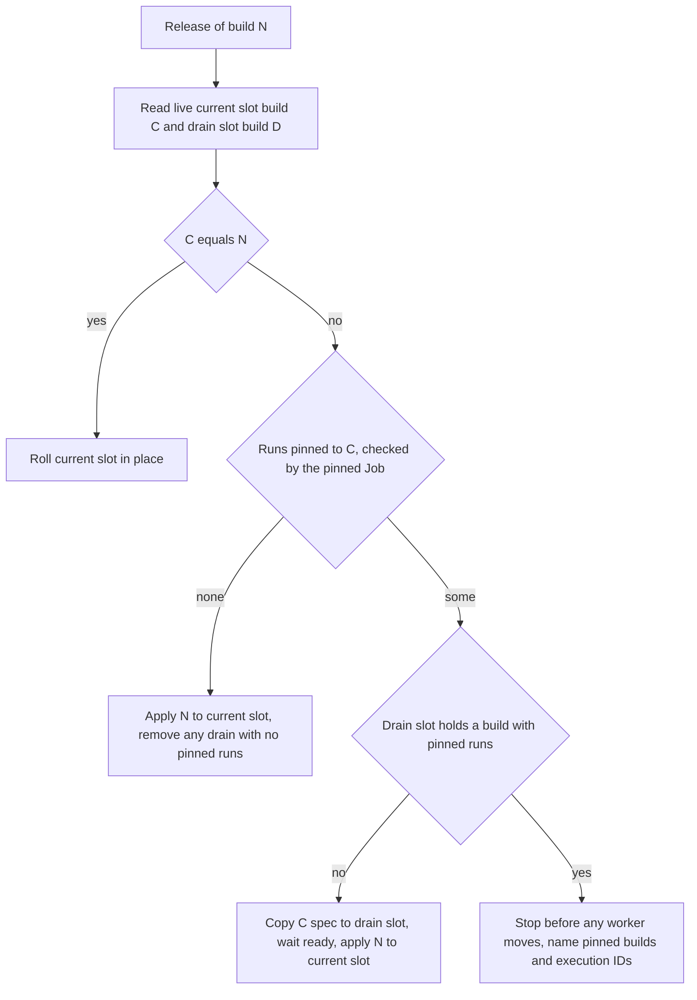
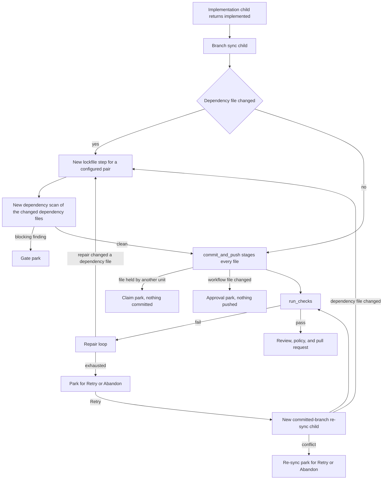

# Run Recovery Gaps - Plan

## Goal Capsule

- **Objective:** A tenant's run that changes a dependency, fails its checks, is abandoned, or is in flight during a deploy reaches a pull request or a clear next step through the platform alone, with no manual repository, store, or cluster work by the user or an operator.
- **Means:** Two EKS worker slots drained like the ECS workflow worker (KTD1), a platform lockfile step and a dependency scan before any install (KTD5, KTD7), a re-sync on retry (KTD8), reporting in place of silent drops and cut alert detail (KTD9, KTD10), and tenant bundle activation with an EKS context for the operator scripts (KTD11).
- **Authority:** The Product Contract requirements win on behavior. The Key Technical Decisions win on mechanism within those requirements. A unit overrides neither.
- **Execution profile:** One pull request, the open ADP-160 PR #88 on branch `ADP-160`. The units land as separate commits in dependency order.
- **Stop conditions:** Stop and report when rebar's write lock does not serialize two live pods on separate nodes against the tenant's EFS store (U10). Stop and report when neither Trivy nor an OSV-Scanner build that runs in the scanner pod reports a known-malicious package (U8).
- **Finishing:** The implementer verifies locally and deploys to the AWS sandbox. The user commits, pushes, and merges.

---

## Product Contract

### Summary

The plan closes six gaps that the AWS end-to-end test exposed, plus one exposure the review found. After this work the platform regenerates lockfiles itself and scans every dependency change before anything installs it. It keeps a previous build's EKS workers running while runs are pinned to it, and it lets running activities finish when a worker stops. A retry re-syncs the branch with its base, and the deployed restart works for rebar tenants. Alerts keep the cause of a failure, files outside a ticket's file impact are committed and reported instead of dropped, and a commit that touches GitHub workflow files waits for a person.

### Problem Frame

The test ran two tickets end to end in AWS. A TypeScript ticket that added Jest could not pass `npm ci`, because the agent sandbox has no package registry access and so cannot write a lockfile. A person had to commit the lockfile. A retry after that fix ran the checks on the stale branch and failed again. The run then stranded across a deploy, because the EKS activity worker of its pinned build was replaced, and recovering it took a manual versioning override. Restarting it without Slack failed, because the deployed restart command does not load the tenant's configuration bundle. Along the way the alert showed only npm's usage text, and the commit silently left out two files the agent wrote. Together these mean a user cannot rely on the platform to finish a run without help.

### Key Decisions

- **Files outside the file impact are committed, and a file another active unit holds parks the run.** (session-settled: user-directed, chosen over committing only new files while excluding tracked files that tooling rewrote, and over committing every file with no park, because the user wants no silent loss and no collision between parallel units.) Governs R11.
- **Running activities finish before a worker pod stops.** (session-settled: user-directed, chosen over accepting cancellation at each deploy, because single-attempt activities such as `apply_ci_repair` fail on cancellation.) Governs R13.
- **A re-sync conflict on retry parks for a decision.** (session-settled: user-directed, chosen over the existing terminal end with a Restart run alert, because the user wants the run to stay recoverable in place.) Governs R7.
- **Workflow file changes wait for approval on every run.** (session-settled: user-directed, chosen over a separate ticket, because a pushed workflow runs with the repository's Actions secrets before any review.) Governs R12.
- **The lockfile step applies no release-age cooldown.** (session-settled: user-directed, chosen over a 7-day cooldown and over reporting young versions, because ADP's own dependency handling has no cooldown and its SAST release-age list is report-only.) Governs R4.

### Requirements

**Deploy continuity**

- R1. A run pinned to a build keeps its activities served by that build's EKS activity and review workers until the run ends, while at most two builds have pinned runs.
- R2. A release that would need a third build with pinned runs stops before it moves any ECS or EKS worker, and names the pinned builds and their execution IDs.
- R3. A previous build's draining workers serve only the runs pinned to them. They install no schedules and receive no Slack interactions.
- R13. When a worker pod stops for a deploy or a restart, its running activities finish before the process exits, within a bounded grace period.

**Dependency changes**

- R4. When a run's change touches a dependency manifest or lockfile that the repository's profile pairs with a lock command, the platform regenerates the lockfile from the manifest in a checks pod, runs no package install scripts while doing so, and commits it with the change.
- R5. Every dependency the change adds or upgrades is scanned for known vulnerabilities and known-malicious packages before any checks command installs it. A blocking finding parks the run with the gate park the platform already uses.
- R6. A lockfile command that fails parks the run with a reason that names the manifest, the command, and the first lines of its error output.

**Recovery**

- R7. Retry repair brings the branch onto the current base branch before it runs the checks again. A conflict parks the run for a Retry or Abandon decision.
- R8. The deployed restart command named in a rebar tenant's alert works without Slack, and so does every other operator script that runs in the activity worker and reads tenant files.
- R9. `inv restart` and the other `inv` tasks that run a script in the activity worker reach an EKS cluster when given `--context`.

**Visibility and safety**

- R10. Alert detail in Slack, email, and Jira keeps the first root-cause lines and the last lines of a command's output, with one note that counts what was left out.
- R11. A changed file outside a ticket's file impact is committed and named in the pull request body and in a run audit event. The run parks instead, before anything is committed, when another active work unit holds that file.
- R12. A commit that adds or changes a file under `.github/workflows/` or `.github/actions/` parks the run for approval before anything is pushed.

### Acceptance Examples

- AE1. Covers R4, R5. Given a Node ticket whose agent adds a devDependency to `package.json` and writes no lockfile, when the implementation finishes, then the platform commits a regenerated `package-lock.json`, the dependency scan passes, and `npm ci && npm test` passes in the checks pod.
- AE2. Covers R5. Given a change that adds a package with an OSV `MAL-` advisory that carries no severity, when the dependency scan runs, then the run parks at the gate before `run_checks` runs, and no checks pod installs the package.
- AE3. Covers R1, R2. Given a run parked on build B1 and a deploy of build B2, when the release runs, then the B1 activity worker keeps running as a draining slot, the parked run resumes on B1 after a decision, and the next deploy after it ends removes the draining slot. Given a run still pinned to B1 and another pinned to B2, a release of B3 stops before any worker moves and names both builds and their execution IDs.
- AE4. Covers R7. Given a run parked after exhausted repairs and a fix pushed to the base branch, when the user presses Retry repair, then the branch includes the new base commit before the checks run.
- AE5. Covers R11. Given a rebar ticket whose file impact lists `src/store.ts` and an agent that also writes `tsconfig.build.json`, when the run commits, then both files are in the commit and the pull request body names `tsconfig.build.json` as outside the declared file impact.
- AE6. Covers R5. Given a Python profile repository whose agent adds a package to `requirements-dev.txt`, when the implementation finishes, then the dependency scan runs before `run_checks`.

### Scope Boundaries

- The agent sandbox keeps its network policy. It gets no package registry access.
- The ECS workflow worker's slot behavior is unchanged. Only its decision code moves into a shared module.
- Truncation helpers outside the alert path keep their current behavior.
- Email delivery in AWS stays with ADP-187.

**Considered and not built**

- A separate allowlist for lockfiles in the commit filter. R11 admits every changed file, so the lockfile needs no special case.
- Re-pinning parked runs when the workflow code is unchanged. Two slots cover every case, including workflow code changes.
- Local two-slot workers. The local workflow worker is one compose service with no drain, so local slots would not prevent a local strand.
- Recovery from a drain pod killed without SIGTERM. rebar holds a foreign-host lock until its 3600-second ceiling, which also applies to one pod today. Evidence of frequent node loss would change this.

#### Deferred to Follow-Up Work

- Consolidating the other truncation helpers, such as `pod_runner._tail`, `model_error_summary`, and the inline `stderr[-N:]` slices.
- Consolidating the three kubectl command builders and the two ECS one-shot task runners beyond what U2 and U5 need.
- uv and Maven package index settings in `registry_mirrors.PACKAGE_ENV` for tenants in `external` registry mode.

---

## Planning Contract

### Key Technical Decisions

- KTD1. **Two EKS worker slots per tenant, drained like ECS.** The current slot keeps the Deployment names `activity-worker` and `review-worker`. While the previous build has pinned runs, a second Deployment named `activity-worker-drain` or `review-worker-drain` runs that build's spec. Both slots carry an `agentic-dev-platform/slot` label in their selector and pod template, with the value `current` or `drain`, so `deploy/activity-worker`, `running_pods`, and every exec resolve only to current-slot pods. A selector is immutable, so the first slot-aware deploy recreates each current Deployment once with the new selector. The pod template keeps the `app.kubernetes.io/name` label and ServiceAccount, so every NetworkPolicy, SecurityGroupPolicy, and RoleBinding selects both slots. (session-settled: user-directed, chosen over re-pinning parked runs and over refusing the deploy, because it is the same drain rule ECS already uses, so one rule covers both platforms.) Conflict call-out: the confirmed design said blue and green, and this keeps a fixed current name with a drain Deployment. Renaming both slots would break at least nine references, including the deployed remedy commands.
- KTD2. **One slot decision shared by ECS and EKS.** The pure decision in `scripts/platform_deploy.py` moves to a new `scripts/worker_slots.py` that imports only the standard library. It receives each slot's replica count and build, the target build, and a pinned check callable, and it returns the slot to start, the slot to drain, or a refusal that names each pinned build and its execution IDs. `platform_deploy` and `eks_deploy_task` both call it, and the eks-deployer image copies the module.
- KTD3. **The pinned check runs as an in-cluster Job.** The eks-deployer image has no Temporal client or route. `scripts/validation_job.py::job_from_cronjob` already launches a Job from the `deployment-validate` CronJob template in the platform image with Temporal egress. It gains an entry point parameter. The deployer runs `scripts.pinned_executions <build>` through it, reads the exit code (`PINNED_EXIT_CODE = 3`), and reads the pinned workflow IDs that the script prints from the Job log.
- KTD4. **A draining slot only serves its pinned runs.** The render sets a slot value in the draining pod's environment. A worker in the draining slot skips `install_tenant_schedules`, `start_socket_mode`, and the approver group refresh. Worker versioning already routes only pinned work to it, and `_worker_runners` already keeps it from moving the current version. Its rebar writes rely on rebar's write lock, which U10 verifies across nodes on EFS before any drain deploy.
- KTD12. **Workers shut down gracefully.** `build_worker` sets `graceful_shutdown_timeout` for the activity and review roles, and both Deployments set `terminationGracePeriodSeconds` longer than it, so `_shut_down_on_sigterm` lets running activities finish before the process exits. Under the Recreate strategy the new current pod starts after that period, which delays only the new build's first activity. The exact timeout is the longest activity a deploy should not cancel, chosen from the activity timeouts during U4.
- KTD5. **The lockfile step is a lock-only mode of `ChecksRunner`.** `run_fix` already creates a pod in the checks image that `gate-engine-egress` admits, copies the workspace in, installs the registry setup, lists the files changed after a marker, and copies them out. A lock mode reuses all of that but runs only the lock command, runs no checks command, exits with the lock command's status, and copies the lockfile out when that command succeeds. `ChecksConfig` and the runtime profile's `checks` block gain the lock command and its manifest and lockfile pair, with defaults `npm install --package-lock-only --ignore-scripts` for `node-react` and `go mod tidy` for `go-service`. The two existing `ChecksRunner(...)` constructions in `services/orchestration/temporal_activities/checks.py` and `services/orchestration/temporal_activities/repair.py` become one `checks_runner(settings)` factory that the new activity also uses, and copying the lockfile back reuses `repair.py::_confined`.
- KTD6. **The dependency step runs after branch sync and before every commit that carries a dependency change.** It runs inside `_push_branch` after the sync child returns synced and before `commit_and_push`. It runs again after `apply_ci_repair` and after the U9 re-sync. It triggers when the change touches any dependency file the profile's scanner reads, which includes `package.json`, `package-lock.json`, `go.mod`, `go.sum`, `requirements*.txt`, `pyproject.toml`, and `pom.xml`. It regenerates the lockfile only for a configured pair, and it always runs the scan. The sync child leaves a configured lockfile out of conflict detection, because the step regenerates it from the merged manifest. The step sits behind a new `workflow.patched` constant beside the others in `services/orchestration/temporal_workflows/draft_pull_request.py`.
- KTD7. **The dependency scan blocks only on what the change added, before any install.** The scan runs through the existing scanner pod path (`services/orchestration/gates/scanner_pod.py`, `RealTrivyScanner`) over the changed dependency files. `scan_scope` attributes a dependency finding to the change only when its package and version are absent from the merge-base copy of that file, so the dependency step and the policy-stage Trivy gate both block only on added or upgraded packages. A finding whose advisory is a malicious-package entry, an OSV `MAL-` ID or a GitHub malware advisory, is classified CRITICAL whatever severity it reports. When Trivy reports no malicious-package entries, OSV-Scanner joins the same scanner pod path as a second scanner, running against a database the image carries so it needs no call to `api.osv.dev`.
- KTD8. **Retry re-syncs through the existing branch sync child.** The `-sync` child compares only uncommitted files and never moves the branch. It gains a committed-branch mode that compares the branch diff with the new base head, applies the diff onto that head, and commits with the two-parent commit `git_host.commit_and_push` already makes. The retry runs it with a child ID and audit event IDs keyed by the retry attempt, behind a `workflow.patched` constant. A conflict parks the run with a new re-sync park whose Retry and Abandon decisions follow `_await_repair_decision`. The run's base commit moves into one field that the implementation child, the sync child, and every commit read.
- KTD9. **One head-and-tail rule for alert detail.** `notifications._bounded_detail` keeps the first lines and the last lines within its line and character limits and writes one omission note. `slack/messages._detail_text` measures the bounded text against `SECTION_TEXT_LIMIT` and trims through the same helper instead of trimming from the head again. `ci_repair.failure_summary` keeps its first marker block when it trims. Jira keeps its field fit, applied to the bounded text.
- KTD10. **File impact reports instead of filtering, and checks claims before committing.** `materialization.stage` admits every changed file and returns the ones outside the declared file impact. Inside `commit_and_push`, after `stage` and before the commit, those files are checked against the claims of other active work units through a new coordination query over the stored claim `file_impact`. A held file returns a held result without committing or pushing, and the workflow parks on it with a new remedy. Otherwise one audit event per commit names the files outside the file impact, replacing the narrower `REPAIR_OUT_OF_SCOPE` case, and `PullRequestNarrative` gains a field that `compose_pull_request_body` renders. The claim query and `stage` share one path matcher, the current `materialization._within`.
- KTD13. **Workflow file changes park for approval.** `commit_and_push` returns, before pushing, a guarded result when the staged changes add or change a path under `.github/workflows/` or `.github/actions/`. The workflow parks on it through `_park_for_gate_decision`, and an approval commits and pushes the staged change. This applies to every run, with or without a file impact.
- KTD11. **One operator entry point activates the tenant bundle.** A helper beside `scripts/operator_identity.local_operator` calls `tenant_config.configure(settings)` without the worker's rejection alert. `scripts/restart.py` and the in-pod scripts that read tenant files call it, namely `import_rebar_tickets`, `rebar_poll`, `intake`, `index_repo`, and `scrub_workspaces`. `k8s_cluster.exec_argv` takes a context override, and `tasks.py::_run_scripted` passes `--context` through, so `inv restart` reaches EKS as `inv deployment-validate` does.

### High-Level Technical Design

The release decision for tenant workers, shared with the ECS path through KTD2. `aws-release` runs it as a preflight before `platform-deploy`, so a refusal stops the release before the ECS workflow worker moves the current version.

The order of a run's stages after implementation, with the new steps marked.

### Assumptions

- `npm install --package-lock-only --ignore-scripts` and `go mod tidy` write their lockfiles without running package scripts. U8 verifies both in the checks image first, because the external research that would have confirmed them did not complete.
- The off-hours sleep and wake functions select tenant workers by Deployment name, and the drain Deployment joins those groups.

### Sequencing

U1 and U2 come first. U10 verifies the rebar lock on EFS before U3 and U4 build and deploy the drain slot. U5 and U6 are independent. U7 lands before U8, because the lockfile must not be dropped by the file impact filter, and U11 builds on U7's held result. U9 lands last, because it changes the retry path that U8's step also enters.

---

## Implementation Units

### U1. Shared worker slot decision

- **Goal:** Move the slot choice out of `platform_deploy` into a function both deploy paths call.
- **Requirements:** R1, R2 (KTD2)
- **Dependencies:** none
- **Files:**
  - `scripts/worker_slots.py` (new)
  - `scripts/platform_deploy.py`
  - `tests/unit/test_platform_deploy.py`
  - `tests/unit/test_worker_slots.py` (new)
- **Approach:**
  1. Extract the decision from `plan_versioned`, `plan_slots`, `drain`, and `_pinned` into a pure function over slot states, a target build, and a pinned check callable that returns the pinned execution IDs.
  2. Keep the once-per-build pinned check cache with it.
  3. Keep the module to the standard library. `platform_deploy` passes `PINNED_EXIT_CODE` handling and `build_id_of` results in as inputs.
- **Patterns to follow:** `scripts/platform_deploy.py::plan_versioned`, the fake `_Ecs` in `tests/unit/test_platform_deploy.py`.
- **Test scenarios:**
  - An idle slot receives the new build and the old slot drains when nothing is pinned to it.
  - An old slot with pinned runs keeps running while the new build starts in the other slot.
  - A deploy of the build already running replaces that slot in place.
  - Two slots holding older builds that both have pinned runs refuse, and the refusal names each build and its execution IDs.
  - A third build takes the slot whose build has no pinned runs.
  - The pinned check runs once per build per deploy.
- **Verification:** `tests/unit/test_platform_deploy.py` passes against the extracted function, and the ECS deploy behavior is identical.

### U2. Pinned check Job from the eks-deployer

- **Goal:** Let the eks-deployer ask Temporal which runs are pinned to a build.
- **Requirements:** R1, R2 (KTD3)
- **Dependencies:** none
- **Files:**
  - `scripts/validation_job.py`
  - `scripts/eks_deploy_task.py`
  - `tests/unit/test_validation_job.py`
- **Approach:**
  1. Give `job_from_cronjob` and `run_job` an entry point argument that defaults to `scripts.deployment_validate`.
  2. Add a deployer function that runs `scripts.pinned_executions <build>` as a Job and returns the pinned workflow IDs from its log, with none for exit 0.
  3. Any exit other than 0 and `PINNED_EXIT_CODE` fails the deploy with the Job's log tail.
- **Patterns to follow:** `eks_deploy_task.py::validate` and `report_after_rollout`.
- **Test scenarios:**
  - A Job built with the pinned entry point runs `python -m scripts.pinned_executions <build>` from the CronJob template.
  - Exit code 0 returns no pinned IDs, and exit code 3 returns the IDs the log lists.
  - Another exit code raises with the Job's output.
  - The default entry point still builds the `deployment-validate` Job unchanged.
- **Verification:** The eks-deployer image test passes.

### U10. Rebar lock verification on EFS

- **Goal:** Prove that two live pods serialize writes to one tenant's rebar store before any drain ships.
- **Requirements:** R1, R3 (KTD4)
- **Dependencies:** none
- **Files:**
  - `tests/integration/test_rebar_store_lock.py` (new)
  - `scripts/rebar_lock_check.py` (new)
- **Approach:**
  1. Write a check that two writers run against one store and that reports whether both sets of commits land without a lost update or a stale lock.
  2. Run it locally as two processes on one directory, which becomes the regression test.
  3. Run it in the sandbox as two pods on different nodes that mount the tenant's EFS workspaces volume.
- **Execution note:** Run the sandbox check before U3's first drain deploy, and stop per the Goal Capsule if a second live holder can take the lock.
- **Test scenarios:**
  - Two processes writing to one store serialize their commits, and the store holds every commit.
  - A writer stopped with SIGTERM leaves no lock behind.
- **Verification:** The sandbox run on two nodes reports serialized writes.

### U3. Drain slot render and deploy

- **Goal:** Keep the previous build's tenant workers running while runs are pinned to it.
- **Requirements:** R1, R2, R3 (KTD1, KTD2)
- **Dependencies:** U1, U2, U10
- **Files:**
  - `scripts/eks_deploy_task.py`
  - `scripts/tenant_render.py`
  - `scripts/aws_release.py`
  - `docker/eks-deployer.Dockerfile`
  - `deploy/kubernetes/activity-worker.yaml`
  - `infra/terraform/examples/private-bedrock/eks.tf`
  - `infra/terraform/off-hours/functions/scale.py`
  - `deploy/README.md`
  - `tests/unit/test_eks_deploy.py`
  - `tests/unit/test_eks_render.py`
  - `tests/unit/test_eks_deployer_image.py`
  - `tests/unit/test_off_hours_scale.py`
- **Approach:**
  1. Add the slot label with value `current` to the current Deployments' selector and pod template. On the first deploy whose live current selector lacks it, recreate the current Deployment after any drain is ready.
  2. Before applying the render, read the live current and drain slots for each tenant worker and run the U1 decision with the U2 pinned check. Read a slot's build from its image and its pinned state from the check, not from its replica count, so a drain the off-hours sleep scaled to zero keeps its build.
  3. To start a drain, copy the live current spec into `<name>-drain` with the slot value `drain`, apply it, and wait until it is ready. The copy sets the drain slot environment value whatever spec it copies, so the first drain from a pre-slot spec also runs as a drain.
  4. Apply the rendered spec to the current slot. The drain Deployment stays out of the applied render so the apply never overwrites its image.
  5. Remove a drain slot whose build has no pinned runs.
  6. Include the drain Deployment in `restart tenant-workers`, `diagnose`, `replace_changed_claims`, the secret restart rules, and the off-hours groups, and restore its replicas after a claim replacement.
  7. Add a preflight mode that runs steps 2 and the refusal check without changing anything, and run it from `aws_release` before `platform_deploy`.
- **Patterns to follow:** `eks_deploy_task.py::get_deployment`, `rollout`, `scale_down`, and `wait_for_no_pods`.
- **Test scenarios:**
  - Covers AE3. A deploy of B2 with runs pinned to B1 creates `activity-worker-drain` on B1 before the current slot moves to B2.
  - With a drain present, the current Deployment's selector matches only the current pod, so `deploy/activity-worker` and `running_pods` exclude the drain pod.
  - A deploy with no runs pinned to the old build applies the new build and creates no drain.
  - A later deploy removes the drain once its build has no pinned runs.
  - A preflight with a pinned drain build and pinned current runs refuses and names both builds and their execution IDs, and `aws_release` stops before `platform_deploy`.
  - A drain scaled to zero by the off-hours sleep is still read as holding its build.
  - `replace_changed_claims` restores the drain's replicas after it scales the namespace down.
  - `restart tenant-workers` names both slots when a drain exists.
- **Verification:** A sandbox deploy with a parked run keeps the old activity worker running, the run resumes on it, and an exec through `deploy/activity-worker` lands on the new build.

### U4. Worker behavior in the drain slot and graceful shutdown

- **Goal:** A draining worker serves its pinned runs without competing with the current slot, and no worker stop cancels running activities.
- **Requirements:** R3, R13 (KTD4, KTD12)
- **Dependencies:** U3
- **Files:**
  - `services/orchestration/worker.py`
  - `scripts/config.py`
  - `deploy/kubernetes/activity-worker.yaml`
  - `deploy/kubernetes/review-worker.yaml`
  - `tests/unit/test_worker.py`
  - `tests/unit/test_eks_render.py`
- **Approach:**
  1. Read the slot value from the environment that U3 sets.
  2. In the drain slot, skip `install_tenant_schedules`, `start_socket_mode`, and `start_approver_group_refresh`.
  3. Set `graceful_shutdown_timeout` in `build_worker` for the activity and review roles, and set `terminationGracePeriodSeconds` on both Deployments above it.
  4. Correct the `_shut_down_on_sigterm` docstring to match the graceful behavior.
- **Test scenarios:**
  - A worker started in the drain slot installs no schedules and opens no Socket Mode client.
  - A worker in the current slot keeps today's startup.
  - An activity running when SIGTERM arrives completes before `run` returns, within the graceful timeout.
  - The rendered worker Deployments set a termination grace period longer than the graceful timeout.
- **Verification:** In the sandbox, the drain pod's logs show no schedule install and no Socket Mode connection, and a deploy during a running repair lets the repair finish.

### U5. Operator scripts load the tenant bundle and reach EKS

- **Goal:** The deployed restart command and the `inv` scripted tasks work for rebar tenants in AWS.
- **Requirements:** R8, R9 (KTD11)
- **Dependencies:** none
- **Files:**
  - `scripts/operator_identity.py`
  - `scripts/restart.py`
  - `scripts/import_rebar_tickets.py`
  - `scripts/rebar_poll.py`
  - `scripts/intake.py`
  - `scripts/index_repo.py`
  - `scripts/scrub_workspaces.py`
  - `scripts/k8s_cluster.py`
  - `tasks.py`
  - `docs/operator-remedies.md`
  - `tests/unit/test_task_restart.py`
  - `tests/unit/test_k8s_cluster.py`
  - `tests/unit/test_tasks.py`
- **Approach:**
  1. Add one bundle activation helper and call it at the top of each listed script's entry point.
  2. Add a context override to `exec_argv` and a `context` option to the tasks that use `_run_scripted`.
- **Patterns to follow:** `tasks.py::deployment_validate` for the `--context` option, `tenant_pinning.start_tenant_config` for activation.
- **Test scenarios:**
  - `scripts.restart` in a process with `TENANT_CONFIG_BUCKET` set reads `tickets.yaml` from the activated bundle.
  - The helper raises the bundle's validation error without sending a Slack alert.
  - `exec_argv` with a context passes `--context` to kubectl, and without one keeps `settings.k8s_context`.
  - `inv restart --context agentic-platform-eks` builds an exec against that context.
- **Verification:** In the sandbox, `python -m scripts.restart <issue>` run through `kubectl exec deploy/activity-worker` restarts a beta run.

### U6. Alert detail keeps the cause

- **Goal:** Alerts show the line that names a failure's cause.
- **Requirements:** R10 (KTD9)
- **Dependencies:** none
- **Files:**
  - `services/orchestration/notifications.py`
  - `services/integration/slack/messages.py`
  - `services/orchestration/langgraph/ci_repair.py`
  - `tests/unit/test_notifications.py`
  - `tests/unit/test_slack_messages.py`
  - `tests/unit/test_ci_repair_planner.py`
- **Approach:**
  1. Change `_bounded_detail` to keep a head block and a tail block within its existing limits, with one note that counts the omitted lines and characters.
  2. Make `_detail_text` call the same helper with the Slack limit instead of trimming from the head.
  3. Make `failure_summary` keep its first marker block when it trims.
- **Test scenarios:**
  - An `npm ci` output of 120 lines whose cause is on line 2 keeps line 2 and the last lines, with one omission note.
  - A detail under the limits is unchanged.
  - A detail that escapes past `SECTION_TEXT_LIMIT` is cut once by the shared helper and keeps its note.
  - `failure_summary` over its line limit keeps the first marker block.
- **Verification:** A sandbox alert for a missing lockfile shows the `can only install with an existing package-lock.json` line.

### U7. File impact reports instead of dropping

- **Goal:** No changed file is lost without a record, and parallel units never commit the same file.
- **Requirements:** R11 (KTD10)
- **Dependencies:** none
- **Files:**
  - `services/orchestration/materialization.py`
  - `services/coordination/claims.py`
  - `services/coordination/service.py`
  - `services/orchestration/temporal_activities/pull_request.py`
  - `services/orchestration/temporal_workflows/draft_pull_request.py`
  - `services/orchestration/change_narrative.py`
  - `services/orchestration/remedies.py`
  - `docs/rebar-ticket-api.md`
  - `tests/unit/test_commit_publish.py`
  - `tests/unit/test_coordination_claims.py`
  - `tests/unit/test_draft_pull_request_workflow.py`
  - `tests/unit/test_operator_remedy_contract.py`
- **Approach:**
  1. Make `stage` admit every changed file and return the ones outside the file impact.
  2. Add a claim store query, a coordination endpoint, and a client method that return the active claims of other units whose stored `file_impact` covers a path, using the shared path matcher.
  3. In `commit_and_push`, after `stage`, return a held result without committing when the query finds a holder.
  4. Park on a held result with a new remedy that names the file and the holding unit.
  5. Record one audit event per commit with the files outside the file impact, keyed by the commit sequence, in place of `REPAIR_OUT_OF_SCOPE`, and add the list to `PullRequestNarrative`.
- **Patterns to follow:** the `REPAIR_OUT_OF_SCOPE` audit in `DraftPullRequestWorkflow._repair`, `PostgresWorkClaimStore.try_claim` for the claim query.
- **Test scenarios:**
  - Covers AE5. A commit with a file outside the file impact includes it and returns it in the outside list.
  - The pull request body names each file outside the file impact.
  - A ticket with no file impact commits every file and reports none outside.
  - A file another active unit's claim covers returns a held result, nothing is pushed, and the run parks with the new remedy.
  - A released or completed claim does not hold its files.
  - The remedy contract test counts the new park site.
- **Verification:** The beta ticket's run commits `tsconfig.build.json` and the pull request names it.

### U11. Workflow file changes park for approval

- **Goal:** No agent-written GitHub workflow reaches a pushed branch without a person's approval.
- **Requirements:** R12 (KTD13)
- **Dependencies:** U7
- **Files:**
  - `services/orchestration/temporal_activities/pull_request.py`
  - `services/orchestration/temporal_workflows/draft_pull_request.py`
  - `services/orchestration/remedies.py`
  - `docs/slack-escalation.md`
  - `tests/unit/test_commit_publish.py`
  - `tests/unit/test_draft_pull_request_workflow.py`
  - `tests/unit/test_operator_remedy_contract.py`
- **Approach:**
  1. In `commit_and_push`, return a guarded result before pushing when the staged paths include `.github/workflows/` or `.github/actions/`, unless the request carries an approval.
  2. Park through `_park_for_gate_decision` with a remedy that names the files, and rerun the commit with the approval on Approve.
- **Test scenarios:**
  - A staged `.github/workflows/ci.yml` returns a guarded result and nothing is pushed.
  - Approve pushes the commit, and Reject ends the run with the gate rejection path.
  - A commit with no workflow paths is unaffected.
  - The remedy contract test counts the new park site.
- **Verification:** A sandbox run whose agent writes a workflow file parks with Approve and Reject buttons.

### U8. Dependency step with the lockfile and the scan

- **Goal:** A run that changes a dependency gets a lockfile and a scan from the platform before anything installs.
- **Requirements:** R4, R5, R6 (KTD5, KTD6, KTD7)
- **Dependencies:** U6, U7
- **Files:**
  - `services/orchestration/checks/config.py`
  - `config/platform/runtime-profiles.yaml`
  - `services/orchestration/checks/runner.py`
  - `services/orchestration/temporal_activities/checks.py`
  - `services/orchestration/temporal_activities/repair.py`
  - `services/orchestration/temporal_activities/lockfile.py` (new)
  - `services/orchestration/gates/scanner_pod.py`
  - `services/orchestration/gates/scan_scope.py`
  - `adapters/interfaces/security_scanner.py`
  - `services/orchestration/branch_sync.py`
  - `services/orchestration/temporal_workflows/draft_pull_request.py`
  - `services/orchestration/remedies.py`
  - `services/orchestration/worker.py`
  - `docs/runtime-profiles.md`
  - `tests/unit/test_checks_runner.py`
  - `tests/unit/test_runtime_profiles.py`
  - `tests/unit/test_scan_scope.py`
  - `tests/unit/test_lockfile_activity.py` (new)
  - `tests/unit/test_draft_pull_request_workflow.py`
  - `tests/unit/test_operator_remedy_contract.py`
- **Files when the OSV-Scanner leg of KTD7 applies:**
  - `scripts/config.py`
  - `scripts/publish_platform_images.py`
  - `infra/terraform/examples/private-bedrock/variables.tf`
  - `infra/terraform/examples/private-bedrock/eks.tf`
  - `deploy/kubernetes/aws/kustomization.yaml`
  - `adapters/real/security_scanner.py`
  - `tests/unit/test_security_scanner.py`
- **Approach:**
  1. Add the lock command and the manifest and lockfile pair to `ChecksConfig` and to the `node-react` and `go-service` profiles, and the dependency file list each profile's scan covers.
  2. Extract `checks_runner(settings)` and use it from `run_checks`, `_project_autofix`, and the new activity.
  3. Add the lock-only mode to `ChecksRunner`.
  4. The activity runs the lock mode for a configured pair, copies the lockfile back through `_confined`, then scans the changed dependency files and returns a gate result.
  5. Attribute dependency findings by package and version against the merge-base file in `scan_scope`, and classify malicious-package advisories as CRITICAL in the severity mapping.
  6. Leave a configured lockfile out of the sync child's conflict detection.
  7. Call the activity per KTD6, behind a new patch constant.
  8. A failed lock command parks with a new remedy whose detail goes through the U6 helper.
- **Execution note:** First verify the lock commands and Trivy's malicious-package coverage in the checks and scanner images, and settle whether the OSV-Scanner leg applies before building the scan call.
- **Patterns to follow:** `repair.py::_project_autofix` for the pod run and file copy, the `_scan` gates in `DraftPullRequestWorkflow._policy` for the scan result.
- **Test scenarios:**
  - Covers AE1. A change to `package.json` with no lockfile runs the lock command, and the lockfile reaches the commit.
  - The lock pod's script contains the lock command and no checks command.
  - A lockfile is copied out when the lock command succeeds, whether or not the project's tests would pass.
  - A repair that edits only `package-lock.json` runs the lock command and the scan before `run_checks`.
  - Covers AE6. A `requirements-dev.txt` change runs the scan before `run_checks`, with no lock command.
  - A change that touches no dependency file skips the step.
  - Covers AE2. A `MAL-` advisory with no severity blocks, and the run parks before `run_checks` is scheduled.
  - A vulnerable package already in the merge-base lockfile does not block.
  - A lock command that exits non-zero parks with a detail that names the manifest and the command.
  - A base change to `package.json` merged by the sync child is followed by a regenerated lockfile, not a conflict.
  - A workflow replayed from a history without the patch runs no dependency step.
- **Verification:** The beta ticket rerun with a devDependency change and no lockfile reaches a pull request with no manual commit.

### U9. Retry repair re-syncs the branch

- **Goal:** A fix on the base branch reaches a parked run when the user retries.
- **Requirements:** R7 (KTD8)
- **Dependencies:** U8
- **Files:**
  - `services/orchestration/branch_sync.py`
  - `services/orchestration/temporal_workflows/branch_sync.py`
  - `services/orchestration/temporal_workflows/draft_pull_request.py`
  - `services/orchestration/remedies.py`
  - `tests/unit/test_branch_sync_workflow.py`
  - `tests/unit/test_draft_pull_request_workflow.py`
  - `tests/unit/test_operator_remedy_contract.py`
- **Approach:**
  1. Add the committed-branch mode to the synchronizer, diffing the branch against the new base head.
  2. Key the child ID and its audit event IDs by retry attempt.
  3. On retry, capture the base head, run the child when it moved, run the U8 step when the merge changed a dependency file, and commit through `commit_and_push` in a sequence slot after the last repair commit.
  4. Park a conflict with the new re-sync park and its remedy.
  5. Move the base commit into one field that every consumer reads.
- **Test scenarios:**
  - Covers AE4. A retry after the base moves runs the checks on a commit whose parents include the new base head.
  - A retry with an unchanged base runs no sync child.
  - A base change that conflicts with the branch parks with Retry and Abandon, and Retry runs the re-sync again.
  - Two retries use distinct child IDs and audit event IDs.
  - A history without the patch replays without the re-sync.
- **Verification:** A sandbox retry after a base fix passes the checks without an abandon and restart.

---

## Verification Contract

| Gate | Command | Applies to |
|---|---|---|
| Unit, end-to-end, and integration suites | `uv run pytest -q tests/unit tests/end_to_end tests/integration` | Every unit |
| Lint and format | `uv run ruff check .` and `uv run ruff format --check .` | Every unit |
| SAST | `uv run inv sast` | Every unit |
| Change scope | `gitnexus detect-changes -r agentic-development-platform` | Before handing each commit message over |
| Rebar lock on EFS | `scripts/rebar_lock_check.py` as two pods on separate nodes | U10, before U3's first drain deploy |
| Sandbox deploy | publish, apply, re-disable the sleep schedule, `inv platform-deploy`, `inv eks-deploy` | U3, U4, U5, U6, U7, U8, U9, U11 |
| End-to-end in AWS | a beta ticket that adds a devDependency with no lockfile, a parked run across a deploy, a retry after a base fix, a deployed restart without Slack, and a run that writes a workflow file | AE1 through AE6 |

---

## Definition of Done

- Every requirement R1 through R13 is met, and each acceptance example passes in tests or in the sandbox.
- The CI suites, ruff, and SAST pass, and `gitnexus detect-changes` shows only the expected symbols.
- The docs that describe the touched behavior are current: `deploy/README.md`, `docs/runtime-profiles.md`, `docs/rebar-ticket-api.md`, `docs/operator-remedies.md`, and `docs/slack-escalation.md`.
- No code from an approach that was abandoned during implementation remains in the diff.
- The user has the commit message for each unit in the `ADP-160` format.
